# Affordable Rental Housing: Units at Stake by 2035

**How many affordable rental homes could the United States need—or put at risk—by 2035? Where are those pressures greatest, and what would it take to keep pace?**

This is my independent research project on affordable rental housing demand and preservation in the United States. I brought together public housing data, demographic projections, and property-level records to look at two connected challenges: the need for additional affordable homes and the risk that some existing subsidized homes may leave their current programs.

The project is intended to make complex housing data easier to examine, question, and use in planning. Its estimates are **scenarios and measures of exposure**, not a prediction that every unit identified will be lost.

| At a glance | Details |
|---|---|
| **Main finding** | **About 0.90–1.03 million units at stake by 2035** under the baseline assumptions (approximately 885,000–1.05 million when sampling uncertainty is included). Preservation-related exposure accounts for about **62–67%** of the baseline total. |
| **Geographic coverage** | All 50 states and Washington, DC (51 geographies). Historical source periods vary, generally spanning 2010–2025; scenarios extend to 2035. |
| **Core methods** | Demographic stock-flow scenarios; logistic regression; ridge-penalized logistic regression with state effects; cohort life tables; a composite need index; bootstrap uncertainty. The wider study also evaluates panel econometrics, Bayesian state-space methods, and machine learning. |
| **Technology** | Python 3.12+, [uv](https://docs.astral.sh/uv/), pandas, statsmodels, linearmodels, scikit-learn. |
| **Full report** | [`REPORT_SHORT.md`](REPORT_SHORT.md) explains the research, methods, code, outputs, and figures in detail. |

**Explore the project:** [Why this project](#why-this-project) · [Headline result](#headline-result) · [Quick start](#quick-start) · [Data](#data) · [Exploratory analysis](#exploratory-analysis) · [Models](#models) · [Results in pictures](#results-in-pictures) · [Try it in five minutes](#try-it-in-five-minutes) · [Repository layout](#repository-layout) · [Reproducibility and checks](#reproducibility-and-checks) · [Limits](#limits) · [Next steps](#next-steps)

## Why this project

My interest in affordable housing finance has shown me how closely housing outcomes are tied to decisions made over many years: where to develop, how to structure financing, when to refinance, and how to preserve homes that are already serving lower-income renters. Those decisions depend on reliable information, but the information is spread across different datasets and programs.

I started with a simple question: **What does the available evidence suggest about affordable rental housing needs and preservation exposure through 2035?**

Two forces matter here:

- **More households may need affordable homes.** Changes in population, age structure, and renting behavior affect the number of extremely low-income (ELI) renters.
- **Some existing affordable homes face program or financing transitions.** Subsidies expire, LIHTC projects reach monitoring milestones, and insured mortgages may terminate earlier than their scheduled dates. These events are not the same as confirmed losses of affordability, but they warrant attention.

An expiration date alone does not tell us what happened next. I therefore examined historical outcomes: whether properties received another subsidy after their previous subsidy ended, whether LIHTC projects remained on state monitoring lists, and when certain HUD-insured mortgages terminated. The study draws on **12,822 historical subsidy-lapse events** and **7,315 LIHTC projects**, alongside demographic and housing-market data.

I also wanted the research to be honest about its limits. Survey estimates can move from year to year because of sampling noise, and a model that fits historical data does not necessarily forecast future outcomes well. Throughout the project, I test methods against simple baselines and distinguish **associations and scenarios** from evidence that a particular intervention actually works.

## Headline result

<p align="center">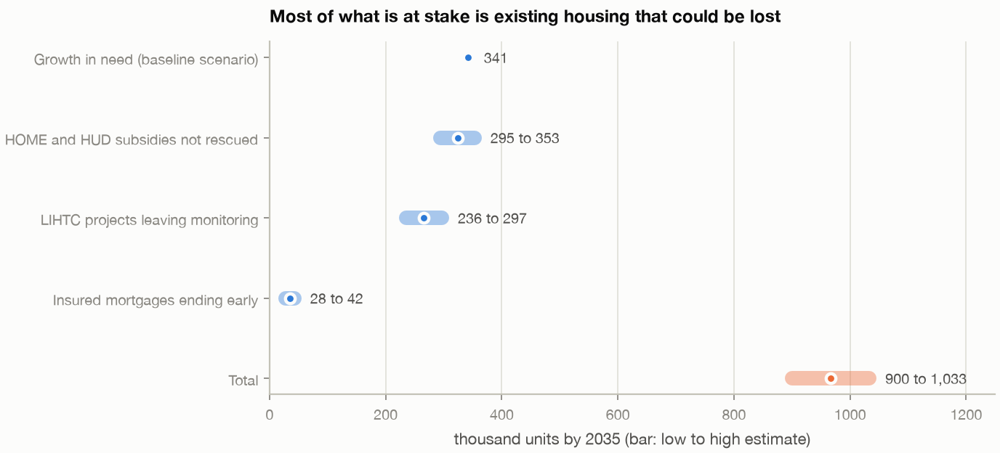</p>

<p align="center"><em>Figure 1. Four components of the estimated national total through 2035, shown as low-to-high ranges in thousands of units.</em></p>

| Component | Approach | Units at stake by 2035 |
|---|---|---:|
| Growth in affordable housing need | Demographic projection using age-specific renting rates | About 341,000 additional affordable units under the baseline scenario |
| HOME and HUD-program subsidies lapsing | Logistic regression based on property size and program | 295,000–353,000 units not re-subsidized **if the relevant subsidies lapse**; an upper-bound exposure estimate |
| LIHTC projects leaving state monitoring lists | Ridge-penalized logistic regression with state effects | 236,000–297,000 units associated with projected monitoring exits |
| HUD-insured mortgages ending early | Cohort life table | 28,000–42,000 units of potential exposure missed by date-based lists |
| **Combined planning-scale total** | **Four components combined** | **0.90–1.03 million** |

In the baseline result, about two-thirds of the total relates to **existing housing potentially exposed to preservation-related transitions**, rather than additional demand from household growth. The components can overlap, and the combined number is an order-of-magnitude planning estimate—not a verified count of homes that will become unaffordable.

The geography also matters. Texas, Florida, and North Carolina stand out in total units, largely because of projected growth. California, New York, Pennsylvania, and Ohio feature prominently in the subsidy-lapse component; Maryland, Michigan, and Virginia in LIHTC monitoring exits. On a per-ELI-renter basis, Idaho, South Dakota, and Utah rank highest.

<p align="center">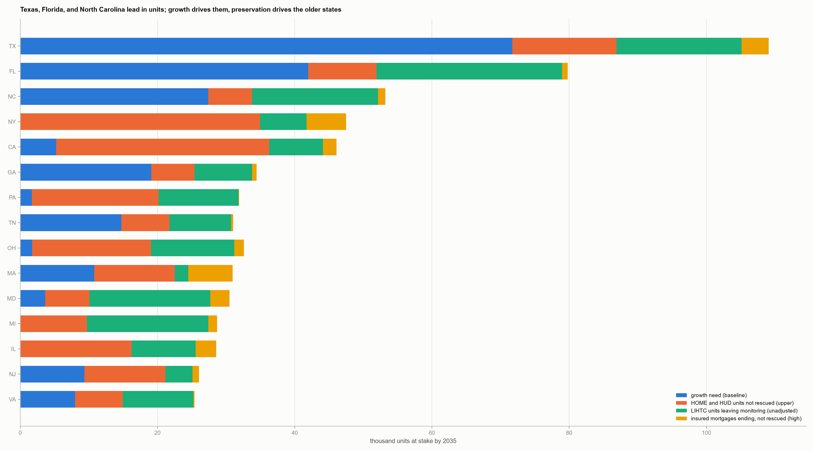</p>

<p align="center"><em>Figure 2. The 15 states with the largest modeled number of units at stake, broken down by source of exposure.</em></p>

## Quick start

You will need **Python 3.12 or newer** and [uv](https://docs.astral.sh/uv/getting-started/installation/). For example, install uv using `brew install uv` or `curl -LsSf https://astral.sh/uv/install.sh | sh`.

The repository includes roughly 15 MB of prepared data, so you can run the included examples without downloading raw source files or obtaining API keys.

```bash
cd SUBMISSION                            # folder containing this README
uv sync                                  # install the locked dependencies in .venv
uv run examples/04_need_index.py         # run an example and inspect the state rankings
```

**Rebuild the report analyses:**

```bash
uv run src/run_short_report.py           # execute the 18 included notebooks; about 14 minutes
uv run src/run_short_report.py all       # also rerun six cleaning scripts; requires raw data (see DATA.md)
```

**Run an individual notebook or example:**

```bash
uv run src/notebook_tools.py notebooks/05_preservation/01_preservation_model.py
uv run examples/06_rescue_model.py
```

The notebook tool generates the executed `.ipynb` from its editable `.py` source. **Edit the `.py` file**, not the generated notebook. Run only one rebuilding process at a time because analyses write into the shared `outputs/` directory.

## How it fits together

<p align="center">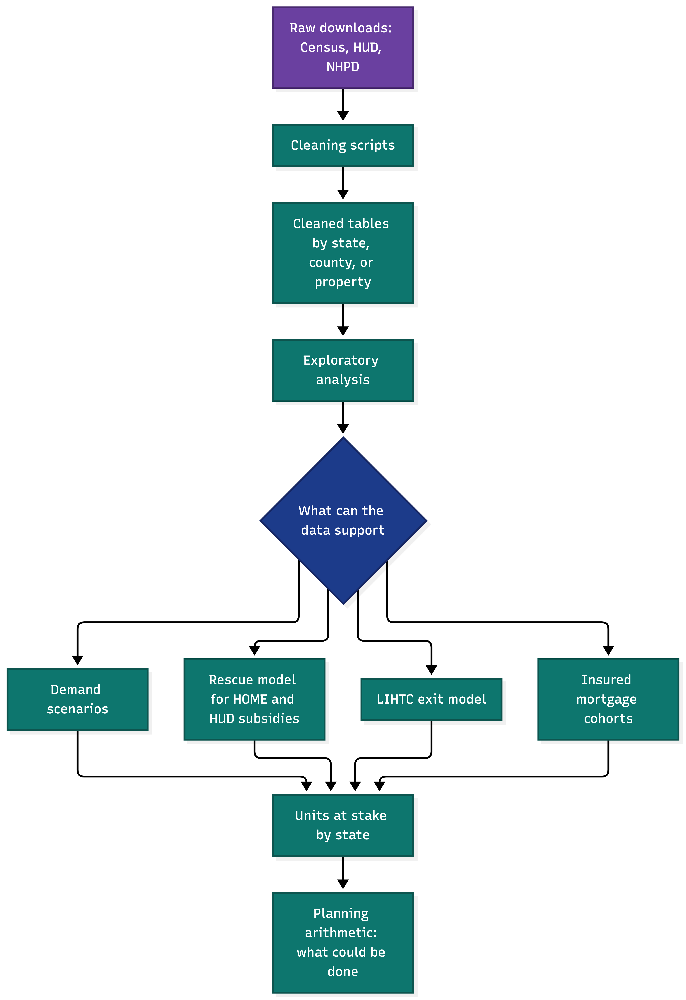</p>

<p align="center"><em>Figure 3. The workflow connects raw sources, prepared tables, individual models, state estimates, and planning calculations.</em></p>

## Data

I combined sources that describe different parts of the housing system. Each source has its own coverage period, definitions, and limitations. The cleaning scripts read from `data/raw/` and write prepared tables to `data/interim/` or `data/processed/`. [`DATA.md`](DATA.md) documents the sources, reference periods, and known issues.

| Source | How it is used | Source period |
|---|---|---|
| Census ACS 1-year estimates (rent, income, rent burden, households, vacancy) | State panel and rent-burden outcome | 2010–2024; no 2020 release |
| Census ACS tenure and population by age | Age-specific renting rates for demand scenarios | 2010–2024 |
| Weldon Cooper Center population projections | Population by age through 2035; 2035 values interpolated | 2020–2050 |
| HUD CHAS | Extremely low-income renter counts and rent-affordable units | Four five-year windows, 2005–09 through 2018–22 |
| National Housing Preservation Database (NHPD) | Subsidy history, expiration dates, and insured mortgages | October 2026 snapshot |
| HUD LIHTC database | Project placement year and monitoring status | Placed in service 1987–2024 |
| HUD HOME rent limits and fair market rents | County-level market/restricted rent gap, tested as a potential predictor | FY2019 and FY2024 |
| NLIHC *The Gap* state table | Independent comparison for state measures; **not** a model input | Table displayed October 11, 2026 |
| FHFA county house price index | Appreciation measure tested as a potential predictor | 1975–2025 |

The prepared state-level tables use `state_fips` as a consistent two-character identifier—for example, `"06"` for California—to make geographic joins traceable.

## Exploratory analysis

Before fitting models, I used five notebooks in `notebooks/01_eda/` to understand what the data could reasonably tell me. Several findings changed the direction of the project.

1. **States differ substantially.** Approximately 73.5% of the observed variation in severe rent burden is between states, 12.0% reflects common year effects, and 14.4% remains as a mix of movement and noise.
2. **Year-to-year changes can be misleading.** The median 90% margin of error is about 1.07 percentage points, but roughly 2.8 in Wyoming, Vermont, and Delaware versus about 0.5 in California and Texas. Sampling error accounts for an estimated 76% of the variance in annual changes.
3. **There is a practical limit to forecast accuracy.** A hypothetical model that perfectly knew the underlying burden rate would still miss a future published survey estimate by about 0.61 points, compared with 1.09 for a persistence baseline. That limits the possible improvement to roughly 44% under the study's assumptions.
4. **State rankings are more stable than annual movements.** The correlation between state ranks in 2010–12 and 2022–24 is about 0.82. The median state's measured burden fell to 22.1% in 2019, rose to 25.1% in 2021, and was 24.4% in 2024.

These results helped me avoid choosing a sophisticated model simply because it looked impressive. A method needed to improve on a simple, defensible baseline using data from periods it had not seen.

<p align="center">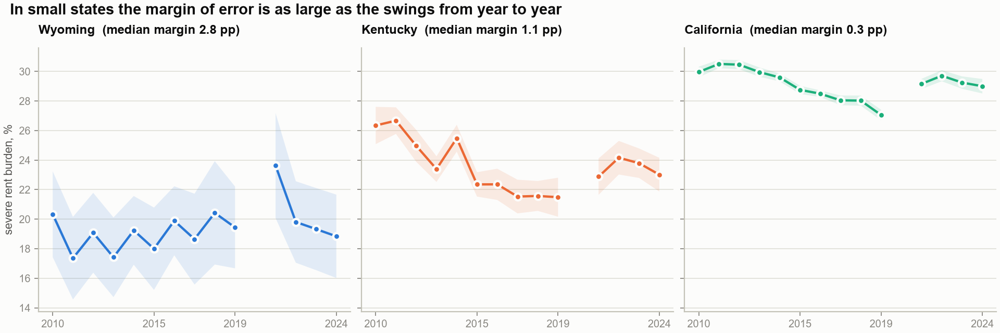</p>

<p align="center"><em>Figure 4. Severe rent burden and 90% survey uncertainty bands. Smaller states can show much wider uncertainty around annual changes.</em></p>

<p align="center">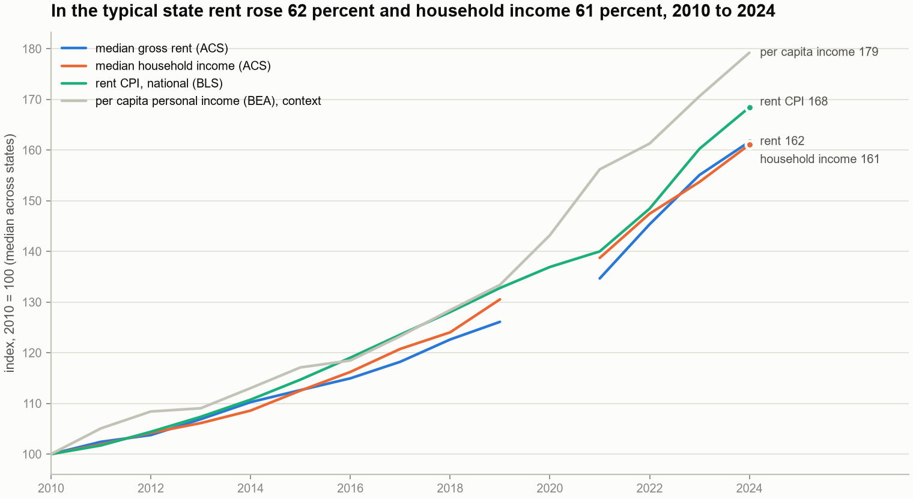</p>

<p align="center"><em>Figure 5. Rent and household income indexed to 2010. Both rose by roughly 62% in the median state, while rent grew faster than income in 38 of 51 geographies.</em></p>

## Models

I tested approaches ranging from simple demographic calculations to statistical learning methods. I retained a method when it answered a clear question and held up to relevant checks—not because it was the most complicated.

| Method | Question it addresses | Main finding |
|---|---|---|
| Composite need index (z-score aggregation) | Which states face the greatest need today? | Florida, Nevada, California, Arizona, and Oregon lead; the top eight ranks are stable in resampling. |
| Demographic projection with age-specific renting rates | How might the number of ELI renter households change? | About 10.9 million in 2023 to 11.6 million by 2035 under the baseline; other renting assumptions change the direction. |
| Logistic regression | Which properties receive a replacement subsidy after a lapse? | Time-split AUC of 0.82; property size explains much of the observed difference. |
| Ridge-penalized logistic regression with state effects and cohort trend | Which LIHTC properties leave agency monitoring lists? | State context carries predictive information (AUC about 0.79–0.80); project variables alone perform poorly across states (about 0.52). |
| Cohort life table | Which insured mortgages end before their scheduled dates? | About 28,000–42,000 units potentially missed by scheduled-expiry lists. |
| Additional logistic tests with state effects | Do rent gaps, house-price appreciation, or nonprofit sponsorship improve predictions? | No reliable improvement within states or out of sample. |
| Bootstrap and sensitivity analysis | How uncertain are the combined numbers? | Roughly 885,000–1.05 million with sampling uncertainty; assumptions about renting behavior produce larger changes. |
| Hindcast and recalibration exercises | Can models reproduce earlier totals or anticipate shifts in rescue rates? | Aggregate hindcast totals are close, but state variation is not well explained and methods did not anticipate the post-2021 rise. |

**Models considered but not distributed in this shorter package:** The full study also evaluates fixed-effects panels, Mundlak tests, Bayesian state-space forecasts, shrinkage and dynamic-panel approaches, Elastic Net, random forest, gradient boosting, and SHAP explanations. The best state-space model achieved about 0.89 of the persistence benchmark's one-year error. Across the reported 27 machine-learning comparisons, none outperformed the simpler econometric alternatives. Those omitted state-level notebooks are discussed in the full study but are **not included** in this repository package.

<p align="center">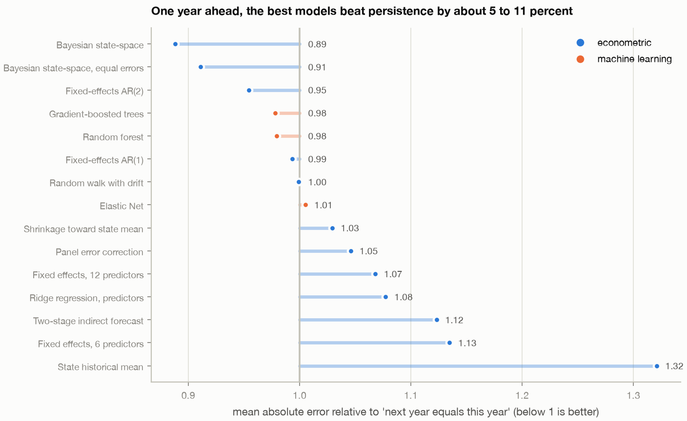</p>

<p align="center"><em>Figure 6. One-year severe-rent-burden forecasts compared with the “same as last year” benchmark. Scores below 1 indicate improvement.</em></p>

## Results in pictures

The figures below illustrate distinct questions: **need today, potential future demand, preservation transitions, and planning choices**. They should not be read as interchangeable measures of confirmed affordability loss.

<p align="center">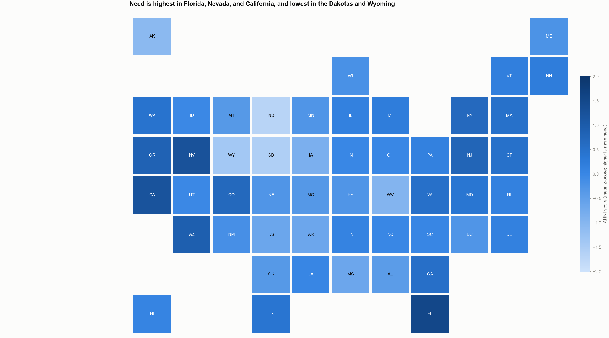</p>

<p align="center"><em>Figure 7. Current housing-need index by state (2022–24). The top eight states stay within two ranking positions in 99.8% of the survey-error resamples.</em></p>

<p align="center">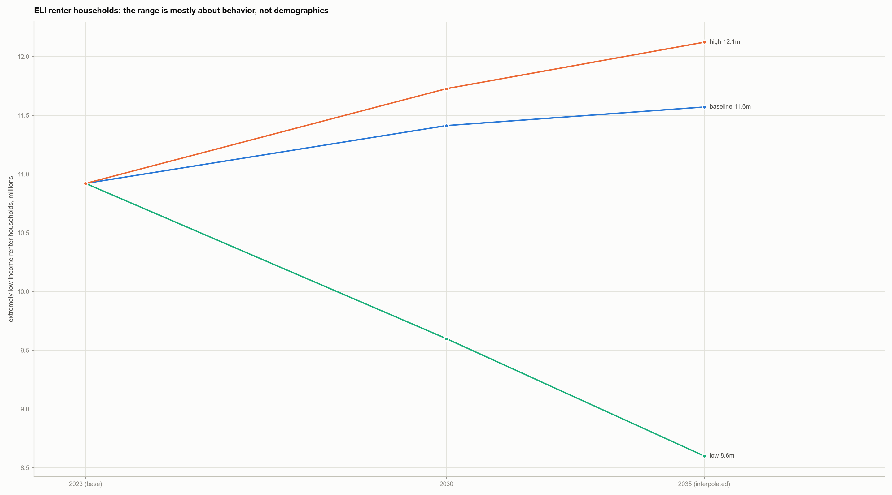</p>

<p align="center"><em>Figure 8. Three scenarios for ELI renter households. Differences mainly reflect renting-behavior assumptions, not separate demographic forecasts.</em></p>

<p align="center">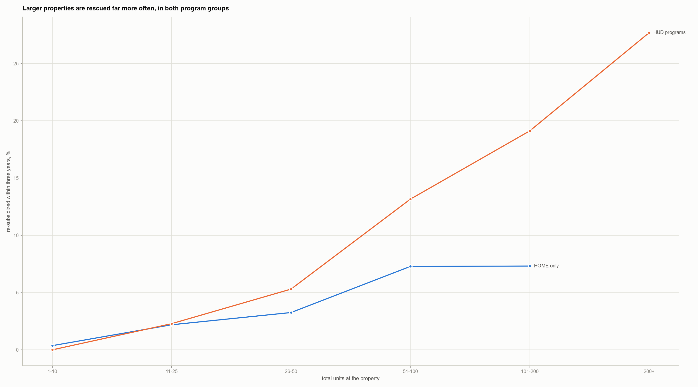</p>

<p align="center"><em>Figure 9. Observed re-subsidization within three years, by property size: below 1% for properties with 10 or fewer units and around 28% for those with at least 200 units.</em></p>

<p align="center">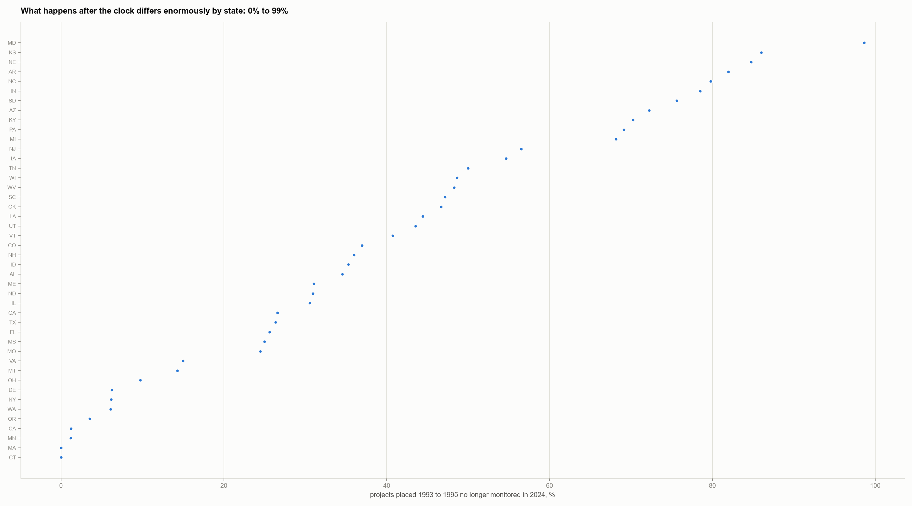</p>

<p align="center"><em>Figure 10. The share of 1993–95 LIHTC projects no longer on state monitoring lists varies widely, from 0% in Connecticut to 99% in Maryland. A monitoring exit is not the same as proven affordability loss.</em></p>

<p align="center">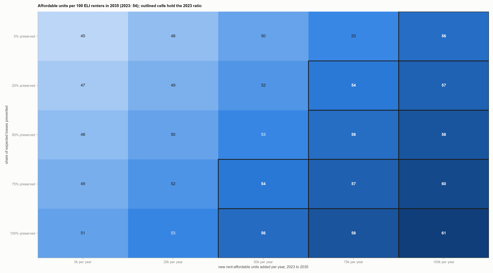</p>

<p align="center"><em>Figure 11. Illustrative 2035 affordable units per 100 ELI renters under different preservation and construction assumptions, compared with about 54 in 2023. These are planning calculations without cost estimates.</em></p>

## Try it in five minutes

The repository has **14 short examples** in [`examples/`](examples/). Each is designed to demonstrate one part of the analysis and print figures that can be compared with the report.

```bash
uv run examples/04_need_index.py       # build and test the state need rankings
uv run examples/06_rescue_model.py     # examine which properties receive replacement assistance
uv run examples/09_units_at_stake.py   # combine the four components by state
```

For example, the combined-results script prints:

```text
national total, units by 2035 (low to high):
  growth need (baseline)                    341,444 to    341,444
  HOME and HUD subsidies not rescued        294,898 to    352,711
  LIHTC leaving monitoring                  235,693 to    296,639
  insured mortgages ending early             27,810 to     42,181
  total                                     899,845 to  1,032,975
```

To inspect the leading states:

```python
import pandas as pd

t = pd.read_csv("outputs/tables/units_at_stake_state.csv")
print(t.sort_values("stake_mid", ascending=False)[["state", "stake_low", "stake_high", "lead"]].head(5).round(0))
#   state  stake_low  stake_high    lead
#      TX   101555.0    109084.0  growth
#      FL    72588.0     79762.0  growth
#      NC    48373.0     53190.0  growth
#      NY    37511.0     47484.0    nhpd
#      CA    38496.0     46094.0    nhpd
```

You can also inspect the property-level events behind the rescue analysis:

```python
import sys
sys.path.insert(0, "src")
import preservation as P

events = P.build_events()  # properties with their last subsidy ending in 2011–2023
print(len(events), int(events.resub_3y.sum()))  # 12,822 events, 189 re-subsidized within three years
```

## Notebooks at a glance

The 18 notebooks included in this package can be read individually or rebuilt using the runner.

| Notebook | Research question | Reported result |
|---|---|---|
| `01_eda/01_coverage` | Which states and periods are represented? | Broad coverage of 51 geographies; gaps include ACS 2020 and selected snapshot sources. |
| `01_eda/02_signal_vs_noise` | How much apparent movement in burden is sampling noise? | Approximately 76% of annual-change variance. |
| `01_eda/03_trends` | How did rent, income, and burden change? | Median-state rents and income rose about 62%; burden fell through 2019 and rose in 2021. |
| `01_eda/04_need_today_ahni` | Which states face the greatest need today? | Need index with rank uncertainty; Florida, Nevada, California, Arizona, and Oregon lead. |
| `01_eda/05_relationships` | What correlates with rent growth and burden changes? | Burden change is dominated by mean reversion; rent growth has modest predictors. |
| `04_scenarios/01_stock_flow` | How might ELI renter numbers evolve? | About 10.9 million in 2023 to 11.6 million in 2035 in the baseline scenario. |
| `05_preservation/01_preservation_model` | Which lapsed subsidies are followed by another subsidy? | AUC 0.82 on a time split; forest and boosting do not improve on the simpler model. |
| `05_preservation/02_lihtc_exit` | Which LIHTC projects leave agency monitoring? | State patterns are important; cohort-split AUC about 0.80. |
| `05_preservation/03_rent_gap`, `05_preservation/06_price_growth` | Do market incentives and sponsor characteristics add explanatory value? | No reliable improvement in the reported tests. |
| `05_preservation/04_mortgage_exit` | What might scheduled-expiration lists miss? | About 28,000–42,000 units connected with early insured-mortgage terminations. |
| `05_preservation/07_state_hindcast`, `05_preservation/08_rescue_drift` | Can the model reproduce previous totals and adapt to new patterns? | Aggregate totals are close, but state shares remain difficult and the recent rise was not anticipated. |
| `06_combined/01_units_at_stake` | How many units are potentially at stake by state? | About 0.90–1.03 million nationally. |
| `06_combined/02_uncertainty_and_sensitivity` | How sensitive is the total? | Approximately 885,000–1.05 million with sampling uncertainty; demand assumptions have larger effects. |
| `06_combined/03_external_benchmarks` | How do estimates compare with independent data? | ELI renter counts correlate with NLIHC's table at 0.995; housing-availability rank correlation about 0.75. |
| `07_homelessness/01_ahar_context` | How does homelessness fit into the broader picture? | Descriptive context; no claim that annual changes are explained by rents. |
| `08_actions/01_what_can_be_done` | What would different preservation and production combinations imply? | Screening trade-offs and capacity arithmetic, without costs or causal claims. |

## Repository layout

```text
REPORT_SHORT.md          Full research write-up, with code, output and figures
README.md                This introduction
DATA.md                  Source locations, periods and known limitations
examples/                14 runnable model examples
notebooks/               18 included notebooks: editable .py plus executed .ipynb
  01_eda/
  04_scenarios/
  05_preservation/
  06_combined/
  07_homelessness/
  08_actions/
src/                     Models, shared helpers, six cleaners and report runner
data/interim/             Prepared input tables
data/processed/           State-year panel and dictionary
data/raw/chas/            Two smaller raw HUD CHAS tables
outputs/tables/          Tables generated by the analyses
outputs/figures/         Figures grouped by research section
fetch-*.py               API download scripts; a free Census key may be needed
pyproject.toml, uv.lock   Dependency definition and lockfile
```

The numbering follows the larger research study. In particular, the state forecasting and machine-learning bake-off sections (`02_econometrics` and `03_ml_bakeoff`) are **not part of this shorter repository package**. The report discusses their findings, while this package concentrates on the workflows used for the combined exposure estimate.

## What this package leaves out, and why

| Not included | What it covered | Reason it is omitted |
|---|---|---|
| State-level Bayesian state-space, fixed-effects, and shrinkage forecasting notebooks | One- to three-year state rent-burden and rent-growth forecasts | Modest performance gains; these forecasts are not used in the combined 2035 estimate. |
| State forecasting machine-learning bake-off and SHAP notebooks | Elastic Net, forests, boosting, and explainability comparisons | None of the reported 27 comparisons improved on simpler models; property-level comparisons remain in the included preservation notebook. |
| Expanded explanatory econometrics | Fixed effects, dynamic relationships and cross-state dependence | Helpful research context, but not required to rebuild the combined estimate. |
| Additional property features and policy-flag profiles | Tract data, extra NHPD fields and five state-level yes/no flags | No demonstrated predictive gain or superseded by the combined approach. |
| Approximately 280 MB of raw downloads | NHPD, LIHTC, CHAS, rent limits and related source files | Repository size; prepared tables are included and [`DATA.md`](DATA.md) explains how to obtain sources. |

## Reproducibility and checks

A central goal of the project is to make the results **inspectable**, including decisions that did not work as expected.

- **Source preservation.** Cleaning scripts read from `data/raw/` and write new prepared files rather than modifying the source downloads.
- **Rebuildable examples.** The included examples and prepared tables let readers check reported values, including the LIHTC estimate of 235,693–296,639 units and the combined 899,845–1,032,975-unit range.
- **Time-aware evaluation.** Forecasting and property models use historical-to-later splits where relevant, rather than randomly mixing future observations into training data.
- **Explicit uncertainty.** The combined estimate is examined through 1,000 resamples, while separate sensitivity analyses show how assumptions about renter demand and rescue patterns affect the total.
- **Independent benchmarks.** State measures are compared against NLIHC's *The Gap* table and published expiring-unit figures, with source and definition differences discussed.
- **Corrections to data leakage.** I identified and removed cases where later subsidy information or outcome-related fields made a model appear unrealistically strong (including apparent AUC values of 0.999 and 0.94). Rent-gap comparisons were also corrected for a weak county join and mixed source years.
- **Repeatable random procedures.** Where simulations or resampling require randomness, fixed seeds allow results to be recreated within ordinary numerical tolerances.

**Scope of reproducibility:** This repository supports the **included** 18-notebook workflow using the prepared data. A full source-cleaning rerun requires the raw downloads. The omitted state-level forecasting notebooks cannot be reproduced from this shorter package alone.

## Limits

The report's Section 8 provides a fuller discussion of threats to validity. The most important cautions are:

- **Scenarios, not forecasts.** The 2035 demand figures depend on projected population and assumptions about renting behavior. The 2035 demographic values are interpolated.
- **Subsidy exposure, not confirmed loss.** The rescue estimate assumes the relevant subsidy actually lapses. The rescue model is based on relatively few observed positive rescue outcomes (58 in training) and covers approximately 41% of expiring units. It is therefore not a comprehensive estimate of all future affordability losses.
- **Changing rescue patterns.** A 2019–2023 hindcast performs reasonably in aggregate but does not explain state-level rescue differences. The observed rescue rate rose after 2021; if that higher rate persisted, the combined estimate would be about 5% lower.
- **LIHTC monitoring is administrative.** A project leaving a state monitoring list may remain affordable. State effects may reflect agency reporting practices as well as substantive program differences.
- **Overlaps and model choices matter.** The four exposure categories may refer to some of the same homes. Sampling error is relatively small compared with changes caused by the assumptions about future renting behavior.
- **No demonstrated intervention effect.** The project identifies associations and illustrates planning trade-offs. It does not establish that a specific preservation action causes units to remain affordable, nor does it estimate intervention costs or returns.

I include these limitations because they affect how the numbers should be used. This project is intended to support **better questions and more informed review**, not replace property-level due diligence or local policy analysis.

## Next steps

I see this as an evolving research effort, not a finished answer. As better data become available and I learn more about affordable housing finance and preservation, I want to keep testing and improving the analysis.

1. **Track LIHTC outcomes more precisely.** Obtain dated monitoring exits and extended-use restriction information from state agencies so that future work can distinguish administrative changes from confirmed affordability outcomes.
2. **Improve property-level history.** Incorporate ownership, management, and inspection information available as of each historical event to avoid using later information to predict earlier outcomes.
3. **Explore policy effects cautiously.** Where dated policy changes are available, evaluate whether designs such as difference-in-differences can help distinguish policy effects from correlations.
4. **Refine the housing gap measure.** Incorporate an availability-adjusted measure using CHAS Table 14B to align more closely with the standard national housing-gap concept.
5. **Refresh and extend the research.** Update datasets as releases permit, compare estimates against subsequent observations, and explore costs and finance risks in a **separate** investment-oriented framework rather than blending them into the need index.

My longer-term goal is to make this work useful beyond any one organization by sharing transparent methods and research that affordable housing developers, investors, housing agencies, and other researchers can examine, challenge, and improve.

---

**Data and reference organizations:** U.S. Census Bureau; U.S. Department of Housing and Urban Development (HUD); National Low Income Housing Coalition (NLIHC); Public and Affordable Housing Research Corporation / National Housing Preservation Database (NHPD); Weldon Cooper Center; Bureau of Labor Statistics (BLS); Bureau of Economic Analysis (BEA); Federal Housing Finance Agency (FHFA).
