# How Many Affordable Rental Units Are at Stake by 2035, and Where?

A short report that combines four models: a demand projection (stock-flow scenarios) and three models of what happens to existing subsidized housing when its restrictions end (HOME and HUD-program subsidies, LIHTC, and HUD-insured mortgages). It adds a need index for today, homelessness as context, and planning arithmetic for what could be done. Section 2 lists every model tried, kept, and dropped; the notebooks for the state-level models are not part of this package (see `README.md`).

It is written so that you can understand the project **before opening any code**: "Start here" explains the idea in plain words, with a glossary; Section 1 gives the answer; Section 2 lists every model tried, kept, and dropped, with the evidence; Section 3 describes the data; Section 4 is the exploratory analysis; Section 5 explains each model in plain words, with the code and a worked example; Sections 6 and 7 give the combined result and what to do about it.

## Start here: the project in plain words

**The question.** Which states will need more affordable rental housing by 2035, and what should be done about it?

**The idea.** Two things can make affordable rental housing scarcer. More households may need it (**demand**), and existing affordable units may disappear when the subsidies or rules that keep them affordable end (**loss**). We model each separately and add the results by state. The answer is the number of affordable units "at stake" in each state: **0.90 to 1.03 million nationally, about two thirds of it, under the baseline growth scenario, existing units that could be lost rather than new demand.**

<p align="center"></p>

*Project flow: from raw downloads to units at stake by state and the planning arithmetic.*

**The pieces in one line each** (Section 2 is the full register of models tried, kept, and dropped).

| Piece | Question it answers | Method | Headline |
|---|---|---|---|
| Need index (5.0) | Which states have the greatest need today? | Composite indicator: seven measures as z-scores averaged in three groups, with rank intervals | Florida, Nevada, California, Arizona, Oregon lead; top eight ranks are stable |
| Demand scenarios (5.1) | How many extremely low income renters will there be in 2035? | Demographic projection with age-specific tenure rates: renter households by age grow with the projected population of the same age | About 6 percent more by 2035 if renting rates hold; the sign depends on whether past declines continue |
| Rescue model (5.2) | When a HOME or HUD subsidy ends, is the property re-subsidized? | Logistic regression (yes-or-no outcome) on property size and program, tested on later years | AUC 0.82; larger properties are rescued far more often |
| LIHTC exit (5.3) | When the 30-year clock ends, does the project leave the agency's monitoring list? | Ridge-penalized logistic regression with state fixed effects and a cohort trend | The state matters, the project does not |
| Insured mortgages (5.4) | How many units does the date-based expiry list miss? | Cohort life table: share of loans already terminated at each age | 28,000 to 42,000 units |

**Terms used throughout.**

| Term | Meaning |
|---|---|
| ACS | American Community Survey, the Census Bureau's yearly sample survey (rents, incomes, households). Every ACS number has a margin of error |
| CHAS | HUD's tabulation of ACS data by income band relative to the local median; the source of the extremely low income (ELI) renter counts and rent-affordable unit counts |
| ELI | Extremely low income: household income at or below 30 percent of the area median (HAMFI, HUD's area median family income) |
| Rent burden | Share of income spent on rent: burdened is 30 percent or more, severely burdened is 50 percent or more |
| NHPD | National Housing Preservation Database: one record per subsidy and per property for federally assisted rental housing, with start and end dates |
| HOME, HUD programs | Federal subsidies recorded in NHPD (HOME grants; Section 8, public housing, Section 202 and 236, and similar) |
| LIHTC | Low Income Housing Tax Credit, the largest producer of subsidized units; restrictions last 30 years or more |
| Monitoring list | Projects the state agency still checks for LIHTC compliance; leaving it does not by itself mean the units stopped being affordable |
| Rescue | A property whose last subsidy ended gets a new subsidy within three years |
| Insured mortgage | An FHA-insured loan that carries affordability rules; NHPD records its scheduled end, which can differ from when the loan actually ended |
| Time split | Train a model on earlier years and test on later ones, never a random split, because the future is what we want to predict |
| AUC | Probability that a randomly chosen rescued property scores higher than a randomly chosen unrescued one: 0.5 is chance, 1.0 is perfect |
| Leakage | Information in the features that the model could not have known at prediction time; it inflates accuracy (we found and removed several cases) |
| Persistence baseline | "Next year equals this year", the benchmark every forecast must beat |
| Logistic regression | A regression for a yes-or-no outcome; it models the odds of the event from the inputs |
| Fixed effects | A separate intercept for each state (and year), so a state is compared with itself over time and fixed differences between states drop out |
| Regularization (ridge, Elastic Net) | A penalty on the size of coefficients that stabilizes a model with many or correlated inputs |
| State-space model | A model with a hidden true value observed with error; the Kalman filter estimates the hidden path |
| Shrinkage (partial pooling) | Pulling a noisy estimate toward a more stable average, such as the state's own history |
| Cohort life table | For each group that started in the same year, the share that has already experienced the event, used to project younger groups |
| Composite indicator | One score built by standardizing several measures and averaging them |

**Three ways to read this project.**

| Time | Read |
|---|---|
| 5 minutes | Section 1 (summary) and the figures index |
| 30 minutes | Sections 2 to 7 (model register, data, exploratory analysis, model details, combined result, what to do), skipping the code excerpts |
| Full detail | Sections 3 and 9, then the notebooks in order (each notebook explains its own method and findings) |

**Try it yourself: fourteen runnable examples.** Every model in this report has a short script in `examples/` that you can run from the project root. Each one loads the cleaned data, runs the method, and prints the numbers quoted in the text; the report shows the code and its output next to the explanation.

| Example | What it shows | Where in the report |
| --- | --- | --- |
| `01_rolling_origin_backtest.py` | A fair forecasting test: fit on the past, predict the future | Section 2.1 |
| `02_fixed_effects_regression.py` | Pooled regression against two-way fixed effects | Section 2.2 |
| `03_noise_and_baseline.py` | How noisy the rent-burden series is, and the "next year equals this year" benchmark | Section 4.2 |
| `04_need_index.py` | Building the need index and its rank intervals | Section 5.0 |
| `05_demand_scenarios.py` | The three demand scenarios | Section 5.1 |
| `06_rescue_model.py` | Which expiring HOME and HUD properties get a new subsidy | Section 5.2 |
| `07_lihtc_exit.py` | Which LIHTC projects leave the monitoring list | Section 5.3 |
| `08_insured_mortgages.py` | Insured mortgages that end early | Section 5.4 |
| `09_units_at_stake.py` | Adding the four pieces by state | Section 6 |
| `10_what_could_be_done.py` | Planning arithmetic: what it would take to hold the line | Section 7 |
| `11_uncertainty_and_sensitivity.py` | How sure we are of the total, and which assumption moves it most | Section 6 |
| `12_state_hindcast.py` | Does the rescue model get the state totals right? A hindcast on 2019-2023 lapses | Section 5.2 |
| `13_rescue_rate_drift.py` | The rescue rate rose after 2021: mix, real-time models, and the effect on the headline | Section 5.2 |
| `14_external_benchmarks.py` | Our state measures and expiring counts against NLIHC and other published figures | Section 6 |

Run one with `uv run examples/04_need_index.py`. They read only the cleaned tables in `data/`, and examples 09 and 10 also read the result tables in `outputs/tables/` (rebuilt by `uv run src/run_short_report.py`).

To look at the final table yourself:

```python
import pandas as pd
t = pd.read_csv("outputs/tables/units_at_stake_state.csv")
print(t.sort_values("stake_mid", ascending=False)[["state", "stake_low", "stake_high", "lead"]].head(5).round(0))
#   state  stake_low  stake_high    lead
#      TX   101555.0    109084.0  growth
#      FL    72588.0     79762.0  growth
#      NC    48373.0     53190.0  growth
#      NY    37511.0     47484.0    nhpd
#      CA    38496.0     46094.0    nhpd
```

(`lead` names the largest piece in that state: growth, the HOME and HUD subsidy lapse `nhpd`, `lihtc`, or `mortgage`.)

---

## 1. Summary

**Question.** What is going to happen to affordable rental housing in the United States, and what needs to be done?

**Answer in three numbers (51 geographies, by 2035).**

| Piece | Model | Units at stake |
|---|---|---|
| Growth in need | Demographic projection with age-specific tenure rates (stock-flow scenarios) | About 341,000 extra affordable units to hold today's ratio (none if renting keeps falling, 621,000 if it rises) |
| HOME and HUD-program subsidies lapsing | Logistic regression (rescue model) | 295,000 to 353,000 units not rescued if their subsidies lapse (an upper bound) |
| LIHTC projects leaving monitoring | Ridge-penalized logistic regression with state fixed effects (LIHTC exit model) | 236,000 to 297,000 units |
| HUD-insured mortgages ending early (properties with no other subsidy) | Cohort life table from NHPD | 28,000 to 42,000 units not rescued, missed by the date-based list |
| **Total, order of magnitude** | | **0.90 to 1.03 million** |

- **Preserving what exists matters more than building for growth.** Under the baseline growth scenario the three preservation pieces are 62 to 67 percent of the total (47 to 53 percent if renting rises, all of it if renting keeps falling).
- **Where the stakes are:** Texas, Florida, and North Carolina in units (growth-driven); California, New York, Pennsylvania, and Ohio where HOME and HUD subsidies lapse; Maryland, Michigan, and Virginia where LIHTC projects leave monitoring. Per ELI renter, Idaho, South Dakota, and Utah are highest.
- **Models tried, kept, and dropped.** Section 2 is the register: econometric models (fixed effects, Mundlak, Bayesian state-space, dynamic panels), machine learning (Elastic Net, random forest, boosting, SHAP), and the property-level models, each with its verdict and evidence.
- **What each model can and cannot claim.** The rescue model ranks properties well (AUC 0.82) but covers only 41 percent of expiring units. The LIHTC model finds that what happens after the clock depends on the state, not the project, and may reflect reporting. The scenarios are not forecasts. The total is an order of magnitude, not an estimate with a margin of error.


*Figure 1. The four pieces of the national total, in thousand units by 2035 (bar: low to high estimate). Growth in need is 341,000 units; the three preservation pieces together are 62 to 67 percent of the total, which is why this report keeps coming back to protecting existing housing.*


*Figure 2. Units at stake by 2035 for the 15 largest states, by source: growth need (blue), HOME and HUD subsidies not rescued (orange), LIHTC leaving monitoring (green), insured mortgages ending early (gold). Texas, Florida, and North Carolina lead and are driven by growth; New York and California are driven by subsidies lapsing.*

### Figures at a glance

Every figure is in `outputs/figures/`; keep that folder next to this file so the images display.

| Figure | What it shows | Section |
| --- | --- | --- |
| 1 | The four pieces of the national total | 1. Summary |
| 2 | Units at stake by 2035 | 1. Summary |
| 3 | Best stable model by target and horizon | 2.1 How models were judged |
| 4 | Pooled, state-effects, and two-way estimates | 2.2 Model register |
| 5 | Severe burden forecast errors by model | 2.2 Model register |
| 6 | Rent growth forecast errors by model | 2.2 Model register |
| 7 | Noisy states move toward their own history | 2.2 Model register |
| 8 | Bayesian error against persistence | 2.2 Model register |
| 9 | Prediction interval coverage | 2.2 Model register |
| 10 | National burden estimate and forecast | 2.2 Model register |
| 11 | Machine learning against the best econometric model | 2.2 Model register |
| 12 | What the forests learned | 2.2 Model register |
| 13 | One-year severe-burden scorecard | 2.4 What model selection showed |
| 14 | Coverage heat map | 4.1 Coverage |
| 15 | Margin of error against state size | 4.2 Signal versus noise |
| 16 | Three states and their margins of error | 4.2 Signal versus noise |
| 17 | Observed changes against sampling error alone | 4.2 Signal versus noise |
| 18 | Rent and income indexed to 2010 | 4.3 Trends |
| 19 | Severe burden by state over time | 4.3 Trends |
| 20 | States keep their place | 4.3 Trends |
| 21 | Within-state correlations | 4.5 Relationships and overlap |
| 22 | Need index by state | 5.0 Where need is greatest today |
| 23 | Rank intervals for the need index | 5.0 Where need is greatest today |
| 24 | The seven components by state | 5.0 Where need is greatest today |
| 25 | Need today and its direction | 5.0 Where need is greatest today |
| 26 | ELI renter households under three scenarios | 5.1 Demand: stock-flow scenarios |
| 27 | Baseline change in ELI renters by state | 5.1 Demand: stock-flow scenarios |
| 28 | Testing the projection mechanism on the past | 5.1 Demand: stock-flow scenarios |
| 29 | Change in ELI renters by state and scenario | 5.1 Demand: stock-flow scenarios |
| 30 | Rescue model AUC by feature set and model | 5.2 HOME and HUD-program subsidies: who is rescued? |
| 31 | Rescue rate by property size | 5.2 HOME and HUD-program subsidies: who is rescued? |
| 32 | Where expiring units are least likely to be rescued | 5.2 HOME and HUD-program subsidies: who is rescued? |
| 33 | State-level hindcast | 5.2 HOME and HUD-program subsidies: who is rescued? |
| 34 | Calibration by year and by size | 5.2 HOME and HUD-program subsidies: who is rescued? |
| 35 | The rescue rate over time | 5.2 HOME and HUD-program subsidies: who is rescued? |
| 36 | LIHTC exit by placement year | 5.3 LIHTC: what happens when the clock runs out? |
| 37 | LIHTC exit by state | 5.3 LIHTC: what happens when the clock runs out? |
| 38 | Where LIHTC units are most likely to leave monitoring | 5.3 LIHTC: what happens when the clock runs out? |
| 39 | Insured loans terminate early | 5.4 HUD-insured mortgages: a pathway the date-based list misses |
| 40 | Insured-mortgage exposure by state | 5.4 HUD-insured mortgages: a pathway the date-based list misses |
| 41 | Market-rent gap estimates | 5.5 Tested ideas that did not work: market rent, price growth, sponsor type |
| 42 | Units at stake per ELI renter | 6. The combined result |
| 43 | Sampling error and the headline range | 6. The combined result |
| 44 | What the total depends on | 6. The combined result |
| 45 | Our state measures against NLIHC's | 6. The combined result |
| 46 | Point-in-time count 2010 to 2024 | Context: homelessness |
| 47 | Rent burden and homelessness rate by state | Context: homelessness |
| 48 | Likelihood of loss against units, by size | Planning arithmetic |
| 49 | Targeting curves | Planning arithmetic |
| 50 | Capacity by state | Planning arithmetic |
| 51 | Lever grid | Planning arithmetic |

---

## 2. Models tried, kept, and dropped

This section is the model-selection record, written as a short methods-and-results account. The study used four kinds of model: state-level econometrics, state-level machine learning, property-level classification, and descriptive indices and scenarios. Each was judged against a simple benchmark on data it had not seen, with the adoption rule written down before looking at results. Tables A and B summarize state-level work done in the full study; its notebooks are not part of this package (see `README.md`), while every kept model in Table C has a notebook here.

### 2.1 How models were judged

**In plain words.** Before comparing models we need a test that cannot be gamed. The rule is simple: a model may only use what was known at the time it predicts. We stand in 2016 and forecast 2017, 2018, and 2019; then stand in 2017 and do it again; and so on. Each forecast is scored against what was later published, and compared with the laziest forecast there is: repeating the last value. The bullets below are the rules in detail, and Example 1 shows the test running.

- **Time-based tests only.** State forecasts use a rolling origin (fit on data through year *t*, predict *t* + 1 to *t* + 3, first origin 2016). Property models train on earlier lapses and test on later ones (train through 2015, test from 2019; a second split trains through 2017 and tests from 2020). No random splits.
- **Benchmarks.** For state forecasts, "next year equals this year" (persistence); for property models, a logistic regression on property size alone.
- **Metrics.** For forecasts, the mean absolute error as a ratio to persistence (below 1 is better), the share of origins won, and the Diebold-Mariano test (which has little power with 3 to 6 origins); every result is also shown without 2021 and without 2021 to 2023, because the post-2021 rent shock is a different regime. For classifiers, the area under the ROC curve (AUC), average precision, and the share of rescues in the top-scored fifth.
- **Adoption rules fixed in advance.** A forecasting model passed only if its ratio was below 1 on all origins, without 2021, and without 2021 to 2023, and it won more than half the origins. A machine learning model had to beat the best econometric model for that target, with an interval excluding 1.
- **A ceiling.** An oracle that knew every state's true burden would still miss the next published value by 0.61 points against 1.09 for persistence, so no model can gain more than 44 percent over the benchmark; the best model captured about a quarter of that gain at one year.
- **Leakage checks.** Four traps were found and fixed: a later subsidy leaked into the first version of the rescue features (AUC 0.999; recorded in the rescue notebook), and, described in Section 5, extra NHPD fields that are filled in mostly for rescued properties (AUC 0.94 from "is it filled in" flags alone), a county match of only 57 percent that produced a spurious rent-gap effect, and two rent-limit vintages mixed while the rescue rate rose.

#### Example 1: The test in code

The project's test harness (`src/evaluation.py`) does exactly that. This script runs three models through it: the benchmark itself, a single line through all states, and a forecast that pulls each state halfway toward its own average.

```python
"""
Example 1: a fair forecasting test. Fit only on the past, predict the future, and compare with "next year equals this year".

Run from the project root:   uv run examples/01_rolling_origin_backtest.py   (needs src/ on the path, so the script adds it)
Uses the project's test harness (src/evaluation.py): for each origin year it trains on rows whose target year is already known,
predicts 1 to 3 years ahead, and scores every forecast against what was later published. First origin 2016.
"""
import sys
sys.path.insert(0, "src")
import pandas as pd

from evaluation import run_backtest, summarize
from features import FEATURE_SETS, make_supervised
from models.baselines import Persistence, PooledAR1, ShrinkToStateMean

panel = pd.read_csv("data/processed/panel.csv", dtype={"state_fips": str})
TARGET = "severe_rent_burden_pct"
models = [Persistence(), PooledAR1(), ShrinkToStateMean(0.5)]       # the benchmark, one line through all states, and a half-way pull to each state's own average

frames = []
for horizon in (1, 2, 3):
    data = make_supervised(panel, TARGET, horizon, FEATURE_SETS["core"])     # one row per state and origin year, with only what was known then
    for m in models:
        frames.append(run_backtest(m, data, TARGET, horizon, first_origin=2016))
results = pd.concat(frames, ignore_index=True)

table = summarize(results)                                    # mean absolute error, the ratio to persistence (below 1 is better), and the share of origin years won
print(table[["horizon", "model", "origins", "mae", "mae_vs_persistence", "origins_won_vs_persistence"]].round(3).to_string(index=False))
```

Output, as produced when this report was written:

```text
 horizon       model  origins   mae  mae_vs_persistence  origins_won_vs_persistence
       1  pooled_ar1        6 1.098               0.991                        0.50
       1 persistence        6 1.107               1.000                         NaN
       1 shrink_0.50        6 1.139               1.029                        0.50
       2 shrink_0.50        5 1.314               0.899                        0.60
       2 persistence        5 1.462               1.000                         NaN
       2  pooled_ar1        5 1.524               1.042                        0.40
       3 shrink_0.50        4 1.606               0.893                        0.75
       3 persistence        4 1.797               1.000                         NaN
       3  pooled_ar1        4 2.063               1.148                        0.25
```

**How to read it.** A ratio below 1 means fewer errors than the benchmark. At one year nothing here clearly beats it. At two and three years, pulling each state halfway toward its own average cuts the error by about 10 percent (0.899 and 0.893). That is the pattern this section keeps finding: the burden is noisy, so a little shrinkage helps and a lot of machinery does not.

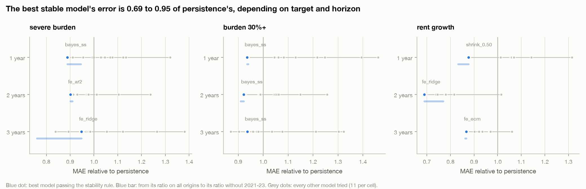

*Figure 3. For each target and horizon, the best model that passed the stability rule (blue dot) against every other model tried (grey dots); the blue bar runs from its error on all origins to its error without 2021 to 2023. The best stable model's error ranges from 0.69 to 0.95 of persistence's, and the biggest gain is rent growth at two years, a number that rests on only three test years.*

### 2.2 Model register

**Naming.** Short labels such as "rescue model" or "LIHTC exit model" are this report's names for a *use* of a standard method, not names of new methods. In each table the first column gives the standard (official) name of the method, the second says what it is in plain words, and the label used elsewhere in this report is shown in brackets. Verdicts are: **kept**, **dropped**, **tested, no effect**, or **not run**.

**Table A. State-level econometrics** (rent burden and rent growth for 51 states, 2010 to 2024)

| Model (standard name) | What it is, in plain words | Used for | Verdict | Evidence |
|---|---|---|---|---|
| Naive (persistence) forecast; random walk with drift; pooled first-order autoregression, AR(1) | Predict next year equals this year; the same plus the average yearly change; or one line from last year's value to this year's across all states | Benchmarks | Kept as the benchmark | Persistence error for severe burden 1.09 points; pooled AR(1) is 0.96 of it at one year |
| Pooled ordinary least squares (OLS) | One regression line through all state-years, ignoring which state each row belongs to | Show why state differences matter | Dropped (biased) | HUD-assisted units +0.21 pooled but -0.23 with state and year effects; Mundlak test p = 1.4e-09 |
| Two-way fixed-effects panel regression, with state-clustered standard errors | Regression with a separate intercept for every state and every year, so each state is compared with its own past; errors may be correlated within a state | Explain what moves with the burden | Kept (explanatory) | A 10 percent higher rent goes with +1.8 points and a 10 percent higher income with -2.8 (t-statistics of 6 or more in absolute value in all six robustness variants); within R-squared 0.29; unemployment, vacancy, lagged permits, and subsidies are not robust |
| Mundlak correlated random-effects specification test | Adds each state's average of the predictors to see whether state effects are correlated with them | Fixed against pooled estimation | Kept as a test | Rejects pooled estimation |
| Robustness variants: division-by-year fixed effects; two-way clustered errors; Driscoll-Kraay standard errors | Alternative ways to absorb regional shocks and correlated errors | Check the fixed-effects results | Kept as checks | Conclusions unchanged |
| Pesaran cross-sectional dependence (CD) test; spatial lag and spatial Durbin panel models | A test of whether states' residuals move together; spatial models let a state's outcome depend on its neighbors' | Cross-state dependence | Test run, spatial models dropped | No dependence remains after year effects; only modest regional clustering (same-division residual correlation +0.047 to +0.071) |
| Fixed-effects autoregressive panel model, AR(2) (labeled FE-AR2) | Predicts the next value from the last two, with a separate intercept for each state (a dynamic panel model) | Forecast the burden | Kept for two years | 0.955 of persistence at one year (the clearest gain; two other models are within 1 percent of persistence), 0.901 at two years, better in all five origins |
| Bayesian state-space (unobserved-components) model, estimated with the Kalman filter and adaptive Metropolis sampling (labeled the Bayesian forecast) | Treats the true burden as hidden: the survey figure equals the hidden value plus sampling error of known size, and the hidden value is a state level plus a national shock plus a persistent state deviation | Forecast the burden and the 30-percent burden | Kept as the one-year forecaster | 0.89 at one year, better at 6 of 6 origins; 30-percent burden 0.94, 0.92, 0.94; 90 percent intervals cover 93 percent at one year but only 85 and 83 percent at two and three |
| Shrinkage (partial-pooling) forecast (labeled the state-anchored blend) | A weighted average of the last value and the state's own historical mean | Forecast rent growth | Kept for one year | 0.876 of persistence, better at 4 of 5 origins |
| Panel error-correction model | Lets rent move back toward its long-run relation with income; fitted to changes | Forecast | Dropped for the burden, kept for rent growth at three years | Burden 1.046 at one year; rent growth 0.87 at three years (2 origins, suggestive only) |
| Ridge regression (L2-penalized linear regression) with predictors | Linear regression with a penalty that shrinks coefficients, to cope with correlated predictors | Forecast | Kept for narrow cells | Severe burden at three years 0.95; rent growth at two years 0.69 (3 origins, the least supported number) |
| State historical-mean forecast | Predict each state's average over its past | Forecast | Dropped | 0.84 at three years, but 1.40 without 2021 to 2023 |
| Indirect (two-stage) forecast | Forecast rent growth and income growth first, then convert them to the burden with the fixed-effects coefficients | Forecast | Dropped | 1.12, 1.24, 1.38 at one to three years, worse than persistence at every horizon |
| Panel vector autoregression; system GMM (Blundell-Bond dynamic panel); pooled mean group; instrumental variables (two-stage least squares); ARIMA; Prophet | Standard panel, causal, and time-series tools | Not applicable here | Not run | Only 14 years for 51 states; GMM and panel VAR are better supported in R; instruments are needed only for causal claims; ARIMA and Prophet suit long single series, not short annual panels |
| Difference-in-differences and other quasi-experimental designs | Compare the change over time in treated and untreated units | Causal effect of a policy | Not run | No dated policy change with a comparison group in the data, so every result here is an association (see 2.5) |

**Reading Table A: the econometric models in pictures and code**

*Why we do not trust a plain regression.* If you ignore which state a row belongs to, rich states and poor states differ for a hundred reasons that have nothing to do with the thing you are studying. A fixed-effects regression gives every state (and every year) its own baseline, so each state is compared only with itself. The picture shows the same regression three ways. Look at the last row: HUD-assisted units look harmful when states are pooled, and the sign flips once each state is compared with itself.

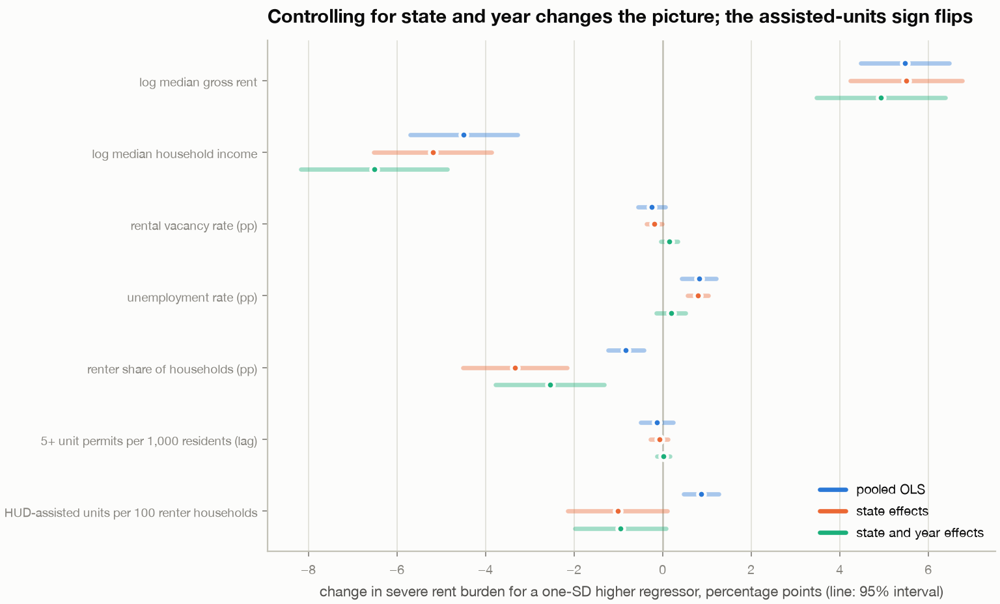

*Figure 4. Change in severe rent burden (percentage points) for a one-standard-deviation higher regressor, with 95 percent intervals, under pooled OLS (blue), state effects (orange), and state and year effects (green). Rent and income keep their signs and size; the assisted-units effect turns from positive to negative and loses significance, and renter share becomes much more negative.*

#### Example 2: Pooled regression against two-way fixed effects

This script fits both models on the same 663 state-years. The first uses all the variation, including differences between states; the second compares each state with its own average and each year with the national average.

```python
"""
Example 2: what moves with the rent burden? Pooled regression against two-way fixed effects.

Run from the project root:   uv run examples/02_fixed_effects_regression.py
Same specification as the explanatory notebook: severe burden on log rent, log income, vacancy, unemployment, renter share,
last year's multifamily permits, and HUD-assisted units, with standard errors clustered by state.
"""
import numpy as np
import pandas as pd
import statsmodels.api as sm
from linearmodels.panel import PanelOLS, PooledOLS

panel = pd.read_csv("data/processed/panel.csv", dtype={"state_fips": str})

# last year's 5+ unit permits per 1,000 residents (what builders had started before the survey year)
permits = panel[["state_fips", "year", "permits_5plus", "population_rate_base"]].copy()
permits["permits_lag1"] = 1000 * permits["permits_5plus"] / permits["population_rate_base"]
permits["year"] += 1
p = panel.merge(permits[["state_fips", "year", "permits_lag1"]], on=["state_fips", "year"], how="left")
p = p[p["acs_available"] == 1]

df = pd.DataFrame({
    "state_fips": p["state_fips"], "year": p["year"], "burden": p["severe_rent_burden_pct"],
    "ln_rent": np.log(p["median_gross_rent"]), "ln_income": np.log(p["median_hh_income"]),
    "vacancy": p["rental_vacancy_rate_pct"], "unemployment": p["unemployment_rate_pct"], "renter_share": p["renter_share_pct"],
    "permits_lag1": p["permits_lag1"], "assisted_per_100": p["psh_units_per_100_renter_hh"],
}).dropna().set_index(["state_fips", "year"])
X = ["ln_rent", "ln_income", "vacancy", "unemployment", "renter_share", "permits_lag1", "assisted_per_100"]
print(f"{len(df)} state-years, {df.index.get_level_values(0).nunique()} states\n")

clustered = dict(cov_type="clustered", cluster_entity=True)          # errors may be correlated within a state
pooled = PooledOLS(df["burden"], sm.add_constant(df[X])).fit(**clustered)
twoway = PanelOLS(df["burden"], df[X], entity_effects=True, time_effects=True).fit(**clustered)

out = pd.DataFrame({"pooled OLS": pooled.params[X], "pooled t": pooled.tstats[X], "two-way FE": twoway.params[X], "two-way t": twoway.tstats[X]})
print(out.round(2).to_string())
print(f"\nR-squared after removing state and year effects: {twoway.rsquared:.2f}")
print(f"a 10 percent higher rent goes with {twoway.params['ln_rent'] * np.log(1.10):+.1f} points; a 10 percent higher income with {twoway.params['ln_income'] * np.log(1.10):+.1f}")
```

Output, as produced when this report was written:

```text
663 state-years, 51 states

                  pooled OLS  pooled t  two-way FE  two-way t
ln_rent                20.77     10.77       18.72       6.64
ln_income             -20.14     -7.25      -29.24      -7.70
vacancy                -0.13     -1.57        0.08       1.58
unemployment            0.42      4.10        0.10       1.13
renter_share           -0.15     -4.00       -0.45      -4.05
permits_lag1           -0.11     -0.68        0.02       0.33
assisted_per_100        0.21      4.30       -0.23      -1.82

R-squared after removing state and year effects: 0.29
a 10 percent higher rent goes with +1.8 points; a 10 percent higher income with -2.8
```

**How to read it.** Rent and income dominate and keep their sign in both models: a 10 percent higher rent goes with 1.8 more points of severe burden, and a 10 percent higher income with 2.8 fewer. That is partly arithmetic, because the burden is computed from rents and incomes. Everything else changes between the two columns: unemployment falls from a strong effect (t 4.1) to nothing (t 1.1), and assisted units flip from +0.21 to -0.23. The pooled column answers "how do states differ?"; the fixed-effects column answers "what moves within a state over time?". Only the second is a fair basis for explaining change.

*Forecasting with the same ideas.* Explaining and predicting are different jobs. The next picture asks how well each model predicts the severe burden one, two, and three years ahead, compared with repeating the last value (the grey line at 1.0). Intervals come from resampling states.

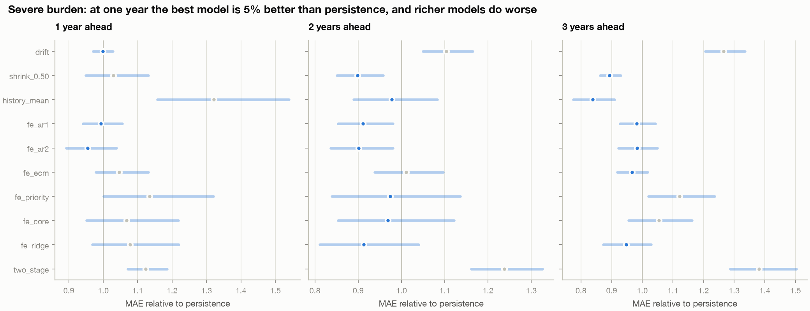

*Figure 5. Mean absolute error relative to persistence, severe burden, by model and horizon (95 percent intervals from resampling states; below 1 is better). At one year the best econometric model, the fixed-effects AR(2), is only about 5 percent better than the benchmark (its interval touches 1), and richer models do worse (twelve predictors 1.07, two-stage 1.12). At two years several models gain about 10 percent; at three years the state historical mean looks best (0.84) but fails without 2021 to 2023.*

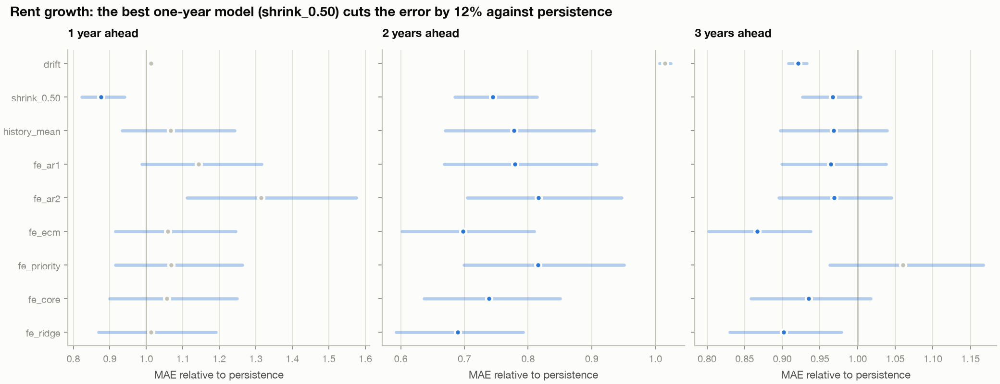

*Figure 6. The same comparison for rent growth. Here predictors help: the shrinkage forecast cuts the one-year error by 12 percent (0.88), and at two years ridge regression and error correction reach 0.69 and 0.70, though only three test years stand behind those two numbers.*

*The Bayesian state-space model.* The model that does best at one year starts from a simple idea. The number the Census publishes for a state is the true burden plus sampling noise, and we know how big that noise is because the Census publishes a margin of error. A small state with a large margin should be trusted less and pulled more toward its own history; a large state should barely move. In symbols, `observed = true + noise`, and the true value is a permanent state level, plus a national shock shared by all states, plus a persistent state-specific deviation.

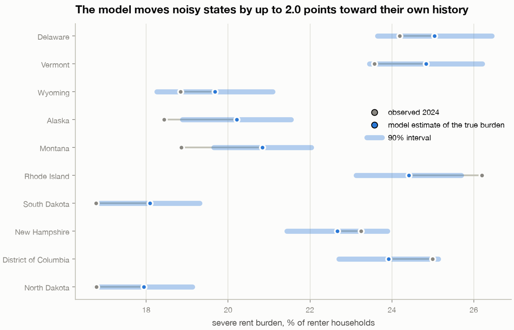

*Figure 7. The model's estimate of the true 2024 burden (blue, with 90 percent interval) against the published value (grey) for the ten noisiest states: Montana, Alaska, and Rhode Island move 1.8 to 2.0 points toward their own history; large, precisely measured states hardly move.*

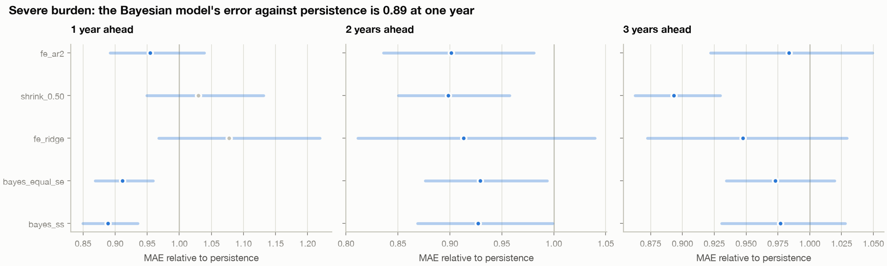

*Figure 8. Severe burden, error relative to persistence for the Bayesian model (bayes_ss), the same model with equal errors for every state, and three econometric rivals: 0.89 at one year (the margins of error are worth about two points of that), 0.93 at two years, and a tie at three.*

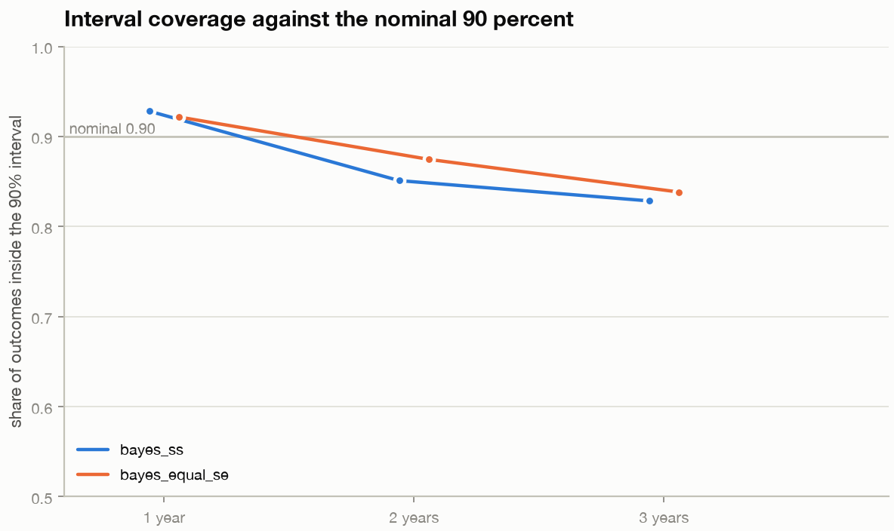

*Figure 9. How often the published value falls inside the model's 90 percent interval: 93 percent at one year, 85 and 83 percent at two and three. The intervals are close to honest one year out and too narrow beyond that, so read the two- and three-year intervals as optimistic.*

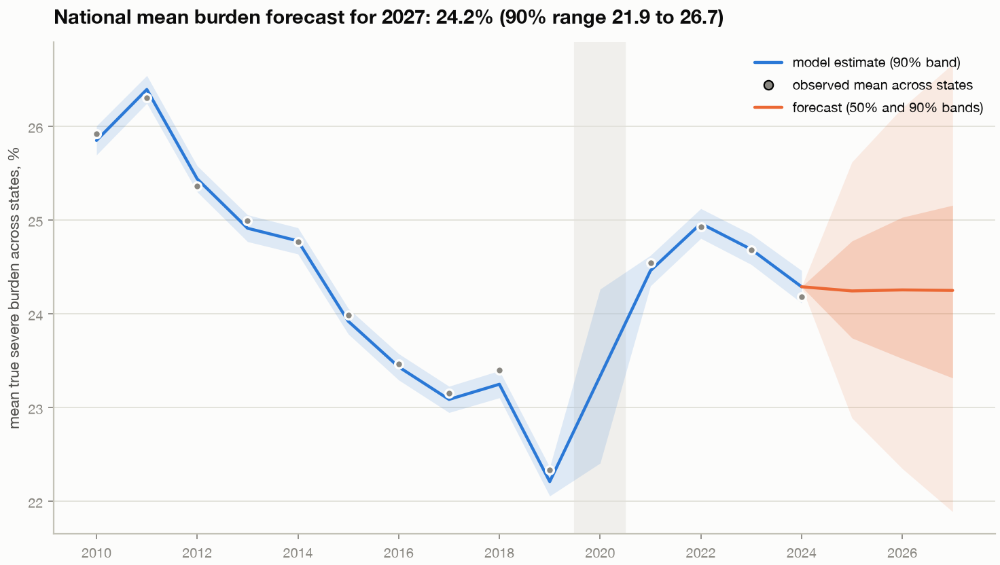

*Figure 10. The model's estimate of the national mean true severe burden (blue) and its forecast to 2027 (orange, 50 and 90 percent bands): 24.2 percent in 2027 with a 90 percent range of 21.9 to 26.7. The 2020 gap, when the Census released no standard 1-year survey, is shaded.*

The heart of the model is a Kalman filter: a standard algorithm that updates its belief about the hidden true values each time a new survey year arrives, and that skips a year (2020) with no survey without any special treatment. This is the function from `src/models/bayes.py` that does it. It is long, but the structure is simple: *predict* the next year from the last, then *update* with the new survey numbers, weighting each state by how precise its survey is (`SE`).

```python
def kalman(Y, SE, params, mu_a, n_ahead=0, store=False):
    """Filter the (S x K) observations Y (NaN where missing) with standard errors SE.
    params = (rho, sig_u, sig_g, sig_a). Returns a dict with the log likelihood, the filtered state at the last column, the n_ahead
    forecast states after it, and (if store) every predicted and filtered state for smoothing."""
    rho, su, sg, sa = params
    S, K = Y.shape
    D = 1 + 2 * S
    ia, iu = slice(1, 1 + S), slice(1 + S, 1 + 2 * S)
    F = np.concatenate([[1.0], np.ones(S), np.full(S, rho)])
    Q = np.zeros(D)
    Q[0], Q[iu] = sg ** 2, su ** 2
    m, P = _prior(S, rho, su, sg, sa, mu_a)
    ll = 0.0
    pred_m, pred_P, filt_m, filt_P = [], [], [], []
    for t in range(K):
        if t > 0:
            m = F * m
            P = F[:, None] * P * F[None, :]
            P[np.diag_indices(D)] += Q
        if store:
            pred_m.append(m.copy()); pred_P.append(P.copy())
        obs = np.flatnonzero(~np.isnan(Y[:, t]))
        if obs.size:
            # H selects g + a_i + u_i for each observed state i, so H P and H P H' are sums of slices of P
            PHt = P[:, [0]] + P[:, ia][:, obs] + P[:, iu][:, obs]                    # D x n
            Sc = PHt[[0], :] + PHt[ia, :][obs, :] + PHt[iu, :][obs, :]               # n x n
            Sc = Sc + np.diag(SE[obs, t] ** 2)
            z = Y[obs, t] - (m[0] + m[ia][obs] + m[iu][obs])
            try:
                L = np.linalg.cholesky(Sc)
            except np.linalg.LinAlgError:
                return {"loglik": -np.inf}
            w = np.linalg.solve(L, z)
            ll += -0.5 * (w @ w) - np.log(np.diag(L)).sum() - 0.5 * obs.size * np.log(2 * np.pi)
            Kg = np.linalg.solve(L.T, np.linalg.solve(L, PHt.T)).T                    # D x n
            m = m + Kg @ z
            P = P - Kg @ PHt.T
            P = 0.5 * (P + P.T)
        if store:
            filt_m.append(m.copy()); filt_P.append(P.copy())
    out = {"loglik": ll, "m": m, "P": P}
    ahead = []
    mm, PP = m.copy(), P.copy()
    for _ in range(n_ahead):
        mm = F * mm
        PP = F[:, None] * PP * F[None, :]
        PP[np.diag_indices(D)] += Q
        ahead.append((mm.copy(), PP.copy()))
    out["ahead"] = ahead
    if store:
        out.update(pred_m=pred_m, pred_P=pred_P, filt_m=filt_m, filt_P=filt_P, F=F)
    return out
```

(In the full study the filter's four settings, the persistence of state deviations and the three shock sizes, are sampled with an adaptive Metropolis algorithm on the exact likelihood. The code is in `src/models/bayes.py` in the full project; it is not part of this package.)

**Table B. Machine learning** (same features, splits, and test as Table A; scikit-learn)

| Model (standard name) | What it is, in plain words | Used for | Verdict | Evidence |
|---|---|---|---|---|
| Elastic Net regression | Linear regression with a combined L1 and L2 penalty that can drop predictors | State forecasts | Dropped | Reproduces the shrinkage forecast for rent growth (ratio to it 1.00005): the penalty removes every economic feature |
| Random forest | Many decision trees fitted to random subsets of the data and averaged | State forecasts; rescue classifier | Dropped | State burdens 1.07 to 1.29 of the econometric bar (one-year burden 0.979 against 0.89); rescue AUC 0.58 to 0.74 against 0.82 for the logistic regression |
| Gradient-boosted decision trees (histogram-based; XGBoost could not be loaded on this machine) | Trees built one after another, each correcting the errors of the last | State forecasts; rescue classifier | Dropped | One-year burden 0.978 against 0.89; rescue AUC 0.80 against 0.82; below the logistic regression in 22 of 24 comparisons with richer features |
| SHAP (Shapley additive explanations) | Splits each prediction among the inputs to show which ones matter | Explain the forests | Kept as a diagnostic | Mean-reversion inputs carry 72 and 86 percent of the importance; no economic feature moves a forecast by more than 0.05 points; for rescue, size and program carry 54 percent, tract context 25, location 11 |

No machine learning model was adopted for any of the 27 target-and-horizon cells.


**Reading Table B: why machine learning did not win**

We gave Elastic Net, random forests, and gradient boosting the same features, the same splits, and the same test, and asked them to beat the best econometric model for each target, not just persistence. They did not. The first picture shows each machine learning model's error as a multiple of the best econometric model's (1.0 means a tie); every point sits to the right of 1.

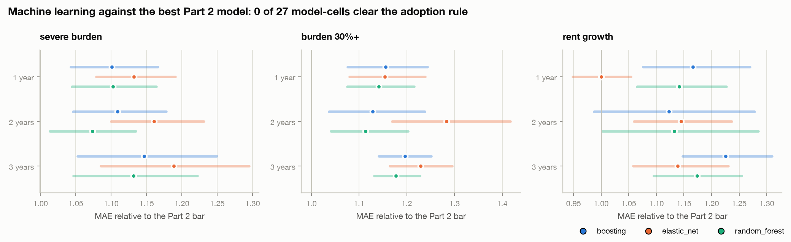

*Figure 11. Each machine learning model's error relative to the best econometric model for that target and horizon (intervals from resampling states). Every point is above 1: 0 of 27 model-cells clear the adoption rule, and in 25 of the 27 cells the interval lies entirely above 1.*

Why? The second picture opens the forests up. Almost everything they learned is mean reversion, the tendency of an unusually high value to fall back toward the state's usual level. That is what the simple models already capture.

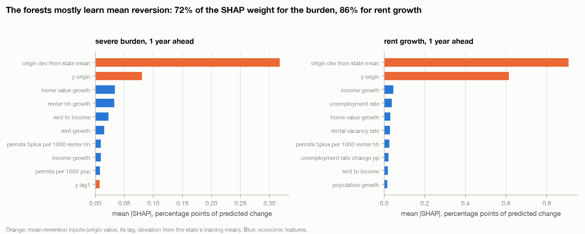

*Figure 12. Mean absolute SHAP value (a measure of how much each input moves the prediction, in percentage points) for a one-year-ahead forest. Orange bars are mean-reversion inputs: 72 percent of the weight for the burden and 86 percent for rent growth. Blue bars are economic features, none moving a forecast by more than 0.05 points.*

The same comparison for the property-level rescue classifier is in Example 6 (Section 5.2): gradient boosting reaches an AUC of 0.81 against 0.82 for the logistic regression.

**Table C. Property-level, scenario, and descriptive methods** (the methods behind the combined result)

| Model (standard name) | What it is, in plain words | Used for | Verdict | Evidence |
|---|---|---|---|---|
| Logistic regression (labeled the rescue model) | Regression for a yes-or-no outcome: models the odds that a property is re-subsidized from its log size and program group | Rescue of HOME and HUD subsidies | Kept | AUC 0.82 (probability that a rescued property scores above an unrescued one); each doubling of units multiplies the odds of rescue by 1.85 |
| Ridge-penalized logistic regression with state fixed effects and a linear cohort trend (labeled the LIHTC exit model) | A logistic regression with one intercept per state and a straight-line trend in placement year; the penalty pulls small states toward the national rate | LIHTC projects leaving the monitoring list | Kept | Project AUC 0.80; state-level error 0.134 against 0.253 for a national trend |
| Cohort life table (empirical termination curve; labeled the insured-mortgage cohort rates) | For each loan start year, the share of loans already terminated; a younger loan is projected with the share an older cohort had at the age it will reach; no fitted parameters | Insured mortgages ending early | Kept (a time-split model is not possible: termination dates are not in the data) | About half of loans started 2010 to 2012 have already terminated |
| Demographic projection with age-specific tenure (headship) rates, run as scenarios (labeled the stock-flow scenarios) | Renter households in each age band are scaled by the projected population of that age band, with each band's renter rate held fixed unless a scenario lets it drift | ELI renters in 2035 | Kept as scenarios, not forecasts | A hindcast overstates renter household growth by 2.0 points (5.96 against 3.94 percent); state error 3.9 against 5.3 for no change |
| Composite indicator with equal, expert, and principal-component weights (labeled the need index) | Seven measures converted to z-scores (distance from the state average in standard deviations) and averaged within three groups, then across groups | Need today | Kept as a descriptive index | Rank correlation 0.88 to 0.99 across weightings; the top eight ranks stable within two places |
| Logistic regression with state market conditions added | The rescue regression plus state rent, vacancy, and unemployment | Rescue classifier | Dropped | AUC 0.51 alone; property plus market 0.80, worse than property alone 0.83 |
| Richer features: tract neighborhood context, location, extra NHPD property fields | Additional inputs to the same classifiers | Rescue classifier | Dropped | Tract context adds nothing; location adds +0.02 AUC (the metro flag); the NHPD fields leak the outcome |
| Logistic regression with state fixed effects, adding county market-rent gap, county house price growth, or nonprofit sponsor | Tests whether a local market or sponsor measure explains outcomes within a state | LIHTC exit and rescue | Tested, no effect | Section 5.5 |
| Cox proportional hazards model (the design of Begley and Reina) | Models the timing of an event, such as an owner opting out | Opt-out timing | Not run | LIHTC exit is observed only as of 2024 and rescue is a new subsidy, not a dated owner decision |

### 2.3 Specifications of the kept models

In each line, *i* is a state and *t* is a year.

- **Two-way fixed-effects panel regression:** `burden[i,t] = a[i] + g[t] + b1*log(rent[i,t]) + b2*log(income[i,t]) + b3*X[i,t] + e[i,t]`, errors clustered by state.
- **Bayesian state-space model:** `y[i,t] = theta[i,t] + u[i,t]`, where `u[i,t]` is Normal with a known variance (the survey margin of error divided by 1.645), and `theta[i,t] = mu[i] + n[t] + d[i,t]`, with `n[t]` a random walk (the national shock) and `d[i,t]` a first-order autoregression (the state deviation).
- **Logistic regression (rescue):** `P(rescued within 3 years) = logistic(b0 + b1*log(total units) + program-group indicators)`.
- **Ridge-penalized logistic regression (LIHTC exit):** `P(left monitoring) = logistic(a[state] + c*(placement year - 1993))`, with an L2 penalty.
- **Demographic projection (scenarios):** `renter households[s,2035] = sum over age bands a of renters[s,a,2023] * pop[s,a,2035] / pop[s,a,2023]`, then `ELI renters = renter households * ELI share * exp(drift * years)`.
- **Cohort life table (insured mortgages):** `extra terminations = units * (F[age+9] - F[age]) / (1 - F[age])`, where `F` is the share of a cohort already terminated at a given age.

### 2.4 What model selection showed

1. **Most of the year-to-year movement in the burden is sampling noise** (76 percent of the variance of changes), so the models that did best were the ones that treat the noise explicitly or shrink toward a state level; adding predictors made one-year forecasts worse, not better.
2. **Flexible models did not help.** With 51 states and 14 years, forests and boosting can learn state identity but not dynamics and cannot extrapolate rents; they were beaten by the simple models in 25 of 27 cells with intervals excluding 1.
3. **At property level, one variable carries the prediction.** Size explains most of who is rescued, and adding neighborhood, market, or location features did not improve the out-of-sample AUC.
4. **LIHTC exit is an institutional pattern.** The state predicts it (AUC 0.79 from state alone) and project characteristics do not (0.52 across states), which cannot be separated into state policy and state reporting practice with these data.
5. **The market-incentive hypotheses did not hold.** Neither the rent gap nor house price growth nor sponsor type explained rescue or exit, and two earlier "significant" results were artifacts.
6. **All of this is association.** No model here shows that an intervention works; the planning arithmetic in Section 7 is conditional on stated assumptions.

**The one picture to remember from this section.** Every model we tried for the one-year severe-burden forecast, on the same scale, with econometric models in blue and machine learning in orange.


*Figure 13. Error relative to 'next year equals this year' for all 15 models tried on the one-year severe-burden forecast (below 1 is better). The Bayesian model (0.89) and fixed-effects AR(2) (0.95) lead, the two machine learning models that come close reach 0.98, and adding more predictors makes the econometric models worse, not better.*

A reasonable summary: the data are short and noisy, so the winning move is to respect the noise (the Bayesian model) or shrink toward each state's history, not to add power.

### 2.5 Directions for further work

1. **Dated LIHTC exits and extended-use periods** from state housing agencies, which would allow survival (Cox hazard) models of when projects leave, and a like-for-like test of the Begley and Reina factors.
2. **As-of-event owner, manager, and inspection history** (for example repeated NHPD snapshots), to test for-profit against nonprofit ownership and physical condition without the survivorship trap.
3. **Causal designs where state policy varies over time**, such as difference-in-differences on state qualified-contract or preservation rules; this needs dated policy data and a comparison group that are not yet sourced.
4. **An availability-adjusted affordable-unit gap** (CHAS Table 14B), to match the standard national measure.
5. **A time-series small-area model with random sampling variances** (a dynamic Fay-Herriot type), and wider intervals beyond one year, since the current intervals under-cover at two and three years.
6. **Refresh with 2025 data** (ACS, revised LIHTC placement years, a newer NHPD snapshot) and retest the rescue model on lapses through 2025.
7. **Local data for homelessness changes** (continuum-of-care counts), and **construction, land, and insurance costs** for the deferred investment index.

---

## 3. Data and cleaning: what is required

A handful of sources feed the combined answer (the table below, plus the FHFA house price index for one optional test). Raw files are never edited; each has one cleaning script that writes to `data/interim/`.

| Source | Role | Raw location | Obtained by | Cleaning script | Output |
|---|---|---|---|---|---|
| ACS 1-year, tenure by age of householder (B25007) and population by age (B01001), 2010 to 2024 | Renter households by age for the demand model | `data/raw/acs1_age/` | `fetch-acs-age-data.py` (Census API key) | `src/clean_acs_age.py` | `acs_age_tenure_state_year.csv` |
| Weldon Cooper Center population projections (2020 Census base; 2030, 2040, 2050) | Population by age to 2035 (2035 is interpolated) | `data/raw/state_population_projections/` | `fetch-population-projections.py` | `src/clean_population_projections.py` | `population_projection_age_sex.csv` |
| HUD CHAS (2010-2014, 2018-2022) | ELI share of renters; rent-affordable units | `data/raw/chas/` | Manual download | `src/clean_chas.py` | `chas_state_vintage.csv` |
| National Housing Preservation Database, All Subsidies and All Properties | Subsidy history: what happened when subsidies ended; the 2026 to 2035 expiry list; the insured-mortgage pathway | `data/raw/nhpd/` | Manual download (free account) | `src/clean_nhpd.py` | `nhpd_subsidies.csv.gz`, `nhpd_properties.csv.gz` |
| HUD LIHTC property database | LIHTC projects, placement year, and whether the agency still monitors them | `data/raw/lihtc/` | Manual download | `src/clean_lihtc.py` | `lihtc_projects.csv.gz` (project level) |
| HUD HOME rent limits, FY2019 and FY2024 (optional) | County gap between the market rent and the 60 percent restricted rent, tested as a predictor (no effect) | `data/raw/home_rent_limits/` | Manual download (HUD's site blocks scripts) | `src/clean_home_rent_limits.py` | `home_rent_limits_county.csv` |
| State market panel (ACS, BLS, BEA, HUD), 2010 to 2025 | State rent, income, vacancy, and unemployment at the time of each event (tested as predictors and found not to help) | `data/processed/panel.csv` | Built by the full project (not included); the table is included precomputed | (built from ACS, BLS, BEA, and HUD sources) | `panel.csv` |

**What the cleaned tables look like.** Each source ends as a plain table in `data/interim/` that any notebook reads with one `pd.read_csv` call:

| Table | One row is | Rows | Main columns |
|---|---|---|---|
| `nhpd_subsidies.csv.gz` | a subsidy | 209,262 | `property_id`, `program`, `status`, `start_year`, `end_year`, `assisted_units`, `inactive_reason` |
| `nhpd_properties.csv.gz` | a property | 121,333 | `property_id`, `state_fips`, `total_units`, `county_fips`, `tract_fips`, `n_active_subsidies` |
| `lihtc_projects.csv.gz` | a LIHTC project | 54,928 | `hud_id`, `state_fips`, `pis_year` (placed in service), `n_units`, `est_end_year`, `left_monitoring` |
| `chas_state_vintage.csv` | a state and a CHAS period | 204 | renters by income band and cost burden, rent-affordable units, derived rates |
| `acs_age_tenure_state_year.csv` | a state and a year | 714 | renter households, owner households, and population by age band |
| `population_projection_age_sex.csv` | a state, year, and sex | 765 | population by five-year age band for 2020, 2030, 2035, 2040, 2050 |
| `home_rent_limits_county.csv` | a county and a fiscal year | 6,287 | fair market rents and HOME rents by bedroom count, the 60 percent rent, and the gap |
| `fhfa_hpi_county.csv` | a county and a year | 106,252 | house price index and 1, 5, 10-year growth |

All state keys are two-character FIPS strings (`"06"` is California), so any table joins to any other on `state_fips`.

The **project-level LIHTC table** (`src/clean_lihtc.py` writes one row per project with recoded fields and asserts that the monitored count matches the file) and the **ACS age tables** are the two sources built for this analysis. `DATA.md` logs how each source was obtained, its reference period, and its quirks. The raw downloads are not included (about 280 MB), apart from two small CHAS tables that the need-index notebook reads; the cleaned tables that every notebook reads are.

To rebuild every notebook from the cleaned tables (about 14 minutes; no raw data needed):

```bash
uv run src/run_short_report.py
```

This runs the eighteen notebooks listed in Section 9 in order. Adding `all` also re-runs the six cleaning scripts, which need the raw downloads described in `DATA.md` placed under `data/raw/`.

---

## 4. What the data look like: exploratory analysis (`notebooks/01_eda/`)

Before choosing models, five notebooks check what the data can and cannot support. All five are in this package and read the included `data/processed/panel.csv`. This is where most of the modeling choices in Section 5 come from.

### 4.1 Coverage (`01_coverage.py`)

The annual core is complete for all 51 states. The modeling target, the ACS share of renters paying 50 percent or more of income on rent ("severe burden"), is observed in 714 state-years, which makes 612 year-to-year changes. The gaps are 2020 (the Census Bureau did not release a standard 1-year ACS), 2025 (not yet published), and the CHAS snapshots, which exist only for four multi-year windows and so are never treated as an annual series. Eleven known breaks (for example HUD's redefinition of the extremely low income limit in fiscal 2014 and its change of program categories in the subsidized-households data) are tabulated and flagged in the panel.

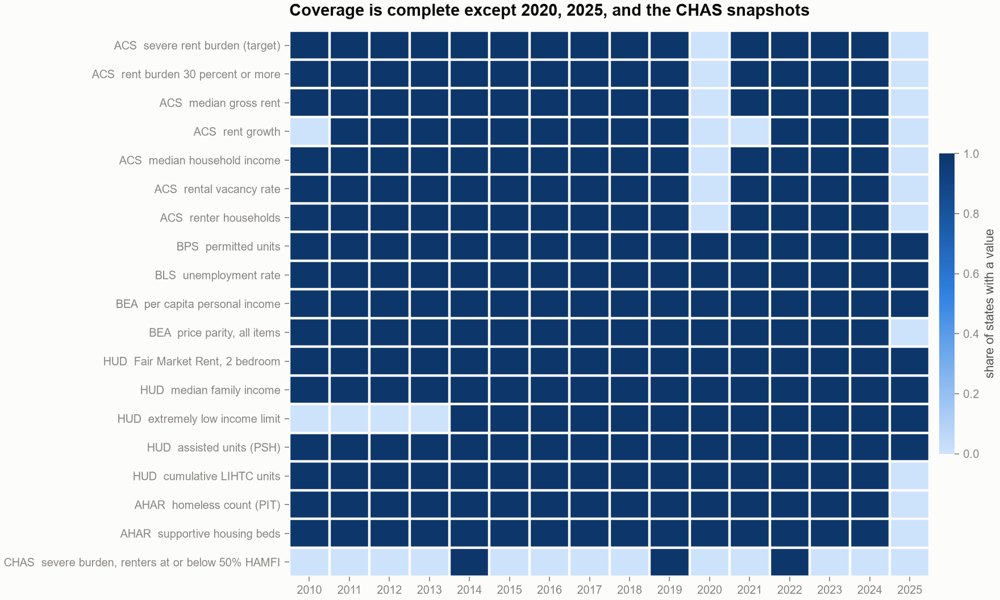

*Figure 14. Share of states with a value, by variable and year (dark means all 51). Gaps are 2020 and 2025 for ACS, and CHAS appears only for its window end years.*

### 4.2 Signal versus noise (`02_signal_vs_noise.py`)

**In plain words.** The Census does not count every household; it asks a sample. So every state's burden number is an estimate with a margin of error around it, and in small states that margin is as big as a typical year-to-year change. That matters for everything that follows: a one-year rise in Wyoming is not news, and a model that treats it as news will chase noise.

The ACS is a sample, so each state's burden carries a margin of error: a median of 1.07 percentage points, about 2.8 to 2.9 in Wyoming, Vermont, and Delaware, and about 0.5 in California and Texas. Of the variance in the severe burden, 73.5 percent is between states, 12.0 percent is common year effects, and 14.4 percent is left over, a mixture of real state movement and noise.

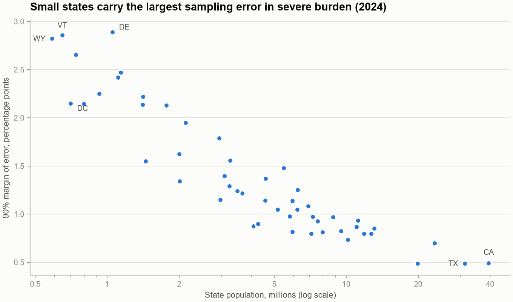

*Figure 15. The 90 percent margin of error of severe burden against state population, 2024: small states carry the largest sampling error.*


*Figure 16. Severe burden over time with the 90 percent margin of error shaded, for Wyoming (median margin 2.8 points), Kentucky (1.1), and California (0.3). In Wyoming the shaded band is as wide as the year-to-year swings, so most of the movement could be sampling luck; in California the margin is a sliver.*

Sampling error alone accounts for about 76 percent of the variance of year-to-year changes in severe burden (22 percent for rent growth, so rent growth carries real signal). A simulation with state and year effects plus sampling noise reproduces the data closely: observed spread of changes 1.38 points against 1.28 simulated.

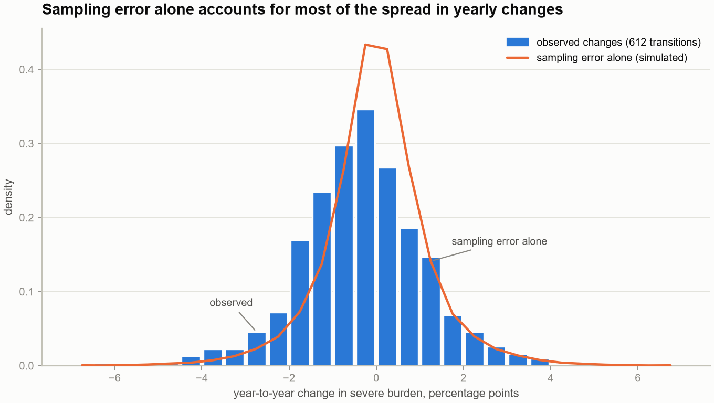

*Figure 17. Year-to-year changes in severe burden (bars) against what sampling error alone would produce (line). Most of the movement is noise; a little real state-specific movement remains.*

This sets a ceiling: an oracle that knew every state's true burden would still miss the next published value by 0.61 points on average, against 1.09 for "next year equals this year". Even a perfect model can gain at most 44 percent over that baseline, and in practice far less.

#### Example 3: How noisy is the series, and what does the benchmark score?

This script does four things: splits the variation in severe burden into between-state, common-year, and leftover parts; measures the margin of error; scores 'next year equals this year' on the 612 consecutive-year changes; and checks how many changes are smaller than the survey's own uncertainty.

```python
"""
Example 3: how noisy is the rent-burden series, and what does "next year equals this year" score?

Run from the project root:   uv run examples/03_noise_and_baseline.py
Reads data/processed/panel.csv (one row per state and year).
"""
import numpy as np
import pandas as pd

panel = pd.read_csv("data/processed/panel.csv", dtype={"state_fips": str})
d = panel.dropna(subset=["severe_rent_burden_pct"]).sort_values(["state_fips", "year"]).copy()
print(f"state-years with the target: {len(d)} ({d.state_fips.nunique()} states, {d.year.nunique()} years)")

# 1. Where does the variation sit? Peel off state averages, then year averages; what is left is the remainder.
y = d["severe_rent_burden_pct"]
total_ss = ((y - y.mean()) ** 2).sum()
state_part = d.groupby("state_fips")["severe_rent_burden_pct"].transform("mean") - y.mean()
resid_1 = y - y.mean() - state_part
year_part = resid_1.groupby(d["year"]).transform("mean")
rest = resid_1 - year_part
print("\nshare of the variance in severe burden")
print(f"  between states      {100 * (state_part ** 2).sum() / total_ss:5.1f} %")
print(f"  common year shocks  {100 * (year_part ** 2).sum() / total_ss:5.1f} %")
print(f"  left over           {100 * (rest ** 2).sum() / total_ss:5.1f} %   (real state movement plus sampling noise)")

# 2. How big is the sampling error? The ACS publishes a 90 percent margin of error with every estimate.
moe = d["severe_rent_burden_pct_moe"]
print(f"\n90 percent margin of error: median {moe.median():.2f} points, 90th percentile {moe.quantile(0.9):.2f}, maximum {moe.max():.2f}")
last = d[d.year == 2024].set_index("state_fips")
print("  2024:", ", ".join(f"{s} {last.loc[f, 'severe_rent_burden_pct_moe']:.1f}" for s, f in (("WY", "56"), ("VT", "50"), ("CA", "06"), ("TX", "48"))))

# 3. The benchmark: predict next year's value with this year's value (persistence).
d["next"] = d.groupby("state_fips")["severe_rent_burden_pct"].shift(-1)
d["next_year"] = d.groupby("state_fips")["year"].shift(-1)
pairs = d[(d.next_year == d.year + 1)].dropna(subset=["next"])          # only true consecutive years (2020 is missing)
err = (pairs["next"] - pairs["severe_rent_burden_pct"]).abs()
print(f"\npersistence error over {len(pairs)} year-to-year changes: mean absolute error {err.mean():.2f} points")

# 4. What share of those changes is smaller than the survey's own uncertainty? Combine the margins of the two years.
d["next_moe"] = d.groupby("state_fips")["severe_rent_burden_pct_moe"].shift(-1)
pairs = d[(d.next_year == d.year + 1)].dropna(subset=["next", "next_moe"])
combined_moe = np.sqrt(pairs["severe_rent_burden_pct_moe"] ** 2 + pairs["next_moe"] ** 2)
inside = (pairs["next"] - pairs["severe_rent_burden_pct"]).abs() <= combined_moe
print(f"changes smaller than the combined margin of error of the two years: {100 * inside.mean():.0f} %")
```

Output, as produced when this report was written:

```text
state-years with the target: 714 (51 states, 14 years)

share of the variance in severe burden
  between states       73.5 %
  common year shocks   12.0 %
  left over            14.4 %   (real state movement plus sampling noise)

90 percent margin of error: median 1.07 points, 90th percentile 2.22, maximum 3.55
  2024: WY 2.8, VT 2.9, CA 0.5, TX 0.5

persistence error over 612 year-to-year changes: mean absolute error 1.09 points
changes smaller than the combined margin of error of the two years: 75 %
```

**How to read it.** About three quarters of the variation is simply which state you are in (Florida is high, the Dakotas are low, year after year). Only 14 percent is left once you strip out state and year, and that remainder mixes real movement with noise. The benchmark misses by 1.09 points on average, and in three quarters of year-to-year changes the move is smaller than the combined margin of error of the two years.

### 4.3 Trends (`03_trends.py`)

From 2010 to 2024 the median state's rent index reached 162 and its household income index 161, and rent outgrew income in 38 of 51 states (by a median 2.9 points; Colorado, Arizona, Utah, Washington, Nevada, and Texas by 20 points or more; DC is the main exception). Rent as a share of income rose in 38 states and fell in 13.


*Figure 18. Median-state rent and household income, 2010 = 100, with the national rent CPI and per capita personal income for context. The ACS lines break at 2020, when there was no 1-year release.*

The target moved in a U shape: median severe burden 26.2 percent in 2010, 22.1 in 2019, 25.1 in 2021, and 24.4 in 2024, with a 2024 range of 16.8 percent (North and South Dakota) to 32.1 (Florida). The break is rent growth, not unemployment: median rent growth ran 1.5 to 3.6 percent a year in 2011 to 2019, then 7.8, 7.4, and 5.4 in 2022 to 2024.

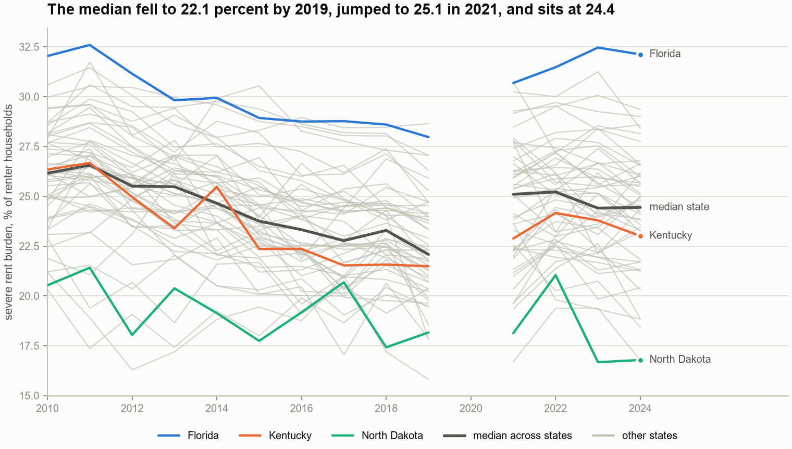

*Figure 19. Severe rent burden by state (grey), the median state (dark), and three highlighted states; the median fell to 22.1 percent by 2019 and jumped to 25.1 in 2021. The gap is 2020.*

State rankings are persistent (the three-year averages for 2010 to 2012 and 2022 to 2024 correlate 0.87), and 40 of 51 states improved over the period; Nevada, Texas, and Maryland worsened.

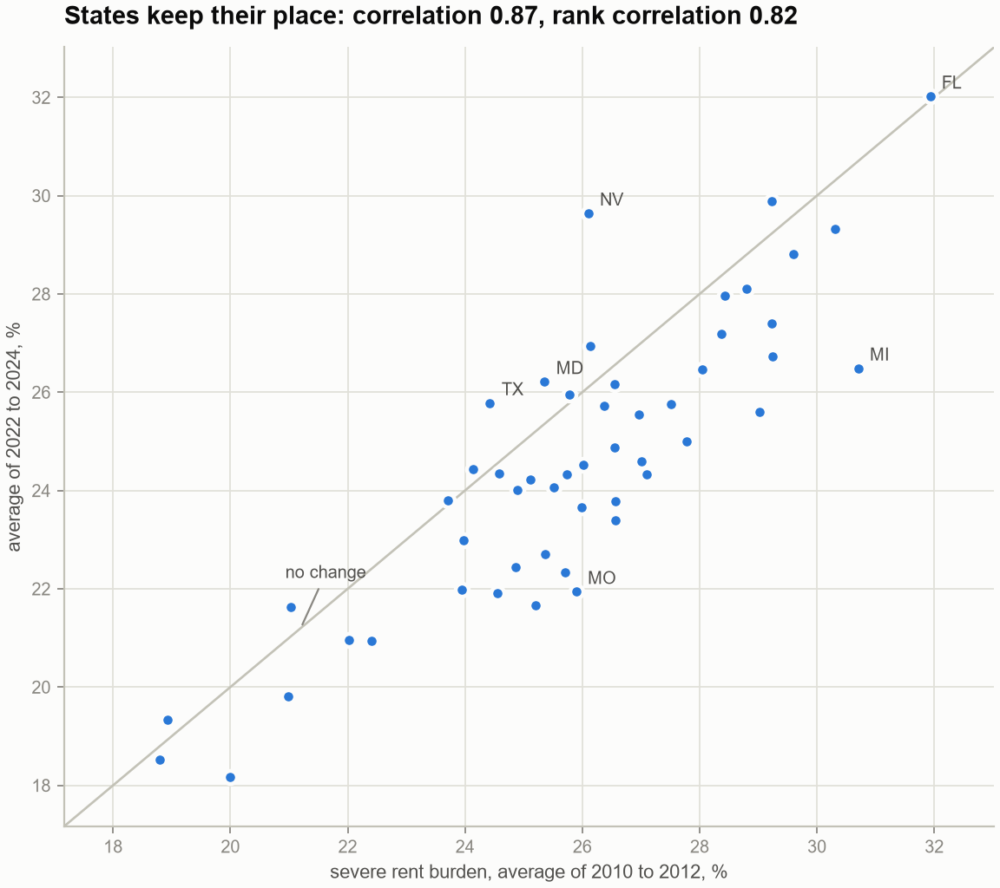

*Figure 20. Each state's severe burden in 2010 to 2012 (horizontal) against 2022 to 2024 (vertical); the grey line is no change. Correlation 0.87 (rank correlation 0.82). Florida stays at the top; Nevada, Texas, and Maryland moved up; Michigan and Missouri improved the most.*

### 4.4 Need today (`04_need_today_ahni.py`)

This notebook builds the need index and its rank intervals; the results are in Section 5.0 below (Figures 22 and 23 there).

### 4.5 Relationships and overlap (`05_relationships.py`)

All correlations here are within state and year (state and year averages removed), using only what was known at the time. The twelve core predictors overlap little (variance inflation 1.1 to 1.8), except the two building-permit measures, which are used one at a time.

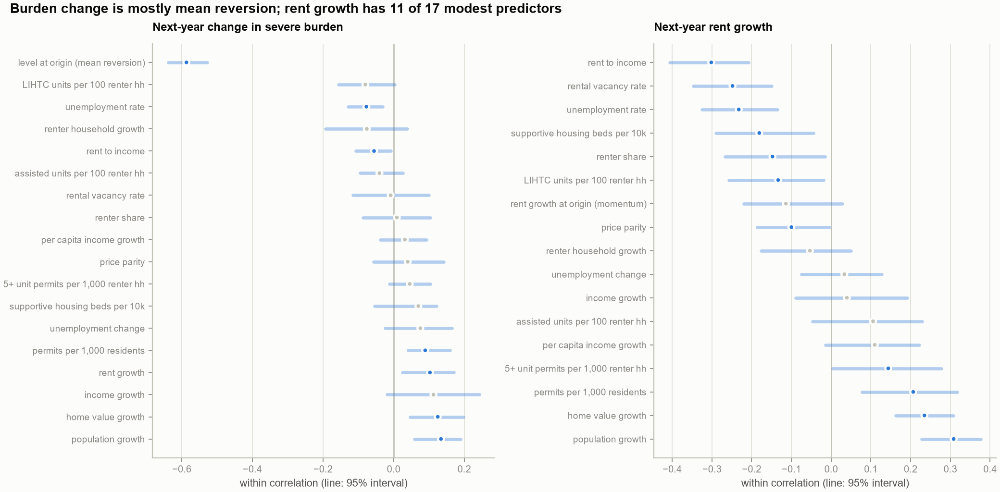

*Figure 21. Within-state correlations (95 percent intervals) of next-year change in severe burden (left) and next-year rent growth (right) with candidate predictors. Burden change is mostly mean reversion (-0.59); no economic predictor exceeds 0.13. Rent growth has 11 of 17 predictors with the expected sign, led by population growth (+0.31) and rent to income (-0.30).*

### What the exploration changed in the plan

- **Judge every forecast against persistence and the 0.61 floor**, and report results with and without 2021 to 2023 (the post-2021 rent shock is a different regime).
- **Treat ACS margins of error as known measurement error**, which is why the state-level forecasting model is a measurement-error state-space model (not part of this package; see `README.md`).
- **Do not rank states on one year of the burden.** The need index uses multi-year averages and shows rank intervals.
- **Expect little for machine learning to find** in the burden (mean reversion dominates) and more in rent growth; the later machine learning tests confirmed this.
- **Use CHAS for ranking, not for panel regressions:** it has four snapshots per state and ranks stay almost fixed between them (rank correlation 0.92 to 0.97).

---

## 5. The models

### 5.0 Where need is greatest today (`notebooks/01_eda/04_need_today_ahni.py`)

**Method (standard name):** Composite indicator (z-score aggregation) with rank intervals from resampling the survey error.

**In plain words.** The need index is a report card. It scores every state on how many renters are stretched, how few affordable homes there are, and how fast rents have outrun incomes, and then averages the scores. A high score means more need today; it says nothing about the future.

The need index measures today's need, not the future. It combines seven components in three dimensions, each a z-score across states: **burden** (severe and 30-percent rent burden, and severe burden among low-income renters), **gap** (affordable units per 100 extremely low income renters, rental vacancy), and **pressure** (rent as a share of income, rent growth minus income growth), with the dimensions equally weighted.


*Figure 22. Need index by state, 2022-24: the highest-need states are Florida, Nevada, California, Arizona, Oregon, New Jersey, Colorado, New York, Georgia, and Virginia; the lowest are North Dakota, South Dakota, Wyoming, Alaska, West Virginia, and Iowa.*

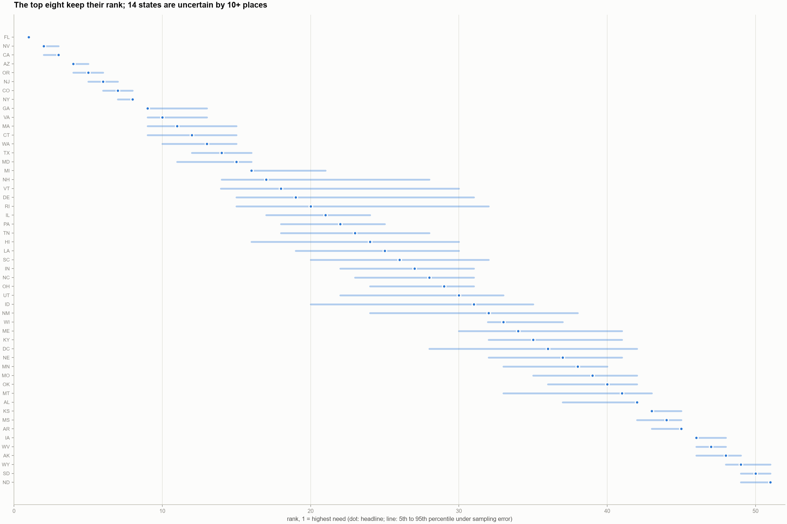

*Figure 23. Rank intervals from 1,000 redraws of the survey error: the top eight states keep their rank within two places, while 14 states, mostly small ones in the middle, have intervals ten or more places wide.*

- **Always quote a rank with its interval.** Weighting choices matter little (rank correlations 0.88 to 0.99 across four weightings).
- **It is not a homelessness predictor** (rank correlation 0.34 with the point-in-time rate): it measures burden and supply.

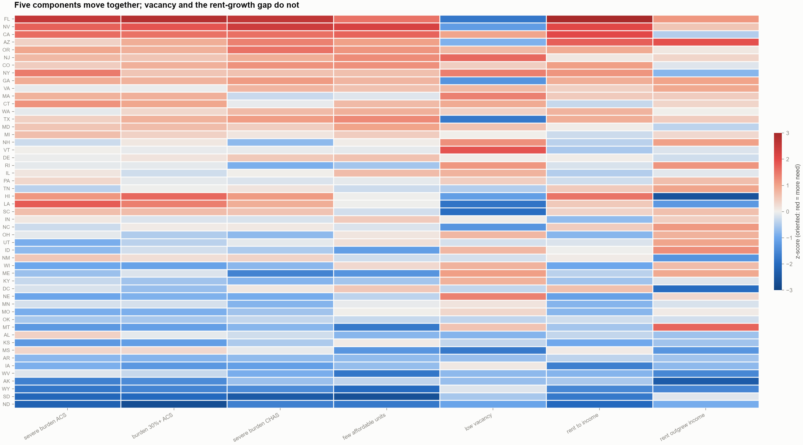

*Figure 24. Z-scores of the seven need-index components for every state, sorted by index (red means more need, blue less). Five components move together; low vacancy and the rent-growth gap do not fit the pattern, which is why the index is also tested with them dropped.*

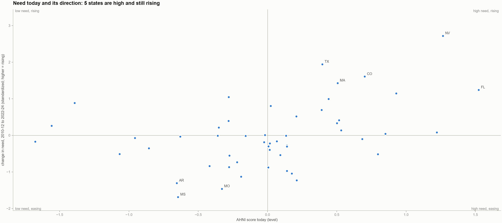

*Figure 25. Need score today (horizontal) against the change in need since 2010-12 (vertical). Nevada is high and rising fastest; Florida, Colorado, Massachusetts, and Texas also rise; Mississippi, Missouri, and Arkansas are low and easing.*

#### Example 4: Build the need index step by step

Seven measures per state are converted to z-scores (how many standard deviations above or below the average state, signed so that higher always means more need), averaged within three groups, and combined. The script then redraws every measure within its survey error 1,000 times to see how much the ranking could change.

```python
"""
Example 4: build the need index step by step, and see how sure we can be of the ranking.

Run from the project root:   uv run examples/04_need_index.py
Seven measures per state -> z-scores (distance from the average state, in standard deviations, signed so that higher always means
more need) -> three groups (burden, gap, pressure) averaged -> one score. Then redraw every measure within its survey error 1,000 times.
"""
import sys
sys.path.insert(0, "src")
import pandas as pd

import ahni

panel = pd.read_csv("data/processed/panel.csv", dtype={"state_fips": str})
est = ahni.build_components(panel)            # one value and one standard error per measure and state (2022-24 averages, CHAS 2018-2022)
z = ahni.zscores(est)                         # z-scores, capped at plus or minus 3
dims = ahni.dimension_scores(z)               # burden, gap, pressure
score = ahni.index_from_z(z, ahni.SCHEMES["equal dimensions (headline)"])
rank = ahni.rank_of(score)                    # 1 = highest need

print("highest need:", ", ".join(rank.sort_values().index[:10]))
print("lowest need: ", ", ".join(rank.sort_values().index[-6:][::-1]))

ranks = ahni.monte_carlo(est, n=1000)         # 1,000 redraws of every measure within its standard error
width = ranks.quantile(0.95) - ranks.quantile(0.05)
top = ranks.loc[:, rank[rank <= 8].index]
print(f"\ntop eight stay within two places of their headline rank in {100 * ((top - rank[top.columns]).abs() <= 2).mean().mean():.1f} percent of draws")
print(f"states whose 90 percent rank interval is 10 or more places wide: {int((width >= 10).sum())}")
schemes, loadings, pc_share = ahni.all_schemes(z)
print("rank correlation of each weighting with the headline:", schemes.apply(ahni.rank_of).corrwith(rank, method="spearman").round(2).to_dict())
```

Output, as produced when this report was written:

```text
highest need: FL, NV, CA, AZ, OR, NJ, CO, NY, GA, VA
lowest need:  ND, SD, WY, AK, WV, IA

top eight stay within two places of their headline rank in 99.8 percent of draws
states whose 90 percent rank interval is 10 or more places wide: 14
rank correlation of each weighting with the headline: {'equal dimensions (headline)': 1.0, 'expert (burden 50, gap 30, pressure 20)': 0.98, 'equal components': 0.99, 'first principal component': 0.88}
```

**How to read it.** The ranking at the top is solid: the eight highest-need states hold their rank to within two places in 99.8 percent of the redraws. In the middle it is not: 14 states, mostly small ones, have rank intervals ten or more places wide. The three alternative weightings (equal components, expert weights, principal components) agree with the headline at 0.88 to 0.99 rank correlation. Quote ranks with their intervals.

### 5.1 Demand: stock-flow scenarios (`notebooks/04_scenarios/01_stock_flow.py`)

**Method (standard name):** Demographic projection with age-specific tenure (headship) rates, run as three scenarios.

**In plain words.** Think of it as a headcount by age. Younger adults rent more and older adults less, so when a state's population grows or ages the number of renters changes even if nobody changes their behavior. We take today's renters in each age group and scale each group by how much that age group is projected to grow.

Renter households by age of householder (ACS 2022-24, eight age bands) grow with the projected population in the same band, holding each band's renter rate fixed. Extremely low income (ELI) renters are renter households times the CHAS 2018-2022 ELI share. The low and high scenarios let renter rates and the ELI share drift at the 10th and 90th percentile of their historical drift across states. These are **scenarios, not forecasts**, and 2023 and 2035 are interpolations of the Cooper years.

**How it works (excerpt from `src/scenarios.py`, comments added).**

```python
base_r = window_mean(acs, BASE_WINDOW, "hh_renter")   # renter households by age band, ACS 2022-24 mean
growth = pop / base_pop                               # projected population relative to the base year, by age band
stock = (base_r * growth).sum(axis=1)                 # renter households if each age band keeps its renter rate
r = stock * np.exp(g_rate * dt)                       # scenario drift in the renting rate (0 in the baseline)
eli = r * share * np.exp(g_eli * dt)                  # ELI renters = renter households x CHAS ELI share (with drift)
```

**Worked example, Idaho.** In 2023 Idaho has about 34,956 ELI renter households and 25,945 rent-affordable units, 74 per 100. The baseline projects 22.9 percent more ELI renters by 2035 (the fastest in the country), so holding 74 units per 100 needs about 5,946 more affordable units. The low scenario (renting keeps falling) needs none; the high scenario needs 7,467.


*Figure 26. Extremely low income (ELI) renter households, 2023 to 2035: 11.6 million in the baseline, 12.1 million in the high scenario, 8.6 million in the low scenario. The spread comes from assumptions about renting, not from demographics.*

| Scenario | ELI renters, 2035 | Change from 2023 (10.9 million) |
|---|---|---|
| Baseline (rates and share constant) | 11.6 million | +6.0 percent |
| High | 12.1 million | +11 percent |
| Low | 8.6 million | -21 percent |
| Reference: median historical drift | 10.4 million | -5 percent |

- **Check against the past:** applying 2014-16 renter rates to the actual 2022-24 age structure overstated renter household growth for 2015 to 2023 by 2.0 points (5.96 against 3.94 percent) but beat "no change" on state error (3.9 against 5.3 points). Age structure captures part of the geographic pattern and overstates the level.
- **Reading:** demographics alone add about 0.65 million ELI renters by 2035, but renter rates and the ELI share fell in most states over the last decade, so the direction of the national change depends on whether that drift continues. The data cannot settle it. The piece used below is the baseline requirement of 341,000 units.

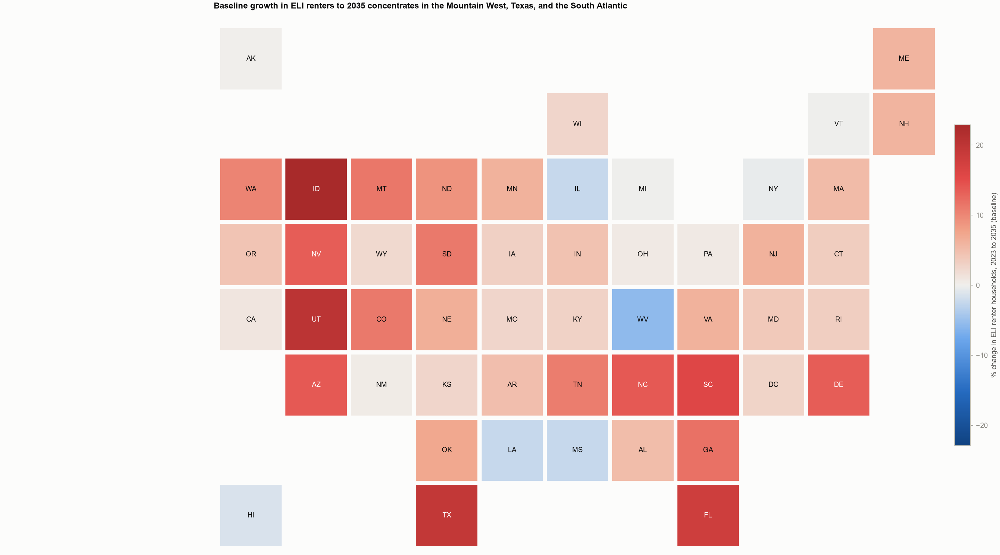

*Figure 27. Baseline change in ELI renter households, 2023 to 2035, by state: growth concentrates in the Mountain West, Texas, Florida, and the Carolinas (Idaho +23 percent), while eight states fall.*

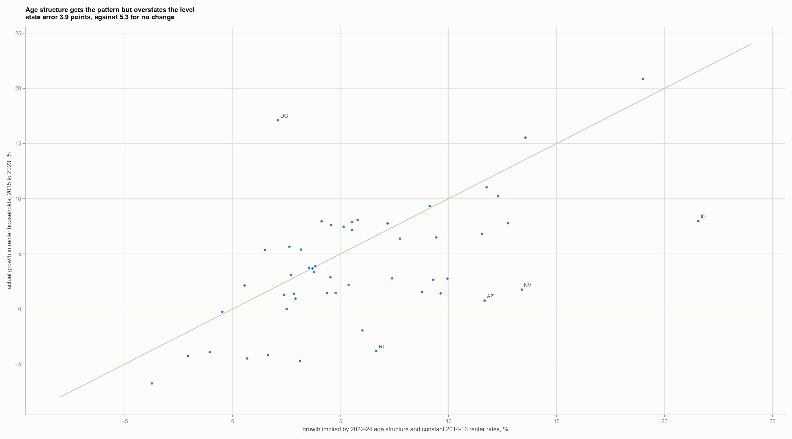

*Figure 28. Growth in renter households 2015 to 2023 implied by 2014-16 renter rates and the 2022-24 age structure (horizontal) against actual growth (vertical). The pattern is right but the level is too high (5.96 against 3.94 percent on average); Idaho, Nevada, and Arizona grew much less than age structure suggests and DC much more. State error is 3.9 points against 5.3 for assuming no change.*

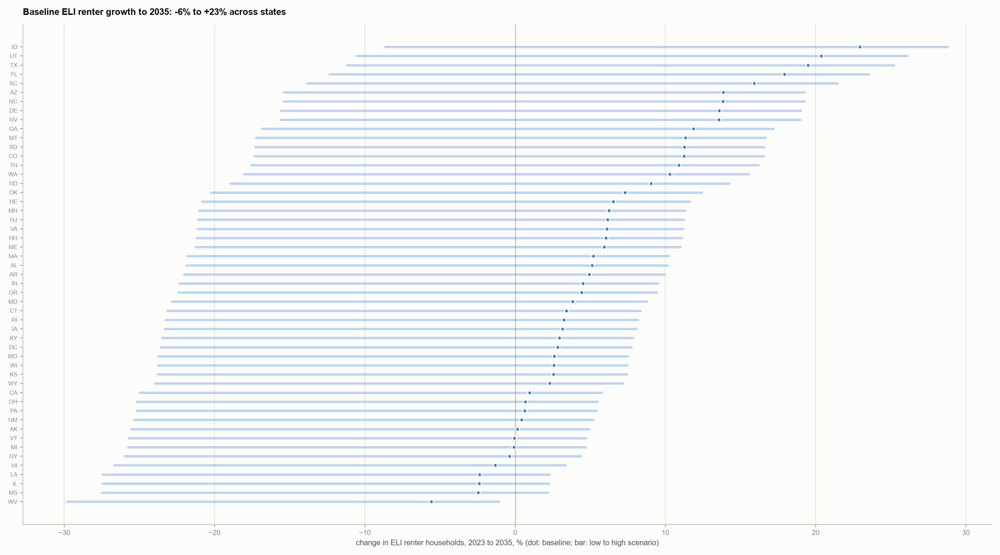

*Figure 29. Baseline change in ELI renter households 2023 to 2035 for every state (dot) with the low-to-high scenario range (bar): from -6 percent in West Virginia to +23 percent in Idaho. The bars are wide because the low and high scenarios let renting rates drift as fast as they did in the last decade.*

#### Example 5: Three demand scenarios

The script loads the cleaned inputs, measures how renting actually drifted in the past, projects renter households and ELI renters to 2030 and 2035, and checks the mechanism against 2015 to 2023.

```python
"""
Example 5: how many extremely low income (ELI) renter households will there be in 2035? Three scenarios.

Run from the project root:   uv run examples/05_demand_scenarios.py
Renter households by age of householder, grown with the projected population of the same age; ELI share from CHAS.
"""
import sys
sys.path.insert(0, "src")
import pandas as pd

import scenarios as S

acs, cooper, chas, panel = S.load_inputs()
drift = S.historical_drift(acs, chas)                 # how renter rates and the ELI share actually drifted, 2015 to 2023, state by state
print("share of states where renter rates fell:", f"{100 * (drift.g_rate < 0).mean():.0f} %", "| ELI share fell:", f"{100 * (drift.g_eli < 0).mean():.0f} %")

result = S.project(acs, cooper, chas, years=(2030, 2035), drift=drift)
national = result.groupby(["scenario", "year"])[["renter_hh", "eli_renters"]].sum() / 1e6
print("\nnational totals, millions")
print(national.round(2).unstack("scenario").to_string())

base = result[(result.scenario == "baseline")].pivot(index="state_fips", columns="year", values="eli_renters")
change = (100 * (base[2035] / base[2023] - 1)).sort_values()
names = panel.groupby("state_fips").state_abbr.first()
print("\nbaseline change in ELI renters, 2023 to 2035:")
print("  largest rises: ", ", ".join(f"{names[s]} {v:+.0f}%" for s, v in change.tail(4)[::-1].items()))
print("  largest falls: ", ", ".join(f"{names[s]} {v:+.0f}%" for s, v in change.head(3).items()))

h = S.hindcast(acs)                                   # test of the mechanism on the past: does age structure alone explain 2015 to 2023?
print(f"\nhindcast, mean growth 2015 to 2023: actual {h.actual_growth_pct.mean():.2f}% against {h.age_rates_growth_pct.mean():.2f}% predicted from age structure")
```

Output, as produced when this report was written:

```text
share of states where renter rates fell: 63 % | ELI share fell: 80 %

national totals, millions
         renter_hh               eli_renters              
scenario  baseline   high    low    baseline   high    low
year                                                      
2023         45.66  45.66  45.66       10.92  10.92  10.92
2030         47.91  48.87  44.75       11.41  11.73   9.60
2035         48.71  50.38  43.33       11.57  12.12   8.60

baseline change in ELI renters, 2023 to 2035:
  largest rises:  ID +23%, UT +20%, TX +19%, FL +18%
  largest falls:  WV -6%, MS -2%, IL -2%

hindcast, mean growth 2015 to 2023: actual 3.94% against 5.96% predicted from age structure
```

**How to read it.** In the baseline, where renting rates hold, the country adds about 0.65 million ELI renters by 2035. The spread to 12.1 million (high) and 8.6 million (low) is much larger than that, and it comes from one assumption: whether the long decline in renting continues. That is why these are scenarios and not forecasts. The hindcast line is the honest caveat: age structure alone gets the pattern but overstates growth by two points.

### 5.2 HOME and HUD-program subsidies: who is rescued? (`notebooks/05_preservation/01_preservation_model.py`)

**Method (standard name):** Logistic regression (a regression for a yes-or-no outcome) on log property size and program group, tested on later years.

**In plain words.** When a subsidy runs out, someone decides whether to renew it, replace it, or let the building go market-rate. We looked at 12,822 past cases and asked what the buildings that got a new subsidy had in common. The answer is mostly size: big buildings tend to be saved, small ones rarely are.

From the NHPD subsidy history: 12,822 properties whose last subsidy lapsed in 2011 to 2023, and whether each was re-subsidized within three years (1.5 percent were; 9.2 percent of HUD-program properties). Features known at the time: property size and assisted units, program group, subsidy age, and state market conditions. Tested on a time split (train through 2015, test 2019 to 2023; a second split agrees).

**How it works (simplified excerpts from `src/preservation.py`).** An *event* is a property whose last subsidy ended with "End Date Passed" in 2011 to 2023. The label asks whether it got a new subsidy within three years; the model is a logistic regression on size and program group, scored on a later time period:

```python
# label: any subsidy that starts in [Y, Y+3] and runs past Y (Y is the year the last subsidy ended)
new = sub[(sub.start_year >= sub.Y) & (sub.start_year <= sub.Y + HORIZON) & ((sub.end_year > sub.Y) | sub.end_year.isna())].property_id.unique()
ev["resub_3y"] = ev.index.isin(new).astype(int)

SPLITS = {"main": (2015, 2019)}     # train on lapses up to 2015, test on lapses from 2019 (the gap keeps label windows apart)
model = make_pipeline(StandardScaler(), LogisticRegression(C=0.5, max_iter=5000))
model.fit(train[["log_total_units", "g_hud", "g_lihtc", "g_rhs", "g_other"]], train.resub_3y)
```

**Worked examples.** Four real events and three properties scored for 2026 to 2035 (`p_rescue` is the chance of rescue *if the subsidy lapses*; expected unrescued units = units x (1 - `p_rescue`)):

| Event: property | State | Lapse year | Program group | Total units | Rescued within 3 years? |
|---|---|---|---|---|---|
| 1002756 | IL | 2014 | HUD program | 284 | yes |
| 1013002 | NH | 2021 | HOME only | 24 | yes |
| 1053461 | MD | 2016 | HOME only | 76 | no |
| 1183546 | MA | 2015 | HOME only | 61 | no |

| Scored: property | State | Program group | Total units | `p_rescue` |
|---|---|---|---|---|
| 1019547 | NC | HUD program | 7 | 1.5 percent |
| 1027791 | CA | HUD program | 67 | 9.7 percent |
| 1013126 | VA | HOME only | 16 | 1.8 percent |

Rescues are rare (189 of 12,822 events), and size is what separates them: a 7-unit property has a chance near 1 percent, a 200-unit one near 28 percent.

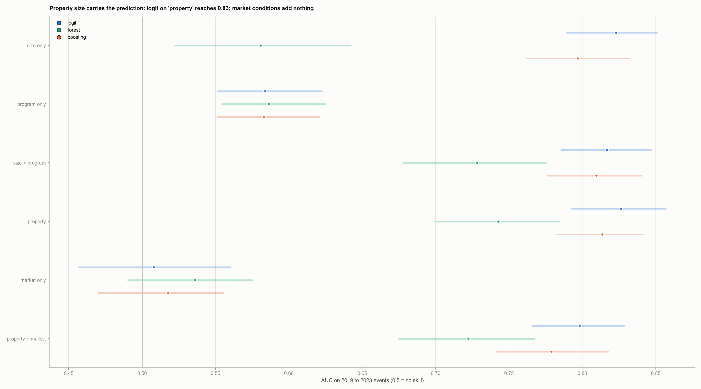

*Figure 30. Rescue-model AUC (2019 to 2023 events) by feature set and model: property size carries the prediction, the logistic regression is as good as anything, and state market conditions add nothing.*

- **Size predicts rescue; nothing else adds to it.** Logistic regression on property size alone has an AUC of 0.82 (90 percent interval 0.79 to 0.85) and the top fifth of scores holds 65 percent of the rescued properties. Boosting (0.80) and a random forest (0.58 to 0.74) do no better; state rent and income conditions have no out-of-sample skill (AUC about 0.51). Each doubling of total units multiplies the odds of rescue by 1.85.


*Figure 31. Share of properties re-subsidized within three years, by size: under 1 percent at 10 units or fewer, rising to 28 percent at 200 or more units.*

- **Application:** 21,678 active properties have a last subsidy ending 2026 to 2035; the model can speak for the HOME and HUD-program ones (41 percent of the units). If every scored subsidy lapsed, 295,000 to 353,000 units would go unrescued. This is an **upper bound**: the history only contains lapses, so the score is the chance of rescue given a lapse. It under-predicts the middle of the range, so it is a ranking, not a probability.

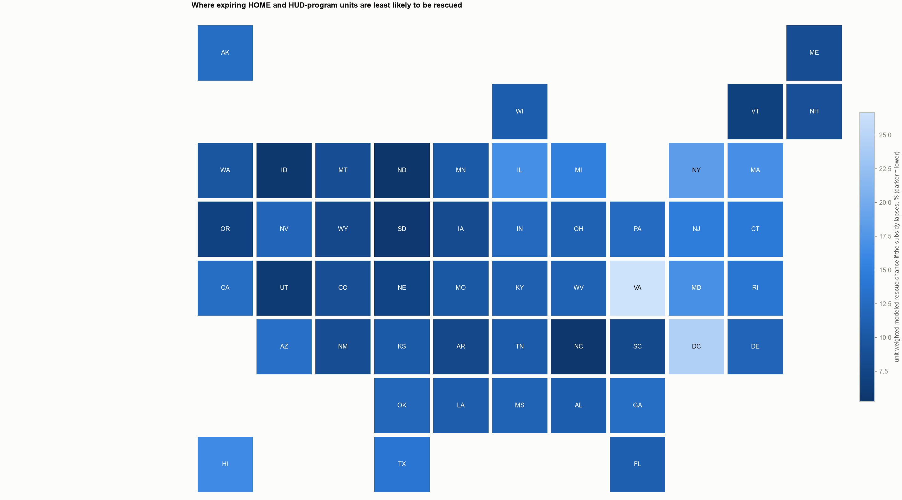

*Figure 32. Unit-weighted modeled rescue chance by state if the subsidy lapses (darker means lower). North Dakota, North Carolina, Idaho, South Dakota, Utah, and Vermont are lowest; Virginia and DC are highest. This is a ranking, not a probability: the model under-predicts the middle of the range.*

#### Example 6: Which expiring properties get a new subsidy?

The script builds the 12,822 lapse events, trains a logistic regression on lapses through 2015, tests it on lapses from 2019, compares it with gradient boosting, and then scores the 11,327 active properties whose last subsidy ends 2026 to 2035.

```python
"""
Example 6: when a HOME or HUD subsidy ends, which properties get a new subsidy? A logistic regression on property size.

Run from the project root:   uv run examples/06_rescue_model.py
Events are properties whose last subsidy ended 2011-2023; the label is "re-subsidized within three years". Train on early lapses, test on later ones.
"""
import sys
sys.path.insert(0, "src")
import numpy as np
import pandas as pd
from sklearn.metrics import roc_auc_score

import preservation as P

events = P.build_events()                              # one row per property whose last subsidy ended
print(f"{len(events):,} events; rescued within 3 years: {int(events.resub_3y.sum())} ({100 * events.resub_3y.mean():.1f} %)")
print("rescue rate by program group:", (100 * events.groupby("group").resub_3y.mean()).round(1).to_dict())

train, test = P.split(events, "main")                  # train on lapses up to 2015, test on lapses from 2019
cols = P.FEATURE_SETS["size + program"]                # log total units plus program-group indicators
p_logit = P.fit_predict(train, test, cols, "logit")
p_boost = P.fit_predict(train, test, P.FEATURE_SETS["property"], "boosting")
y = test.resub_3y.to_numpy()
print(f"\ntest set: {len(test):,} events, {int(y.sum())} rescued")
print(f"AUC, logistic regression on size and program: {roc_auc_score(y, p_logit):.2f}")
print(f"AUC, gradient boosting on all property features: {roc_auc_score(y, p_boost):.2f}")
p_size = P.fit_predict(train, test, P.FEATURE_SETS["size only"], "logit")
print(f"AUC, logistic regression on size alone: {roc_auc_score(y, p_size):.2f}")
print(f"share of all rescues found in the top-scored fifth of events: {100 * P.capture(y, p_size):.0f} % (size alone), {100 * P.capture(y, p_logit):.0f} % (size and program)")

# what the model says about size: rescue chance by size band, among HUD-program events
hud = events[events.group == "hud"].assign(band=lambda d: pd.cut(d.total_units, [0, 10, 25, 50, 100, 200, 10**6]))
print("\nHUD-program rescue rate by size (units):")
print((100 * hud.groupby("band", observed=True).resub_3y.mean()).round(1).to_string())

# score the properties whose last subsidy ends 2026-2035
scored, model = P.rescue_projection(events)
ok = scored[scored.p_rescue.notna()]
print(f"\nscored {len(ok):,} active properties; expected units not rescued if every subsidy lapsed: "
      f"{(ok.units_lb * (1 - ok.p_rescue)).sum():,.0f} to {(ok.units_ub * (1 - ok.p_rescue)).sum():,.0f}")
```

Output, as produced when this report was written:

```text
12,822 events; rescued within 3 years: 189 (1.5 %)
rescue rate by program group: {'home_only': 1.0, 'hud': 9.2, 'lihtc': 3.5, 'other': 2.9, 'rhs': 8.3}

test set: 4,640 events, 102 rescued
AUC, logistic regression on size and program: 0.82
AUC, gradient boosting on all property features: 0.81
AUC, logistic regression on size alone: 0.82
share of all rescues found in the top-scored fifth of events: 65 % (size alone), 62 % (size and program)

HUD-program rescue rate by size (units):
band
(0, 10]            0.0
(10, 25]           2.3
(25, 50]           5.3
(50, 100]         13.2
(100, 200]        19.1
(200, 1000000]    27.7

scored 11,327 active properties; expected units not rescued if every subsidy lapsed: 294,898 to 352,711
```

**How to read it.** Rescues are rare (1.5 percent overall), and size nearly explains them: a HUD-program property of ten units or fewer is essentially never rescued; one of 200 units or more is rescued 28 percent of the time. A one-variable model ranks properties as well as a model with every property feature (AUC 0.82 against 0.81), and finds 65 percent of the rescues in the top-scored fifth of events. The last line is an upper bound: it assumes every scored subsidy lapses, and the history only contains lapses.

#### Does the aggregate hold up? A state-level hindcast (Example 12)

**In plain words.** The rescue model ranks properties well, but the headline adds them up by state, so a reviewer will ask: do the totals come out right? We check it the way a forecast would be checked. Train on lapses through 2015, predict every lapse from 2019 to 2023, and compare with what happened, in units, by state.

```python
"""
Example 12: does the rescue model get the aggregate right? A hindcast on 2019-2023 lapses.

Run from the project root:   uv run examples/12_state_hindcast.py
Train on lapses through 2015, predict every lapse from 2019 to 2023, and compare predicted with actual units, by state.
"""
import sys
sys.path.insert(0, "src")
import hindcast as H

train, test = H.run("main")                       # test has a column p: the predicted chance of rescue
S = H.summary(train, test)

print(f"test lapses: {S['test_events']:,}; observed rescue rate {100 * S['test_rate']:.1f} %, mean predicted {100 * S['mean_predicted']:.1f} %")
print(f"\nunrescued units: predicted {S['unrescued_pred_upper']:,.0f}, actual {S['unrescued_act_upper']:,.0f}")
print(f"  across {S['states']} states, correlation with actual: model {S['unrescued_pearson_model']:.3f}, lapsing units alone {S['unrescued_pearson_units_only']:.3f}")
print(f"\nrescued units: predicted {S['rescued_total_model']:,.0f}, actual {S['rescued_total_act']:,.0f}")
print(f"  across states, correlation with actual: model {S['rescued_pearson_model']:.2f}, lapsing units alone {S['rescued_pearson_units_only']:.2f}")
print(f"  rescued SHARE by state ({S['states_40plus']} states with 40+ lapses), predicted against actual: {S['share_pearson']:.2f}")

print("\npredicted and observed rescue rate (%) by lapse year:")
print((100 * H.by_year(test)[["predicted", "observed"]]).round(1).to_string())
```

Output, as produced when this report was written:

```text
test lapses: 4,640; observed rescue rate 2.2 %, mean predicted 1.3 %

unrescued units: predicted 67,863, actual 68,413
  across 51 states, correlation with actual: model 0.996, lapsing units alone 0.998

rescued units: predicted 5,580, actual 5,030
  across states, correlation with actual: model 0.76, lapsing units alone 0.86
  rescued SHARE by state (32 states with 40+ lapses), predicted against actual: -0.07

predicted and observed rescue rate (%) by lapse year:
        predicted  observed
Y                          
2019.0        1.2       0.5
2020.0        1.0       0.8
2021.0        1.2       1.4
2022.0        1.1       3.9
2023.0        1.9       4.5
```

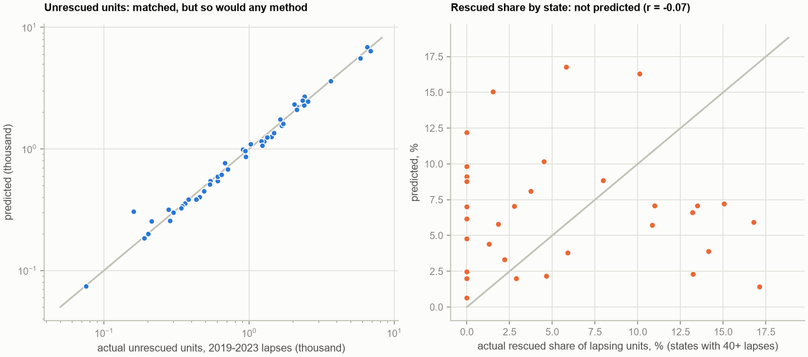

*Figure 33. Left: predicted against actual unrescued units by state (log scales); the points sit on the line, but a method with no rescue model at all would too, because about 97 percent of lapsing units are unrescued either way. Right: predicted against actual rescued share of lapsing units, for the 32 states with 40 or more lapses; there is no relationship (r = -0.07).*

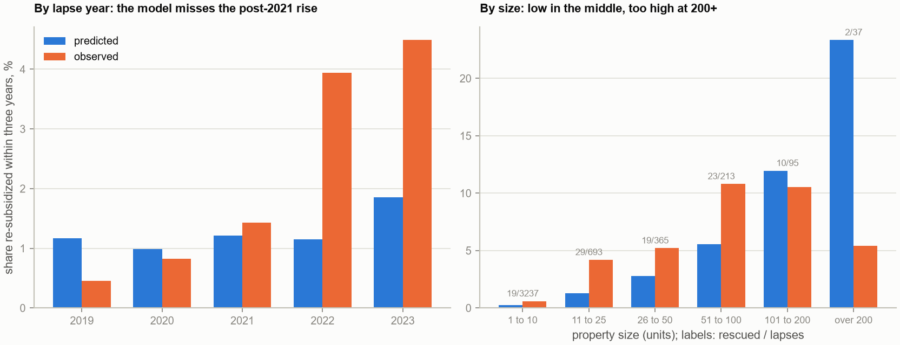

*Figure 34. Left: share re-subsidized, predicted against observed, by lapse year. Right: by property size, with rescued over lapses on each bar. The model is close for 2019 to 2021 and misses the rise after 2021 (3.9 and 4.5 percent observed against 1.2 and 1.9 predicted); it is too low for properties of 10 to 100 units and too high above 200 units (2 rescues in 37 lapses).*

**How to read it.** Three results, in order of importance. First, the totals are right: predicted unrescued units are within 1 percent of actual nationally and the state correlation is 0.996, but a method with no model gets 0.998, so this shows the totals are sound, not that the model adds skill. Second, the part the model does predict is right in level (5,580 rescued units predicted against 5,030 actual) but **it does not explain differences between states**: the rescued share by state is uncorrelated with the prediction, so the state ranking of the HOME and HUD piece is mostly a ranking by how many units are expiring. Third, the rescue rate has moved: it jumped after 2021, which the model, fitted on earlier years, misses; the next section looks at what that does to the headline.

#### The rescue rate moved after 2021 (Example 13)

**In plain words.** The hindcast showed that after 2021 far more lapsing properties were re-subsidized: 3.9 and 4.5 percent of the 2022 and 2023 lapses, against about 1 percent before. A reviewer will ask whether that is just a different mix of properties, whether a model that is kept up to date could have seen it coming, and what the headline would be if the new rate lasts. This example answers all three.

```python
"""
Example 13: the rescue rate rose after 2021. Is it the mix of properties, can a model keep up, and what if it persists?

Run from the project root:   uv run examples/13_rescue_rate_drift.py
"""
import sys
sys.path.insert(0, "src")
import pandas as pd

import preservation as P
import rescue_drift as D
import uncertainty as U

events = P.build_events()
events["period"] = pd.cut(events.Y, [2010, 2015, 2020, 2023], labels=["2011-15", "2016-20", "2021-23"])

# 1. Is it the mix of properties? Compare the rate and the mix over time, and within the biggest group.
print("all lapses:")
print(events.groupby("period", observed=True).agg(lapses=("Y", "size"), rescue_rate_pct=("resub_3y", lambda s: 100 * s.mean()), median_units=("total_units", "median")).round(2).to_string())
print("\nHOME-only lapses (93 percent of all):")
print(events[events.group == "home_only"].groupby("period", observed=True).resub_3y.agg(lapses="size", rescue_rate_pct=lambda s: 100 * s.mean()).round(2).to_string())

# 2. Can a model updated in real time keep up? For lapses in year T, use only outcomes already labeled (lapses through T-3).
rt = D.real_time(events)
print("\nreal-time test, 2019-2023 (lower log loss is better):")
print(D.summary(rt).sort_values("log_loss").round(3).to_string())
print("\nmean predicted rescue rate (%) in 2022 and 2023, observed 3.9 and 4.5:")
print((100 * rt[rt.year >= 2022].pivot(index="method", columns="year", values="predicted")).round(1).to_string())

# 3. What if the recent rate persists? Move the model's intercept to reproduce the 2022-23 rate, then recompute the headline.
prep = U.prepare()
p_recent, shift, rate = D.recent_rate_probabilities(prep["ev"], prep["scored"])
lo0, hi0 = U._unrescued(prep["scored"], prep["scored"].p_rescue)
lo1, hi1 = U._unrescued(prep["scored"], p_recent)
print(f"\nif rescue stays at {100 * rate:.1f} percent: HOME and HUD units not rescued {lo0:,.0f}-{hi0:,.0f} -> {lo1:,.0f}-{hi1:,.0f}")
```

Output, as produced when this report was written:

```text
all lapses:
         lapses  rescue_rate_pct  median_units
period                                        
2011-15    5233             1.11           2.0
2016-20    4803             0.85           3.0
2021-23    2786             3.23           4.0

HOME-only lapses (93 percent of all):
         lapses  rescue_rate_pct
period                          
2011-15    4898             0.43
2016-20    4521             0.60
2021-23    2513             2.63

real-time test, 2019-2023 (lower log loss is better):
                  log_loss  brier  mean_abs_calibration_error
method                                                       
static               0.098  0.021                       0.013
recency weighted     0.100  0.021                       0.014
year trend           0.102  0.022                       0.018
intercept shift      0.103  0.022                       0.015
constant rate        0.116  0.022                       0.016

mean predicted rescue rate (%) in 2022 and 2023, observed 3.9 and 4.5:
year              2022  2023
method                      
constant rate      0.8   0.6
intercept shift    0.9   1.1
recency weighted   1.0   1.4
static             1.1   1.6
year trend         1.1   1.6

if rescue stays at 4.2 percent: HOME and HUD units not rescued 294,898-352,711 -> 252,415-300,927
```

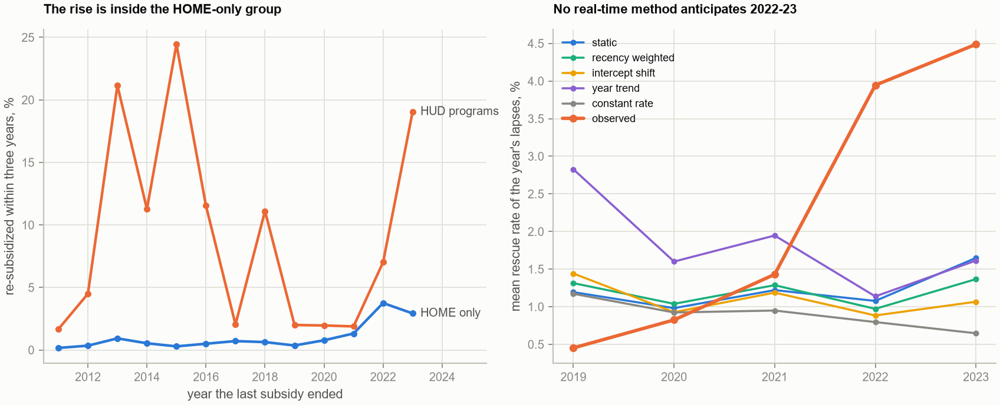

*Figure 35. Left: the share of lapses re-subsidized within three years, by lapse year, for HOME-only properties (blue) and HUD-program properties (orange, about 60 lapses a year, so noisy). Right: what each method updated in real time would have predicted for 2019 to 2023 (thin lines) against what happened (thick orange).*

**How to read it.** First, it is not the mix of properties: the median size and the HUD share barely changed, and the rise sits inside the HOME-only group, whose rate went from 0.4 and 0.6 percent to 2.6 percent. Second, no real-time method anticipates it: refit every year on the outcomes already known (a lapse needs three years to be labeled), the plain model, a recency-weighted one, an intercept shift, a trend, and a constant rate all predict 0.7 to 1.7 percent for 2022 and 2023, and the plain model has the best log loss. A jump in the data cannot be learned from the years before it, so this is a change in regime (probably funding or rules that the data do not contain). Third, we treat it as a scenario: if the rescue rate stays at its 2022-23 level of 4.2 percent, the average rescue chance of the scored properties roughly doubles, HOME and HUD units not rescued fall from 295,000 to 353,000 to 252,000 to 301,000, and the total falls by about 5 percent. The headline keeps the all-years model, the conservative choice (a larger loss), and states this alternative beside it.

### 5.3 LIHTC: what happens when the clock runs out? (`notebooks/05_preservation/02_lihtc_exit.py`)

**Method (standard name):** Ridge-penalized logistic regression with state fixed effects and a linear cohort trend.

**In plain words.** A LIHTC project promises to stay affordable for at least 30 years, and afterwards the state agency may stop checking. We asked which projects drop off the agency's list and found that it depends on the state far more than on anything about the project.

The HUD database flags projects the allocating agency **no longer monitors** (11,217 of 54,928; the dictionary says this does not mean the units stopped being affordable). The outcome is leaving the monitoring list, modeled for projects placed 1990 to 1995 (30-year allocations observed at ages 29 to 34; 7,315 projects).

**How it works (excerpt from `src/lihtc_exit.py`).** Each project gets one effect for its state plus a straight-line trend across placement years; a penalty pulls small states toward the national rate. Projects placed 1996 to 2005 are then scored as if they behave like the 1993 cohort at the same age:

```python
def _x(self, df):
    d = pd.get_dummies(pd.Categorical(df.state_fips, categories=self.states), dtype=float).to_numpy()   # one column per state
    trend = (df.pis_year.to_numpy(float) - TREND_CENTER)[:, None] * TREND_SCALE / 3.0                    # cohort trend
    return np.hstack([trend, d])

self.m = LogisticRegression(C=self.C, max_iter=5000).fit(self._x(df), df.left_monitoring)
...
f["p31"] = model.predict(f, pis_year=TREND_CENTER)    # chance of having left the list by about age 31
```

**Worked example, Idaho.** 4,352 monitored units were placed in service in 1996 to 2005. The model expects 1,658 (calibration-adjusted) to 1,987 (unadjusted) of them, 46 percent, to leave the monitoring list by about 2027 to 2036. Maryland's projected share is 91 percent, California's 6: the state, not the project, is what the model learned.

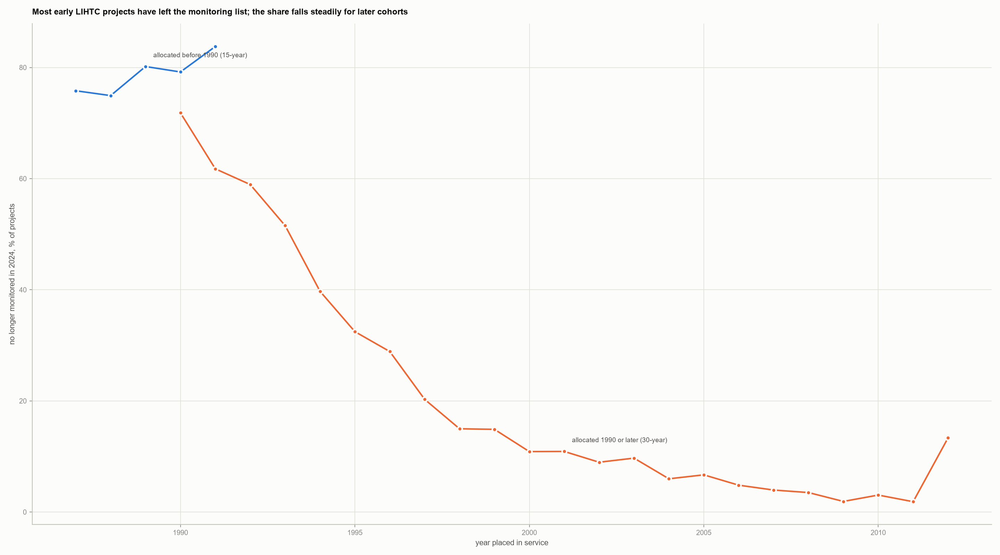

*Figure 36. Share of LIHTC projects no longer monitored in 2024, by placement year: about three quarters of the oldest cohorts, falling to roughly 3 percent for 2010 placements (orange: 30-year allocations; blue: 15-year).*

- **An age cliff and a state effect.** Of projects with 15-year commitments, 75 to 84 percent have left monitoring; among 30-year allocations the share falls from 72 percent (1990 placements) to 32 percent (1995) and about 3 percent for 2010. State alone ranks projects with an AUC of 0.79; **project characteristics have no skill across states** (leave-states-out AUC 0.52). State rates for 1993-95 placements run from 0 percent (Connecticut) to 99 percent (Maryland), and persist across adjacent cohorts (rank correlation 0.79, 0.84, 0.69).
- **Model:** a state-effects logit with a cohort trend. Tested without peeking, it predicts state exit rates with an error of 0.134 against 0.253 for a national trend (47 percent lower), though it over-predicts the level (0.476 against 0.405).
- **Application:** 13,007 projects placed 1996 to 2005 are still monitored (1.0 million units). If they behave like the older cohorts at the same age, **236,000 to 297,000 units** (24 to 30 percent) will have left the list by about 2027 to 2036 (the lower figure is calibration-adjusted). Largest: Florida, North Carolina, Texas, Michigan, Maryland. Highest shares: Maryland 91 percent, Nebraska 82, Pennsylvania 80, North Carolina 78.
- **Whether this is state policy or state reporting practice cannot be separated with these data**, and it matters: if it is reporting, real losses are smaller.


*Figure 37. Share of projects placed 1993 to 1995 that are no longer monitored, by state: from 0 percent (Connecticut) to 99 percent (Maryland). What happens after the clock depends on the state, not the project.*

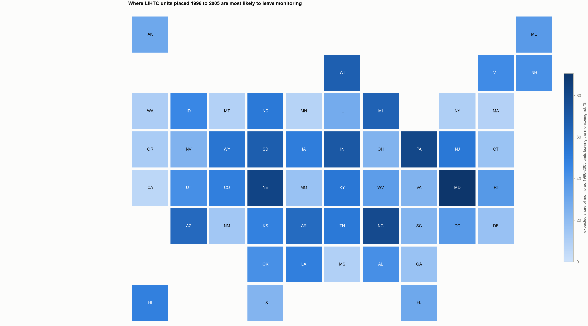

*Figure 38. Expected share of monitored LIHTC units placed 1996 to 2005 that leave the monitoring list by about age 31, by state. Maryland, Nebraska, Pennsylvania, and North Carolina are darkest; California, Minnesota, and Massachusetts are lightest. The pattern follows state lines, not project types.*

#### Example 7: Which LIHTC projects leave the monitoring list?

The script fits the state-effects logistic regression on projects placed 1990 to 1995, tests it by training on 1990-92 and predicting 1993-95, and then projects the 13,007 projects placed 1996 to 2005 that are still monitored, adjusting for those already gone.

```python
"""
Example 7: when the LIHTC clock runs out, does a project leave the agency's monitoring list? One effect per state plus a cohort trend.

Run from the project root:   uv run examples/07_lihtc_exit.py
Sample: 30-year allocations placed in service 1990-1995 (observed at ages 29 to 34). Train on 1990-92, test on 1993-95, then project 1996-2005.
"""
import sys
sys.path.insert(0, "src")
import pandas as pd

import ahni
import lihtc_exit as L

projects = L.load_projects()                                     # one row per LIHTC project, with placement year and left_monitoring (1 = no longer monitored)
sample = projects[projects.pis_year.between(1990, 1995)]
print(f"{len(sample):,} projects placed 1990-95; {100 * sample.left_monitoring.mean():.0f} % have left the monitoring list")
print("share that left, by placement year:", (100 * sample.groupby("pis_year").left_monitoring.mean()).round(0).astype(int).to_dict())

ev = L.cohort_split_eval(projects, C=0.3)                        # train 1990-92, test 1993-95
print(f"\nout of sample: project AUC {ev['auc']:.2f}; state-level error {ev['state_mae']:.3f} against {ev['state_mae_national_trend']:.3f} for a national trend")

# the fit used for the projection: one effect per state plus a straight-line cohort trend, trained on all of 1990-95
model = L.StateLogit(C=0.3).fit(sample)
future = L.project_future(projects, model)                       # projects placed 1996-2005, scored as the 1993 cohort behaved at the same age (about 31)
cell = future.groupby(["state_fips", "pis_year"]).agg(p31=("p31", "first"), observed=("left_monitoring", "mean"))
future = future.join(cell.rename(columns={"observed": "obs_cell"})[["obs_cell"]], on=["state_fips", "pis_year"])
# some projects in each state-and-year cell have already left, so only the remaining share can still leave
future["remaining_share"] = ((future.p31 - future.obs_cell) / (1 - future.obs_cell)).clip(lower=0, upper=1)
monitored = future[future.left_monitoring == 0].copy()                                    # still on the list today
monitored["expected_units"] = monitored.n_units * monitored.remaining_share
total, expected = monitored.n_units.sum(), monitored.expected_units.sum()
print(f"\n{len(monitored):,} projects placed 1996-2005 are still monitored ({total:,.0f} units); expected to leave by about age 31: {expected:,.0f} units ({100 * expected / total:.0f} %)")

# the cohort test over-predicted the level, so a calibration-adjusted variant scales the predicted shares down
scale = ev["mean_obs"] / ev["mean_pred"]
adj = (monitored.n_units * (((future.loc[monitored.index, "p31"] * scale) - monitored.obs_cell) / (1 - monitored.obs_cell)).clip(lower=0, upper=1)).sum()
print(f"calibration-adjusted: {adj:,.0f} units, so the range is {adj:,.0f} to {expected:,.0f}")

by_state = monitored.groupby("state_fips").agg(units=("n_units", "sum"), leaving=("expected_units", "sum"))
share = (100 * by_state.leaving / by_state.units).sort_values()
print("lowest share leaving:", ", ".join(f"{ahni.ABBR[s]} {v:.0f}%" for s, v in share.head(3).items()), "| highest:", ", ".join(f"{ahni.ABBR[s]} {v:.0f}%" for s, v in share.tail(3)[::-1].items()))
```

Output, as produced when this report was written:

```text
7,315 projects placed 1990-95; 49 % have left the monitoring list
share that left, by placement year: {1990: 72, 1991: 62, 1992: 59, 1993: 51, 1994: 39, 1995: 32}

out of sample: project AUC 0.80; state-level error 0.134 against 0.253 for a national trend

13,007 projects placed 1996-2005 are still monitored (1,002,236 units); expected to leave by about age 31: 296,639 units (30 %)
calibration-adjusted: 235,693 units, so the range is 235,693 to 296,639
lowest share leaving: CA 6%, MN 8%, MA 9% | highest: MD 91%, NE 82%, PA 80%
```

**How to read it.** The age cliff is steep (72 percent of 1990 placements have left, 32 percent of 1995 placements), and the state does most of the sorting: the same project is far more likely to leave in Maryland than in California. The projected loss is a range because the cohort test over-predicted the level; the lower number scales the predictions back to match what was observed. Remember what the outcome is: leaving the list, not necessarily losing affordability.

### 5.4 HUD-insured mortgages: a pathway the date-based list misses (`notebooks/05_preservation/04_mortgage_exit.py`)

**Method (standard name):** Cohort life table (empirical termination curve), with no fitted parameters.

**In plain words.** Some affordable buildings are financed with a federally insured mortgage that carries rent rules. If the loan ends early, the rules can end sooner than the calendar says, and the database records only the scheduled end. We use what happened to older loans of the same age to estimate how many younger ones will end early.

NHPD lists FHA-insured mortgages that carry affordability restrictions as "HUD Insured" subsidies, and records many as "Terminated Mortgage" (14,672 records, 17 percent of all inactive subsidies and 95 percent of inactive insured records). The recorded end date is the scheduled maturity, so 48 percent of these loans ended early; the termination year itself is not recorded, so the model uses loan cohorts rather than a time split.

**How it works (excerpt from `src/mortgage_exit.py`).** Loans that started in year *s* are observed at age 2026 - *s*; by 2035 they will be nine years older, so their chance of having ended by then is read from the cohort that started nine years earlier. The loss is the terminations times one minus the observed refinance rate:

```python
s = e.start_year.clip(1965 + shift, 2024).astype(int)
now = curve.share_terminated.reindex(s).to_numpy()            # share of this cohort already terminated
fut = curve.share_terminated.reindex(s - shift).to_numpy()    # share of the cohort `shift` years older (the future of this one)
add = np.clip((fut - now) / (1 - now), 0, 1)                  # new terminations among loans still running
term = e.units.to_numpy() * add
return term, term * (1 - rescue)                              # terminated units, and units not rescued
```

For Idaho the insured-mortgage piece is small (113 to 179 units); it matters most in Massachusetts, New York, and Texas.

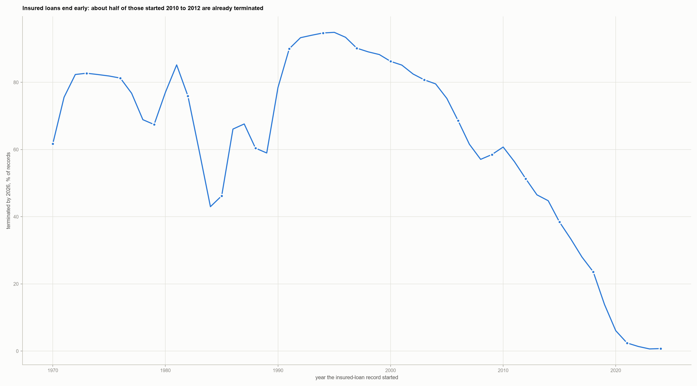

*Figure 39. Share of HUD-insured loan records that have terminated, by the year the record started: about half of those started in 2010 to 2012 are already gone.*

- **Termination usually does not end affordability.** Of 10,536 properties that lost an insured mortgage, 86 percent had other subsidies and 90 percent of those still hold an active one. Where the insured loan was the only subsidy ever, only 3.9 percent are assisted now; for the 2,579 with no other active subsidy, 7.4 percent have a new insured record.
- **Insured loans end fast.** 75 percent of records started in 2005 have terminated, 51 percent of those started in 2012, 38 percent of 2015.
- **Exposure the date-based list misses:** 558 properties (78,195 units, median start 2019) have an insured loan as their only active subsidy and a scheduled end after 2035. If they follow earlier cohorts, 30,000 to 44,000 units see the mortgage end by 2035 and **27,800 to 42,200 would not be rescued**. Largest in Massachusetts, New York, Texas, Illinois, and Maryland. This adds about 3 to 4 percent to the combined total.

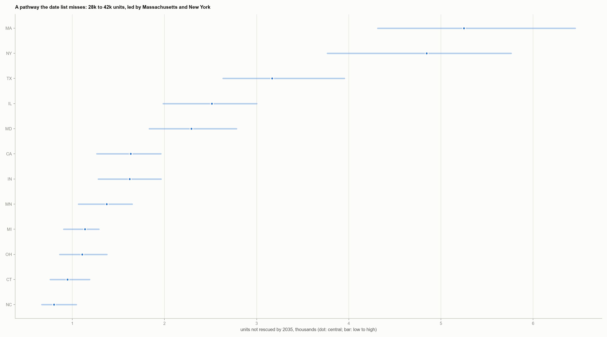

*Figure 40. Units of insured-only properties expected to lose the mortgage and not be rescued by 2035, by state (dot: central estimate; bar: low to high): 28,000 to 42,000 units in total, led by Massachusetts and New York.*

#### Example 8: Insured mortgages that end early

There is nothing to fit here: the method counts. For each start year it asks what share of loans has already terminated, and it applies the share an older cohort had at the age this one will reach.

```python
"""
Example 8: insured mortgages that end early. A cohort life table, with no fitted parameters.

Run from the project root:   uv run examples/08_insured_mortgages.py
NHPD records the scheduled end of each HUD-insured loan, but many loans terminate earlier, so the date-based expiry list misses them.
"""
import sys
sys.path.insert(0, "src")
import ahni
import mortgage_exit as M

subsidies, properties = M.load()

# 1. What happens when an insured mortgage terminates? Most properties keep another subsidy.
outcomes = M.outcome_table(subsidies)
print(f"properties that lost an insured mortgage: {len(outcomes):,}; had other subsidies: {100 * outcomes.other_subsidy_ever.mean():.0f} %")
rescue, n = M.rescue_rate(outcomes)
print(f"of {n:,} with no other active subsidy, {100 * rescue:.1f} % hold a new insured record (a refinance)")

# 2. The life table: of the loans that started in year s, what share has already terminated?
curve = M.cohort_curve(subsidies)
print("\nshare of insured loans terminated, by start year:", {y: f"{100 * curve.share_terminated[y]:.0f}%" for y in (2005, 2010, 2012, 2015, 2018, 2020)})

# 3. The loans the date-based list misses: insured loan is the only active subsidy, scheduled end after 2035
exposed = M.exposed_properties(subsidies, properties)
print(f"\n{len(exposed)} properties ({exposed.units.sum():,.0f} units) have an insured loan as their only active subsidy and a scheduled end that is not already on the 2026-2035 list")

# 4. Project forward: a loan that started in year s is observed at age 2026 - s; by 2035 it is nine years older, so read its
#    chance of having ended from the cohort that started nine years earlier (7 and 11 years give the low and high cases).
table, info = M.exposure_by_state(subsidies, properties)
total = table[["mortgage_unrescued_low", "mortgage_unrescued_central", "mortgage_unrescued_high"]].sum()
print(f"units expected to lose the mortgage and not be rescued by 2035: low {total.iloc[0]:,.0f}, central {total.iloc[1]:,.0f}, high {total.iloc[2]:,.0f}")
print("largest (central):", ", ".join(f"{ahni.ABBR[s]} {v:,.0f}" for s, v in table.mortgage_unrescued_central.nlargest(4).items()))
```

Output, as produced when this report was written:

```text
properties that lost an insured mortgage: 10,536; had other subsidies: 86 %
of 2,579 with no other active subsidy, 7.4 % hold a new insured record (a refinance)

share of insured loans terminated, by start year: {2005: '75%', 2010: '61%', 2012: '51%', 2015: '38%', 2018: '24%', 2020: '6%'}

558 properties (78,195 units) have an insured loan as their only active subsidy and a scheduled end that is not already on the 2026-2035 list
units expected to lose the mortgage and not be rescued by 2035: low 27,810, central 34,837, high 42,181
largest (central): MA 5,250, NY 4,845, TX 3,169, IL 2,514
```

**How to read it.** Insured loans end fast (three quarters of 2005 loans are gone) and when they do the property usually keeps another subsidy. The exposure is the 558 properties where the insured loan is the only subsidy: about 28,000 to 42,000 of their units would lose the mortgage and not be rescued. That is a small piece (3 to 4 percent of the total) but it is invisible in the date-based expiry list, which is the point.

### 5.5 Tested ideas that did not work: market rent, price growth, sponsor type (`notebooks/05_preservation/03_rent_gap.py`, `06_price_growth.py`)

**Method (standard name):** Logistic regression with state fixed effects and state-clustered standard errors.

The hypothesis: where the market rent is far above the restricted rent, owners gain more by leaving, so those places should lose more affordable units. The gap is measured by county as the fair market rent divided by the rent affordable at 60 percent of median income (HUD HOME rent limits, FY2019 and FY2024); it exceeds 1 in 26 percent of counties in 2024, up from 17 percent in 2019.

- **No effect.** Within states the gap does not explain LIHTC exit (coefficient +0.025, t 0.20; out-of-sample AUC 0.794 with state effects and 0.793 with the gap) or HOME and HUD rescue (+0.049, t 0.59).
- **Two earlier "significant" results were artifacts** (a 57 percent county match, and two rent-limit vintages mixed while the rescue rate rose); the notebook shows both as a warning.

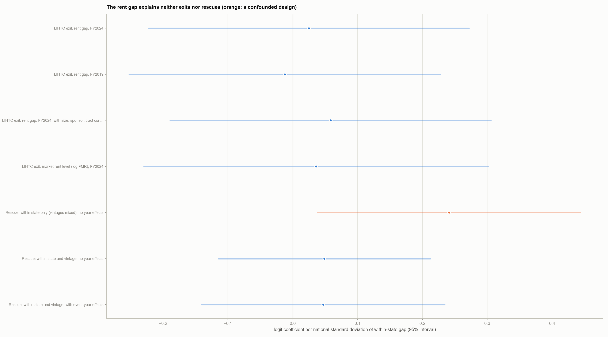

*Figure 41. Estimated effect of the county rent gap on LIHTC exit and on rescue (95 percent intervals): all straddle zero once matching and the time trend are handled correctly (orange: a confounded version).*

The closest published precedent is Begley and Reina (*Journal of Housing Economics*, 2014), who model owners of New York's Mitchell-Lama properties and find that local price appreciation, for-profit ownership, and being past all affordability restrictions raise the chance of opting out. We tested the first two nationally (`06_price_growth.py`, FHFA county house price index):

- **House price growth: no effect.** Within-state five-year price growth does not explain rescue (coefficient -0.024 per standard deviation, t -0.30; out-of-sample AUC unchanged at 0.817) or LIHTC exit (+0.015, t 0.18; AUC 0.787 with and without it).
- **Nonprofit sponsor: no detectable effect.** Within a state, LIHTC projects with a nonprofit sponsor leave monitoring about as often as others (odds ratio 0.94, t -0.49).
- **Why the results may differ from theirs:** their outcome is a dated owner opt-out in one city and ours is an undated exit or a new subsidy across the nation, so the studies are not strictly comparable. Their third factor, being past all restrictions, cannot be tested here: our events are past the end date by construction.

---

## 6. The combined result

The four pieces are added by state (`notebooks/06_combined/01_units_at_stake.py`). The sum is an accounting device: the supply pieces can overlap where a property carries both subsidies, the first is conditional on a lapse, and the second counts leaving monitoring, not loss. It is used to rank states and give scale.

See Figure 2 above for the 15 largest states.

**How the pieces are added (excerpt from `src/combined.py`, `src/uncertainty.py`, `src/hindcast.py`, `src/rescue_drift.py`).** The low case pairs the lower bound of each supply piece; the high case pairs the upper bounds; growth is the baseline scenario in both:

```python
t["stake_low"]  = t.growth_need_baseline + t.nhpd_unrescued_lb + t.lihtc_leaving_adj + t.mortgage_lb
t["stake_high"] = t.growth_need_baseline + t.nhpd_unrescued_ub + t.lihtc_leaving     + t.mortgage_ub
t["stake_mid"]  = (t.stake_low + t.stake_high) / 2
t["stake_per100_eli"] = 100 * t.stake_mid / t.eli_renters
```

**Worked example, Idaho (units by 2035).**

| Piece | Low | High |
|---|---|---|
| Growth need (baseline) | 5,946 | 5,946 |
| HOME and HUD subsidies not rescued | 1,206 | 1,370 |
| LIHTC leaving monitoring | 1,658 | 1,987 |
| Insured mortgages ending early | 113 | 179 |
| **Total** | **8,923** | **9,482** |

The midpoint, 9,203 units, is 26 per 100 of Idaho's 2023 ELI renters, the highest in the country, and growth is the largest piece (65 percent). Texas, by contrast, has the largest total (101,000 to 109,000) but a lower per-renter figure.

| Group | States | Largest piece |
|---|---|---|
| 16 growth-led | Texas, Florida, North Carolina, Georgia, Tennessee, South Carolina, Arizona, Washington | Households outgrowing the stock |
| 25 HOME and HUD-led | California, New York, Pennsylvania, Ohio, New Jersey, Illinois, Massachusetts, Alabama | Subsidies lapsing without rescue |
| 10 LIHTC-led | Maryland, Michigan, Virginia, Wisconsin, Colorado, Indiana, Louisiana, Nebraska | Projects leaving monitoring |

- **Largest in units:** Texas 102,000 to 109,000, Florida 73,000 to 80,000, North Carolina 48,000 to 53,000, New York 38,000 to 47,000, California 38,000 to 46,000.
- **Highest per 100 ELI renters in 2023:** Idaho 26, South Dakota 21, Utah 18, North Carolina 16, South Carolina 16 (with NLIHC's renter counts as the denominator, South Dakota and Idaho tie at 21 and Utah is third at 19). This measures change by 2035, not today's gap: California and New York have a low stake per ELI renter but already rank among the highest on the need index (`notebooks/01_eda/04_need_today_ahni`), and Florida combines the highest need today with the second-largest stake.

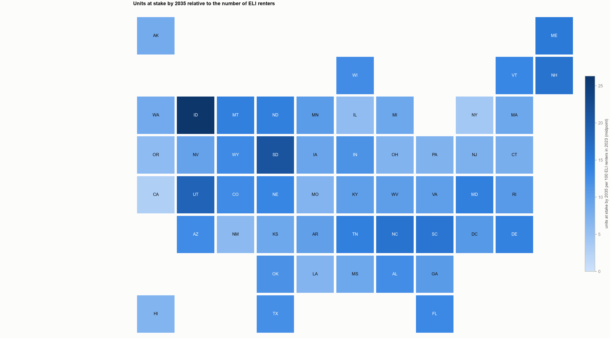

*Figure 42. Units at stake by 2035 per 100 ELI renters in 2023 (midpoint): highest in Idaho, South Dakota, and Utah, lowest in California, New York, and Illinois, which already rank high on today's need.*

#### Example 9: Putting the four pieces together

This script reads the state table that combines the demand scenario with the three preservation models, prints the national total by piece, and lists the largest states.

```python
"""
Example 9: put the four pieces together by state, and ask what it would take to hold the line.

Run from the project root:   uv run examples/09_units_at_stake.py
Needs the result tables written by the notebooks (outputs/tables/), which `uv run src/run_short_report.py` rebuilds.
"""
import sys
sys.path.insert(0, "src")
import pandas as pd

import combined

t = combined.units_at_stake()                                   # one row per state: growth need, subsidies lapsing, LIHTC leaving, mortgages ending
parts = {"growth need (baseline)": "growth_need_baseline", "HOME and HUD subsidies not rescued": ("nhpd_unrescued_lb", "nhpd_unrescued_ub"),
         "LIHTC leaving monitoring": ("lihtc_leaving_adj", "lihtc_leaving"), "insured mortgages ending early": ("mortgage_lb", "mortgage_ub")}
print("national total, units by 2035 (low to high):")
for name, col in parts.items():
    lo, hi = (t[col].sum(), t[col].sum()) if isinstance(col, str) else (t[col[0]].sum(), t[col[1]].sum())
    print(f"  {name:38s} {lo:>10,.0f} to {hi:>10,.0f}")
print(f"  {'total':38s} {t.stake_low.sum():>10,.0f} to {t.stake_high.sum():>10,.0f}")
pres = (t.nhpd_unrescued_lb + t.lihtc_leaving_adj + t.mortgage_lb).sum() / t.stake_low.sum(), (t.nhpd_unrescued_ub + t.lihtc_leaving + t.mortgage_ub).sum() / t.stake_high.sum()
print(f"preservation share of the total: {100 * min(pres):.0f} to {100 * max(pres):.0f} percent")

print("\nlargest states (units):")
print(t.nlargest(5, "stake_mid")[["state", "stake_low", "stake_high", "lead"]].round(0).to_string(index=False))
print("\nhighest per 100 ELI renters:")
print(t.nlargest(4, "stake_per100_eli")[["state", "stake_per100_eli"]].round(1).to_string(index=False))
```

Output, as produced when this report was written:

```text
national total, units by 2035 (low to high):
  growth need (baseline)                    341,444 to    341,444
  HOME and HUD subsidies not rescued        294,898 to    352,711
  LIHTC leaving monitoring                  235,693 to    296,639
  insured mortgages ending early             27,810 to     42,181
  total                                     899,845 to  1,032,975
preservation share of the total: 62 to 67 percent

largest states (units):
state  stake_low  stake_high   lead
   TX   101555.0    109084.0 growth
   FL    72588.0     79762.0 growth
   NC    48373.0     53190.0 growth
   NY    37511.0     47484.0   nhpd
   CA    38496.0     46094.0   nhpd

highest per 100 ELI renters:
state  stake_per100_eli
   ID              26.3
   SD              21.0
   UT              18.4
   NH              16.1
```

**How to read it.** The low case pairs the lower bound of each piece and the high case the upper bounds, so the total is a range of 0.90 to 1.03 million units. Preservation is 62 to 67 percent of it. Texas, Florida, and North Carolina lead in units because they are growing; New York and California lead where subsidies lapse. Per ELI renter, Idaho tops the list (26 units at stake per 100).

#### How sure are we of the total? (Example 11)

**In plain words.** The headline is a range, 0.90 to 1.03 million units, but that range comes from definitions (lower or upper unit counts, adjusted or unadjusted exit shares), not from statistics. Two fair questions follow. How much wider is the range once we admit that the models were fitted on a sample? And which of our choices would change the answer most? To answer the first, we re-run the three preservation models a thousand times, each time on a fresh resample of the training data and with every outcome drawn as a random trial, so that both "the model could be a bit different" and "luck decides which properties are rescued" are counted. To answer the second, we change one assumption at a time and recompute the total.

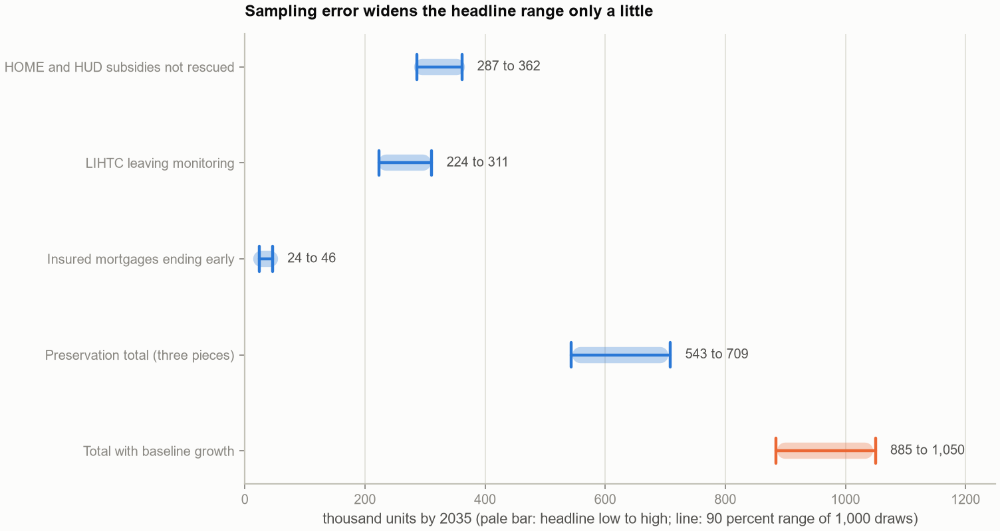

*Figure 43. For each piece, the headline low-to-high range (pale bar) and the 90 percent range of 1,000 resampled runs (thin line). Counting sampling error widens the total from 900,000 to 1,033,000 units to 885,000 to 1,050,000; no single piece changes much.*

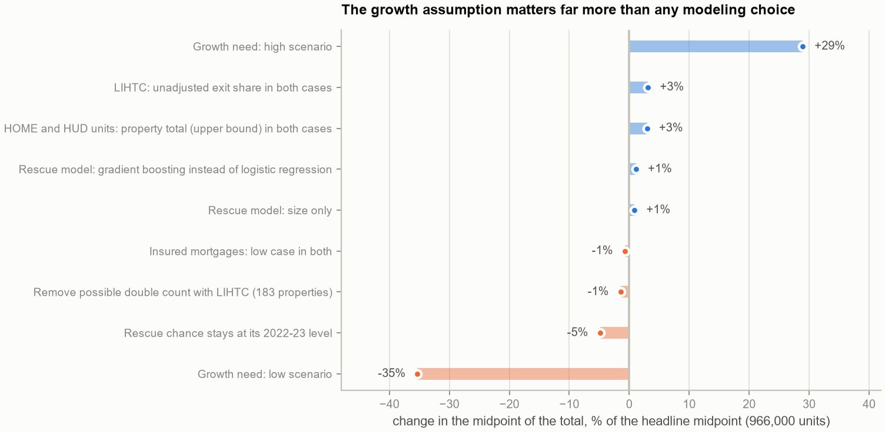

*Figure 44. Change in the midpoint of the total (percent of the headline) when one assumption is changed. Whether renting keeps falling (-35 percent) or rises (+29 percent) matters far more than any modeling choice, the largest modeling choice, whether the post-2021 rescue rate persists, moves it by 5 percent and the rest by 3 percent or less.*

```python
"""
Example 11: how uncertain is the headline total, and which assumption moves it most?

Run from the project root:   uv run examples/11_uncertainty_and_sensitivity.py   (takes about a minute; 200 draws here, 1,000 in the notebook)
One draw resamples the training data, refits each model, scores the properties again, and draws every outcome as a random trial.
"""
import sys
sys.path.insert(0, "src")
import numpy as np
import uncertainty as U

prep = U.prepare()                               # loads the events, the scored properties, the LIHTC sample and the insured loans once
pt = U.point_estimates()                         # the headline pieces, from outputs/tables/units_at_stake_state.csv
draws = U.simulate(200, prep=prep)               # 200 passes through the three preservation models
tot = U.totals(draws, pt)                        # the total in the low and high definitions, baseline growth

low5, high95 = np.percentile(tot.total_low_case, 5), np.percentile(tot.total_high_case, 95)
print(f"headline total: {pt['growth'] + pt['nhpd_lb'] + pt['lihtc_adj'] + pt['mort_low']:,.0f} to {pt['growth'] + pt['nhpd_ub'] + pt['lihtc_raw'] + pt['mort_high']:,.0f} units")
print(f"with sampling error (90 percent range of the draws): {low5:,.0f} to {high95:,.0f} units")

sens = U.sensitivity(prep, pt)                   # one assumption changed at a time
print("\nchange in the midpoint of the total, percent of the headline:")
for _, r in sens.iloc[1:10].iterrows():
    print(f"  {r.change_pct:+5.1f}  {r.case}")
```

Output, as produced when this report was written:

```text
headline total: 899,845 to 1,032,975 units
with sampling error (90 percent range of the draws): 885,821 to 1,048,721 units

change in the midpoint of the total, percent of the headline:
  -35.3  Growth need: low scenario (renting keeps falling)
  +29.0  Growth need: high scenario (renting rises)
   +3.0  HOME and HUD units: property total (upper bound) in both cases
   +0.9  Rescue model: size only
   +1.2  Rescue model: gradient boosting instead of logistic regression
   -4.9  Rescue chance stays at its 2022-23 level
   +3.2  LIHTC: unadjusted exit share in both cases
   -0.7  Insured mortgages: low case in both
   -1.4  Remove possible double count with LIHTC (183 properties)
```

**How to read it.** The statistical uncertainty is modest: the preservation models are well enough determined that resampling moves the total by under 2 percent at either end. The assumption that matters most is not in the preservation models at all. It is the growth piece: if renting keeps falling the total drops by a third, and if renting rises it grows by almost a third. That also qualifies a sentence used earlier: preservation is 62 to 67 percent of the total **under the baseline growth scenario**; under the high scenario it is 47 to 53 percent, and under the low scenario it is all of it. The one change in the underlying process that we can test, the rescue rate staying at its post-2021 level, lowers the total by about 5 percent (Section 5.2). The draws do not cover other changes in process.

#### Do our numbers agree with independent ones? (Example 14)

**In plain words.** A model can agree with itself and still be wrong, so we also compare with figures that other organizations built differently. For states, we use the National Low Income Housing Coalition's Gap table, which comes from survey microdata, not the HUD tabulation we use. For expiring units, we use three published counts built from the same housing database but with different snapshots and definitions, so agreement is expected within a range, not exactly.

```python
"""
Example 14: do our numbers agree with independent published ones? State measures against NLIHC's The Gap.

Run from the project root:   uv run examples/14_external_benchmarks.py
Reads data/interim/nlihc_gap_state.csv (NLIHC's state table, saved from https://nlihc.org/gap on 2026-10-11) and our own result tables.
"""
import pandas as pd

nlihc = pd.read_csv("data/interim/nlihc_gap_state.csv", dtype={"state_fips": str})
ours = pd.read_csv("outputs/tables/scenarios_state.csv", dtype={"state_fips": str})
ours = ours[(ours.scenario == "baseline") & (ours.year == 2023)][["state_fips", "eli_renters", "afford_units"]]
d = nlihc.merge(ours, on="state_fips")
d["ours_per100"] = 100 * d.afford_units / d.eli_renters          # affordable units per 100 ELI renters (NLIHC counts affordable AND available)

print(f"ELI renter households: ours {d.eli_renters.sum() / 1e6:.2f} million, NLIHC {d.nlihc_eli_renters.sum() / 1e6:.2f} million")
print(f"  correlation across {len(d)} states: {d.eli_renters.corr(d.nlihc_eli_renters):.3f}")
print(f"affordable homes per 100 ELI renters, rank correlation with NLIHC: {d.ours_per100.corr(d.nlihc_affordable_available_per100, method='spearman'):.2f}")
low = lambda col: ", ".join(d.nsmallest(5, col).state)
print(f"  five lowest, ours: {low('ours_per100')}")
print(f"  five lowest, NLIHC: {low('nlihc_affordable_available_per100')}")

# published expiring-unit counts against ours (same database, different snapshots and definitions)
e = pd.read_csv("data/interim/nhpd_expiry_state.csv")
print(f"\nfederally assisted units expiring in five years: NLIHC and PAHRC 374,497; ours (last subsidy ends 2026-2030) "
      f"{e.nhpd_last_end_by_2030_units_lb.sum():,.0f} to {e.nhpd_last_end_by_2030_units_ub.sum():,.0f}")
```

Output, as produced when this report was written:

```text
ELI renter households: ours 10.92 million, NLIHC 11.03 million
  correlation across 51 states: 0.995
affordable homes per 100 ELI renters, rank correlation with NLIHC: 0.75
  five lowest, ours: Nevada, California, Florida, Texas, Colorado
  five lowest, NLIHC: Nevada, Oregon, California, Arizona, Florida

federally assisted units expiring in five years: NLIHC and PAHRC 374,497; ours (last subsidy ends 2026-2030) 336,603 to 406,979
```

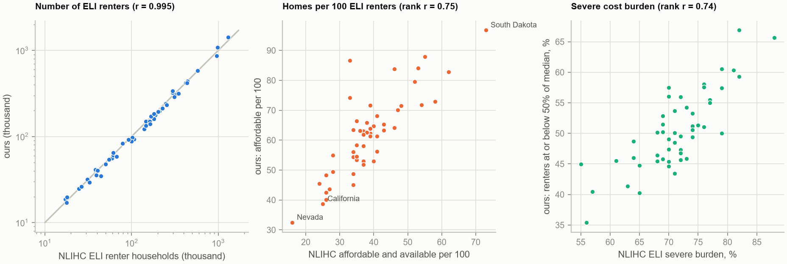

*Figure 45. Our state measures against NLIHC's Gap table: the number of extremely low income renter households (left, log scales, correlation 0.995), affordable homes per 100 of them (middle; ours counts affordable homes, NLIHC's affordable and available, so ours is higher and only the ordering compares; rank correlation 0.75), and the share with severe cost burden (right; rank correlation 0.74).*

| Source | Published | Ours | Reading |
|---|---|---|---|
| NLIHC and PAHRC, Picture of Preservation 2024 (Dec 2024) | 374,497 federally assisted homes with restrictions expiring in the next five years (7% of about 5 million) | 336,603 to 406,979 units whose last subsidy ends 2026-2030 (lower to upper bound); 621,401 to 705,370 if the first subsidy ending counts | published figure falls inside our 'last subsidy ends' range |
| Subedi and Wijekularathna (2025), NHPD with ACS tracts (baseline April 2025) | 10,986 properties and 496,766 units with a primary subsidy ending within five years (by 2030) | 9,244 properties and up to 406,979 units whose last subsidy ends by 2030 | ours is 84% of their properties and 82% of their units; they use the property file's latest end date, which we found unreliable |
| Chicago Fed Letter 514 (Oct 2025), NHPD December 2023 | about one third (34%) of 2.47 million active LIHTC units scheduled to expire by 2035; about 41% with early exits | 25% of active LIHTC units in NHPD end by 2035; 31% of the HUD database's 3.25 million monitored units (38% counting units already past their estimated end) | the HUD-database range (31% to 38%) brackets their 34%; the NHPD share is lower (25%) because units that expired in 2024 and 2025 have already left the active set in our later snapshot |
| NLIHC and PAHRC 2024; Chicago Fed 2025 | 155,555 LIHTC units (8.8% of units placed through 2008) have exited through the qualified-contract process since 1990 | not comparable: our outcome is leaving the monitoring list for any reason (expiry, qualified contract, other); the reason field is filled for only 406 projects | cannot be reproduced; we do not split exits by cause |
| Harvard JCHS household projections 2025-2035 | not retrieved: the page sits behind a bot check, so no figure is quoted | our renter-household projection is not a total-household projection | no comparison made |

**How to read it.** The state measures agree: the same states are short of homes (Nevada, California, Florida among the lowest in both) and the national count of extremely low income renters differs by 1 percent (10.92 against 11.03 million). The need index points the same way as NLIHC's measures (rank correlation -0.60 with its homes per 100 and +0.63 with its severe-burden share; six of our ten highest-need states are among NLIHC's ten lowest-supply states). The published expiring counts bracket or sit near ours. Two honest limits: with NLIHC's renter counts as the denominator, Idaho and South Dakota tie at 21 units at stake per 100 ELI renters and Utah is third, so the order of the top three, not the set, depends on the denominator; and we cannot reproduce the 155,555 early LIHTC exits through the qualified-contract process because our outcome is leaving the monitoring list for any reason. The Harvard household projections could not be retrieved (a bot check), so no comparison is made.

---

### Context: homelessness

HUD's point-in-time count (`notebooks/07_homelessness/`) is context, not an input: 767,856 people were counted in January 2024, 18 percent more than in 2023 (five states account for 76 percent of the rise, led by New York). Across states the rate tracks rents (rank correlation 0.58 with median rent) and the need index (0.33) but not the units-at-stake measure (-0.06), and annual changes within states are not explained by rents, so no projection is made.


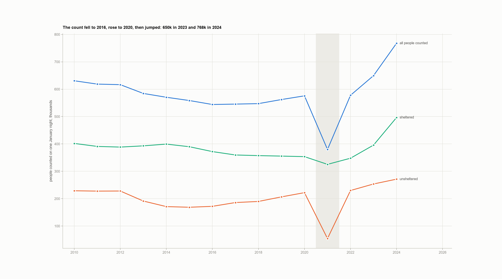

*Figure 46. People counted on one January night: 631,000 in 2010, 544,000 in 2016, 649,000 in 2023, and 768,000 in 2024 (2021 is incomplete).*

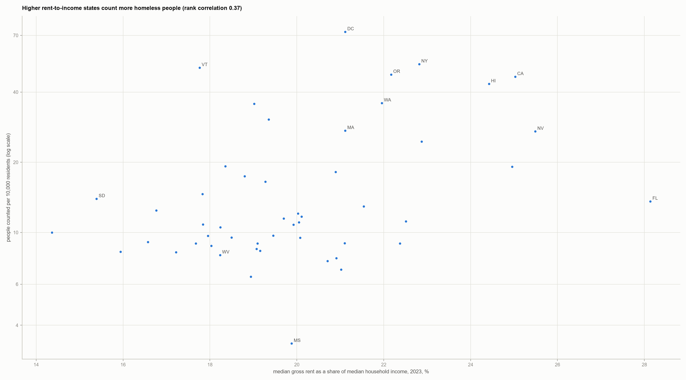

*Figure 47. Across states, higher rents go with a higher homelessness rate (rank correlation 0.58 with median rent); annual changes within a state are not explained by rents, so nothing is projected.*

---

## 7. What needs to be done

These follow from the evidence above and are descriptive: the models show where units are exposed, not which intervention works or what it costs.

1. **Make preservation the first priority, and choose the targeting rule by the aim.** Preservation is 62 to 67 percent of the stake under baseline growth. Small properties are the most likely to be lost (rescue chance under 1 percent at 10 units or fewer, 28 percent at 200 or more) but hold few units: properties of 25 units or fewer are 62 percent of the scored properties and 15 percent of the expected unrescued units, while those of 51 to 200 units hold 56 percent. To cover half the expected loss takes 1,539 properties (14 percent) if the largest go first and 9,753 (86 percent) if the smallest do. Where each action has a fixed cost, aim at the larger properties; aim at small ones only for aims the data do not measure.
2. **In growth states (Texas, Florida, the Carolinas, Georgia, Tennessee, Idaho, Utah), plan supply with the demand.** About 341,000 units are needed nationally to hold the affordable-unit ratio, concentrated in these states.
3. **In LIHTC-exit states (Maryland, Pennsylvania, North Carolina, Michigan, Nebraska), verify before acting.** First establish whether projects that left monitoring are still affordable; the answer decides whether the exposure is real or a reporting artifact. California, Minnesota, and Massachusetts have the lowest exit shares and are the places to learn what keeps projects monitored.
4. **Close the data gaps.** NHPD does not record what happened to LIHTC properties when their clock ended, and RHS (10 percent of expiring units) has too little history to model. Tracking affordability after monitoring ends is the first data step.

---

### Planning arithmetic (`notebooks/08_actions/`)

The models above predict what is likely to happen, where, and how big; they do not say which action works or what it costs. These figures are arithmetic on the predictions, conditional on stated assumptions, with no costs:

- **Targeting depends on the aim.** Small properties are the most likely to be lost but hold few units: those of 25 units or fewer are 62 percent of the scored properties and 15 percent of the expected unrescued units. Aiming at the largest first covers half the expected loss with 14 percent of the properties; the smallest first needs 86 percent.

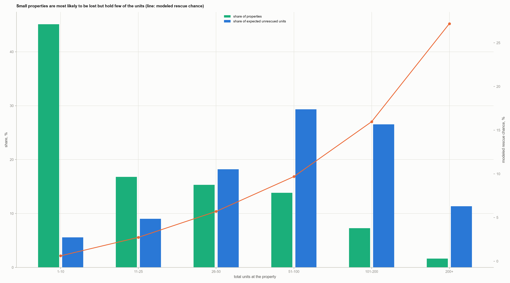

*Figure 48. Small properties are the most likely to be lost (line) but hold few of the units: properties of 51 to 200 units hold 56 percent of the expected unrescued units.*

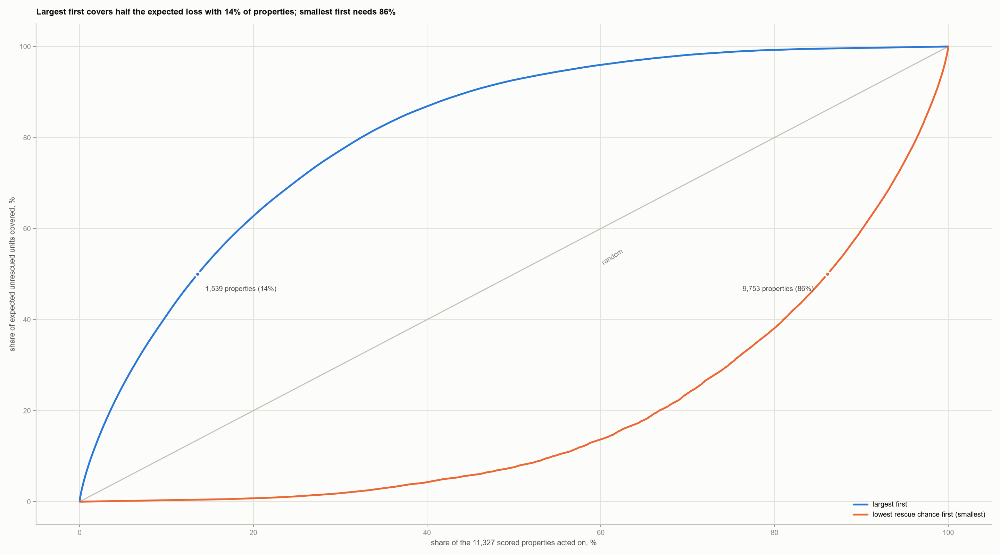

*Figure 49. Share of expected unrescued units covered as properties are acted on: largest first covers half with 14 percent of the 11,327 scored properties, smallest first needs 86 percent.*

- **Capacity.** The stake is 75,000 to 86,000 units a year over 2023 to 2035, 72 to 82 percent of the 104,581 units LIHTC placed per year in 2015 to 2019. In 24 of 51 states it exceeds 12 years of the state's own LIHTC output (Alabama, South Dakota, Idaho, Illinois, and Oklahoma most stretched; Washington, New York, and California least). Not all LIHTC output is net new.

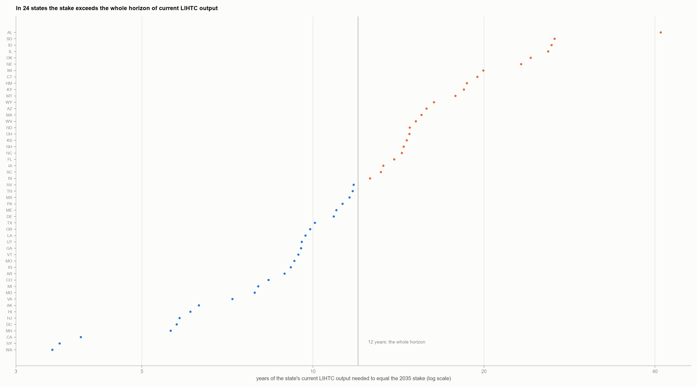

*Figure 50. Years of each state's current LIHTC output needed to equal its 2035 stake: more than 12 years in 24 of 51 states (Alabama, South Dakota, Idaho most stretched; Washington, New York, California least).*

- **Holding the ratio.** Affordable units per 100 ELI renters is 53.6 in 2023. With no action it falls to about 45 by 2035 (an upper bound on deterioration). Holding 53.6 takes 0.91 to 1.04 million units preserved or added by 2035 (76,000 to 87,000 a year). Combinations that do it: about 81,000 new units a year with no preservation; 75,000 a year with a quarter of the losses prevented; 50,000 a year with three quarters prevented; about 29,000 a year with all losses prevented.


*Figure 51. Affordable units per 100 ELI renters in 2035 under combinations of preservation and new production (2023: 54); outlined cells hold the 2023 ratio.*

#### Example 10: What would it take to hold the line?

This is arithmetic, not a model: take today's ratio of rent-affordable units to ELI renters, add the growth in ELI renters and the expected losses, and ask how many units must be preserved or built to stand still.

```python
"""
Example 10: planning arithmetic. What would it take to keep the number of affordable units per 100 ELI renters at its 2023 level?

Run from the project root:   uv run examples/10_what_could_be_done.py
This is arithmetic on the model outputs, not a forecast of what any policy achieves, and it has no costs in it.
"""
import sys
sys.path.insert(0, "src")
import pandas as pd

import actions as A
import combined

stake = combined.units_at_stake()
sc = pd.read_csv("outputs/tables/scenarios_state.csv", dtype={"state_fips": str})
base = sc[sc.scenario == "baseline"]
stock = base[base.year == 2023].afford_units.sum()               # rent-affordable units in 2023 (CHAS), held fixed
eli_2023 = base[base.year == 2023].eli_renters.sum()
eli_2035 = base[base.year == 2035].eli_renters.sum()

loss_low = stake.nhpd_unrescued_lb.sum() + stake.lihtc_leaving_adj.sum() + stake.mortgage_lb.sum()
loss_high = stake.nhpd_unrescued_ub.sum() + stake.lihtc_leaving.sum() + stake.mortgage_ub.sum()
ratio_2023 = 100 * stock / eli_2023
print(f"2023: {stock / 1e6:.2f} million rent-affordable units for {eli_2023 / 1e6:.2f} million ELI renters = {ratio_2023:.1f} per 100")
print(f"2035, nothing lost and nothing built:  {100 * stock / eli_2035:.1f} per 100 (more renters, same units)")
print(f"2035, preservation losses taken out in full: {100 * (stock - loss_high) / eli_2035:.1f} to {100 * (stock - loss_low) / eli_2035:.1f} per 100")

need = [0.01 * ratio_2023 * eli_2035 - stock + loss for loss in (loss_low, loss_high)]
print(f"units to preserve or add by 2035 to hold {ratio_2023:.1f}: {need[0]:,.0f} to {need[1]:,.0f} ({need[0] / 12:,.0f} to {need[1] / 12:,.0f} a year)")

# the lever grid: share of the expected losses prevented (rows) against new units added per year (columns), 2035 ratio per 100 ELI renters
grid = A.lever_grid(stock, eli_2035, (loss_low + loss_high) / 2)
print("\naffordable units per 100 ELI renters in 2035:")
print(grid.round(1).to_string())
```

Output, as produced when this report was written:

```text
2023: 5.85 million rent-affordable units for 10.92 million ELI renters = 53.6 per 100
2035, nothing lost and nothing built:  50.6 per 100 (more renters, same units)
2035, preservation losses taken out in full: 44.6 to 45.7 per 100
units to preserve or add by 2035 to hold 53.6: 907,074 to 1,040,204 (75,590 to 86,684 a year)

affordable units per 100 ELI renters in 2035:
                0k per year  25k per year  50k per year  75k per year  100k per year
0% preserved           45.2          47.8          50.4          52.9           55.5
25% preserved          46.5          49.1          51.7          54.3           56.9
50% preserved          47.9          50.5          53.1          55.6           58.2
75% preserved          49.2          51.8          54.4          57.0           59.6
100% preserved         50.6          53.2          55.8          58.3           60.9
```

**How to read it.** In 2023 there are 53.6 rent-affordable units per 100 ELI renters. If nothing is lost or built the ratio slips to 50.6 just from more renters, and to about 45 if the expected losses come out of the stock. Standing still takes 0.91 to 1.04 million units over twelve years, roughly 76,000 to 87,000 a year. The grid shows the trade: each 25 percent of losses prevented is worth about as much as 12,500 new units a year. It carries no costs and no estimate of what any program achieves.

## 8. Limits

### Threats to validity

The questions a careful reviewer would ask, what we did about each, and what is honestly left. "Evidence" points to the section or notebook where the check is.

| Threat | What could go wrong | What we did | What remains |
|---|---|---|---|
| **Outcome validity** | "Rescued" is a new subsidy recorded in NHPD, and "LIHTC exit" is leaving the agency's monitoring list. Neither is proof that units stopped being affordable | Stated in every place the outcome is used; the headline wording is "not rescued" and "leaving monitoring" (Sections 5.2, 5.3) | No dated exits and no check of what happened to the units; a hand audit of sampled properties and dated agency data would settle it |
| **Leakage** | A feature that knows the outcome inflates accuracy | Time splits only; four traps found and removed (a later subsidy in the features, extra NHPD fields recorded for rescued properties, a poor county match, mixed rent-limit vintages); the extra fields are shown as a warning (Section 2.1) | Other leaks we did not think of |
| **Small samples** | 189 rescued events (58 in training, 102 in test); forecast tests rest on 2 to 6 origins; the best of about 11 models per cell is optimistic | Intervals by resampling states; adoption rules fixed in advance; every model reported, including losers (Section 2); no forecast claimed beyond three years | Tests of significance have little power; a different split could change which model looks best |
| **Uncertainty of the headline** | The range 0.90 to 1.03 million adds bounds from definitions, not statistics | 1,000 resampled runs of the three preservation models with random outcomes: 885,000 to 1,050,000 units (Section 6, Example 11) | The draws cover sampling error, not a change in the process |
| **Dependence on the growth scenario** | The demand piece is a scenario, and it moves the total by -35 to +29 percent | Shown in the sensitivity chart; the "62 to 67 percent preservation" statement is labeled as holding under baseline growth only | The data cannot say whether the long decline in renting continues |
| **Non-stationarity** | The rescue rate rose from about 1 to 4 percent after 2021 | Real-time comparison of five updating methods: none anticipates it; scenario with the recent rate lowers the total about 5 percent (Section 5.2, Example 13) | The cause (funding, rules) is not in the data; if it lasts, the rescue-based piece is smaller |
| **State differences** | The model may not explain why states differ | Hindcast: unrescued totals right to 1 percent, but the rescued share by state is not predicted (r = -0.07 across 32 states) (Section 5.2, Example 12) | The state ranking of the HOME and HUD piece is mostly a ranking by volume of expiring units |
| **Coverage** | The rescue model scores 41 percent of expiring units; LIHTC and RHS are not scored by it; the insured-mortgage piece rests on an assumed age pattern | Each piece reported separately with its coverage; the mortgage piece shown as a range from three cohort shifts | Properties not covered carry no estimate of their own |
| **Double counting** | A property with both a HUD-program and a LIHTC subsidy can appear in two pieces | Largest possible overlap measured: 183 properties, -1.4 percent of the total (Section 6) | Overlap with the insured-mortgage piece is not measured |
| **Survey measurement error** | ACS figures are samples; a small state's burden is mostly noise | Margins of error carried into the need index (rank intervals) and the state-space forecast; no ranking on one year of the burden (Sections 4.2, 5.0) | Margins are assumed accurate |
| **Agreement with other sources** | Internal consistency is not truth | Compared with NLIHC's Gap table (ELI renters r = 0.995; homes per 100 rank r = 0.75) and three published expiring-unit counts, which fall inside or near ours (Section 6, Example 14) | The early-exit count (155,555 units) cannot be reproduced; the Harvard household projection could not be retrieved; the top three states per ELI renter depend on the renter denominator |
| **Causal claims** | A reader may take associations for effects | No causal design was run; difference-in-differences, instruments, and hazard models are listed as not run, with the reason (Section 2.2); the planning arithmetic has no costs and assumes an action succeeds | No estimate of what any intervention achieves |
| **Reproducibility** | Results that cannot be rerun | Raw data immutable; every script rerunnable; fixed seeds; fourteen examples reproduce the quoted numbers; a validation script cross-checks the cleaned tables | No automated tests or continuous integration; several downloads are manual and snapshot-dated; one developer and no independent review |

### Other limits


- A market-rent incentive (the county gap between the fair market rent and the 60 percent restricted rent, from HUD's HOME rent limits) was tested in both preservation models and has no effect within states or out of sample (`notebooks/05_preservation/03_rent_gap`), and neither do county house price growth or nonprofit sponsorship (`06_price_growth`); rescue and exit are driven by property size and by the state, not by local market strength.

- Scenarios are conditional on the Cooper projection and on renter behavior; they are not forecasts, and 2035 is interpolated. The Cooper totals extend 2010-2025 growth trends (2030 total = the July 2025 estimate grown at the average of 2010-2025 and 2020-2025 rates; age detail from 2010-2020 cohort change ratios), with no migration model or uncertainty range.
- The rescue rate rose from about 1 percent to 4 percent after 2021 and no real-time model anticipates it; the headline keeps the all-years rate, and if the recent rate persists the total is about 5 percent lower.
- Our state measures agree with an independent source (NLIHC's Gap table: ELI renter households r = 0.995, homes per 100 rank r = 0.75), but the order among the top states by units at stake per ELI renter depends on the ELI renter denominator, and the early-exit count of 155,555 LIHTC units from the qualified-contract process cannot be reproduced from our outcome.
- The rescue model's totals are right in aggregate in a 2019-2023 hindcast, but it does not explain differences in rescue shares between states (correlation -0.07 across 32 states), so the state ranking of the HOME and HUD piece mostly reflects how many units are expiring and their size mix.
- The rescue model is conditional on a lapse (an upper bound on loss), has only 58 rescued events in training and 102 in test, depends on how fully NHPD records new subsidies, and covers HOME and HUD-program subsidies only.
- The LIHTC outcome is leaving the monitoring list, not losing affordability; the state effect mixes policy and reporting; later cohorts are an extrapolation (confidence falls for projects placed 2001 to 2005).
- The combined total is an order of magnitude: pieces may overlap and none of them has a statistical margin of error that covers its assumptions.
- Associations only; no model here shows that an intervention works. Machine-learning models were tried at each step (the rescue notebook compares a forest and boosting with the logistic model) and did not beat the simple ones; state-level forecasting models are not part of this package (see `README.md`).

---

## 9. Where everything is

| What | Where |
| --- | --- |
| Notebooks (percent-cell `.py` source and executed `.ipynb`), in run order | `notebooks/01_eda/01_coverage`, `02_signal_vs_noise`, `03_trends`, `04_need_today_ahni`, `05_relationships`, `04_scenarios/01_stock_flow`, `05_preservation/01_preservation_model`, `02_lihtc_exit`, `03_rent_gap`, `04_mortgage_exit`, `06_price_growth`, `07_state_hindcast`, `08_rescue_drift`, `06_combined/01_units_at_stake`, `02_uncertainty_and_sensitivity`, `03_external_benchmarks`, `07_homelessness/01_ahar_context`, `08_actions/01_what_can_be_done` |
| Model code | `src/ahni.py`, `src/features.py`, `src/evaluation.py`, `src/panel_tools.py`, `src/models/baselines.py` (used by the exploratory notebooks), `src/scenarios.py`, `src/preservation.py`, `src/lihtc_exit.py`, `src/mortgage_exit.py`, `src/combined.py`, `src/actions.py` |
| Results tables | `outputs/tables/` (the result tables written by the notebooks) |
| Figures | `outputs/figures/` (all figures above) |
| Runnable examples | `examples/` (fourteen scripts, one per model; their output is shown in the report) |
| Data log | `DATA.md` (how each source was obtained; covers the full project's sources, of which the six used here are described in Section 3) |
| What is and is not included, and why | `README.md` |
